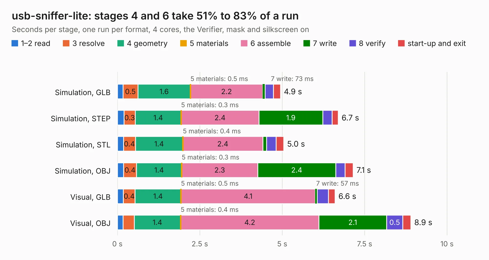

# 443. usb-sniffer-lite

Board 443 of the 3,124 of [Corpus Testing](../Corpus-Testing.md), on [Corpus Page 5](../CorpusTestingPages/Corpus-Testing-05.md#443-usb-sniffer-lite).

| Mode and format | 1–2 read | 3 resolve | 4 geometry | 5 materials | 6 assemble | 7 write | 8 verify | start-up and exit | Total |
|---|---:|---:|---:|---:|---:|---:|---:|---:|---:|
| Simulation, GLB | 0.2 | 0.5 | 1.6 | 0.5&nbsp;ms | 2.2 | 73&nbsp;ms | 0.3 | 0.2 | 4.9 |
| Simulation, STEP | 0.2 | 0.3 | 1.4 | 0.3&nbsp;ms | 2.4 | 1.9 | 0.3 | 0.2 | 6.7 |
| Simulation, STL | 0.2 | 0.4 | 1.4 | 0.4&nbsp;ms | 2.4 | 0.1 | 0.3 | 0.2 | 5.0 |
| Simulation, OBJ | 0.2 | 0.4 | 1.4 | 0.3&nbsp;ms | 2.3 | 2.4 | 0.3 | 0.2 | 7.1 |
| Visual, GLB | 0.2 | 0.4 | 1.4 | 0.5&nbsp;ms | 4.1 | 57&nbsp;ms | 0.3 | 0.2 | 6.6 |
| Visual, OBJ | 0.2 | 0.3 | 1.4 | 0.4&nbsp;ms | 4.2 | 2.1 | 0.5 | 0.2 | 8.9 |

<table align="center"><tr><td valign="top">

| Board | Repo: [ataradov/usb-sniffer-lite](https://github.com/ataradov/usb-sniffer-lite) Board: `usb-sniffer-lite.kicad_pcb` |
|---|---|
| Folder | hardware |
| Complexity | 288&nbsp;/&nbsp;1000 (size&nbsp;193, features&nbsp;95) |
| KESE&nbsp;features | through vias, slotted holes, rounded, trapezoid or chamfered pads, filled zones, copper text, stack-up, dielectric εr and tanδ |
| Tested | 9th November 2026 |
| Copper&nbsp;layers | 2 |
| File&nbsp;format | KiCad 7 (20221018) |
| Parts,&nbsp;tracks,&nbsp;vias | 34, 226, 56 |
| Triangles,&nbsp;simulation | 445,872 in 77 parts |
| Verifier | PASS in all six runs |

</td><td valign="top">

<table>
<tr><th>File type</th><th>File size</th><th>Peak memory used</th></tr>
<tr><th colspan="3" align="left">Simulation</th></tr>
<tr><td>GLB</td><td align="right">15&nbsp;MB</td><td align="right">304&nbsp;MB</td></tr>
<tr><td>STEP</td><td align="right">85&nbsp;MB</td><td align="right">347&nbsp;MB</td></tr>
<tr><td>STL</td><td align="right">22&nbsp;MB</td><td align="right">306&nbsp;MB</td></tr>
<tr><td>OBJ</td><td align="right">45&nbsp;MB</td><td align="right">356&nbsp;MB</td></tr>
<tr><th colspan="3" align="left">Visual</th></tr>
<tr><td>GLB</td><td align="right">13&nbsp;MB</td><td align="right">367&nbsp;MB</td></tr>
<tr><td>OBJ</td><td align="right">38&nbsp;MB</td><td align="right">372&nbsp;MB</td></tr>
</table>

</td></tr></table>

| Previous | Next |
|:---|---:|
| [442. usb-sniffer](b0442b_usb-sniffer_usb-sniffer.md) | [444. Atari TT030](b0444b_Atari-TT030-PCB_Atari-TT030.md) |
