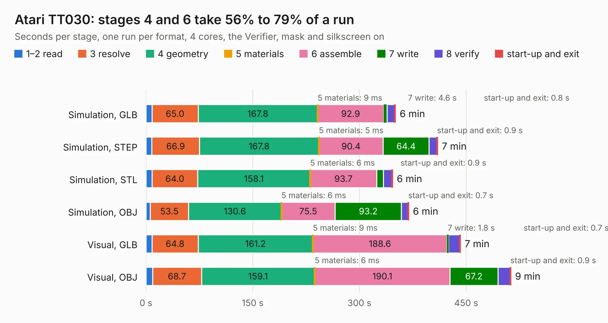

# 444. Atari TT030

Board 444 of the 3,125 of [Corpus Testing](../Corpus-Testing.md), on [Corpus Page 5](../CorpusTestingPages/Corpus-Testing-05.md#444-atari-tt030).

| Mode and format | 1–2 read | 3 resolve | 4 geometry | 5 materials | 6 assemble | 7 write | 8 verify | start-up and exit | Total |
|---|---:|---:|---:|---:|---:|---:|---:|---:|---:|
| Simulation, GLB | 8.4 | 65.0 | 167.8 | 9&nbsp;ms | 92.9 | 4.6 | 11.0 | 0.8 | 350.4 |
| Simulation, STEP | 8.2 | 66.9 | 167.8 | 5&nbsp;ms | 90.4 | 64.4 | 10.9 | 0.9 | 409.6 |
| Simulation, STL | 8.6 | 64.0 | 158.1 | 6&nbsp;ms | 93.7 | 9.2 | 11.9 | 0.9 | 346.4 |
| Simulation, OBJ | 6.2 | 53.5 | 130.6 | 6&nbsp;ms | 75.5 | 93.2 | 9.3 | 0.7 | 369.0 |
| Visual, GLB | 8.5 | 64.8 | 161.2 | 9&nbsp;ms | 188.6 | 1.8 | 16.1 | 0.7 | 441.7 |
| Visual, OBJ | 9.3 | 68.7 | 159.1 | 6&nbsp;ms | 190.1 | 67.2 | 17.2 | 0.9 | 512.6 |

<table align="center"><tr><td valign="top">

| Board | Repo: [AtarianComputing/Atari-TT030-PCB](https://github.com/AtarianComputing/Atari-TT030-PCB) Board: `Atari TT030.kicad_pcb` |
|---|---|
| Complexity | 184&nbsp;/&nbsp;1000 (size&nbsp;174, features&nbsp;10) |
| KESE&nbsp;features | slotted holes |
| Tested | 9th November 2026 to 10th November 2026 |
| Copper&nbsp;layers | 2 |
| File&nbsp;format | KiCad 8 (20240108) |
| Parts,&nbsp;tracks,&nbsp;vias | 577, 3, 0 |
| Triangles,&nbsp;simulation | 19,979,304 in 1205 parts |
| Note | mostly unrouted |
| Verifier | PASS in all six runs |
| Run&nbsp;again | Simulation, OBJ: failed in the corpus run, run again with the memory cap raised from 11 GB to 14.5 GB, and passed |

</td><td valign="top">

<table>
<tr><th>File type</th><th>File size</th><th>Peak memory used</th></tr>
<tr><th colspan="3" align="left">Simulation</th></tr>
<tr><td>GLB</td><td align="right">674&nbsp;MB</td><td align="right">5.0&nbsp;GB</td></tr>
<tr><td>STEP</td><td align="right">3.4&nbsp;GB</td><td align="right">6.8&nbsp;GB</td></tr>
<tr><td>STL</td><td align="right">999&nbsp;MB</td><td align="right">4.7&nbsp;GB</td></tr>
<tr><td>OBJ</td><td align="right">2.2&nbsp;GB</td><td align="right">13&nbsp;GB</td></tr>
<tr><th colspan="3" align="left">Visual</th></tr>
<tr><td>GLB</td><td align="right">331&nbsp;MB</td><td align="right">5.6&nbsp;GB</td></tr>
<tr><td>OBJ</td><td align="right">1.1&nbsp;GB</td><td align="right">6.8&nbsp;GB</td></tr>
</table>

</td></tr></table>

| Previous | Next |
|:---|---:|
| [443. usb-sniffer-lite](b0443b_usb-sniffer-lite_usb-sniffer-lite.md) | [445. esp32-s3-spectrum](b0445b_esp32-zxspectrum-hardware_esp32-s3-spectrum.md) |
