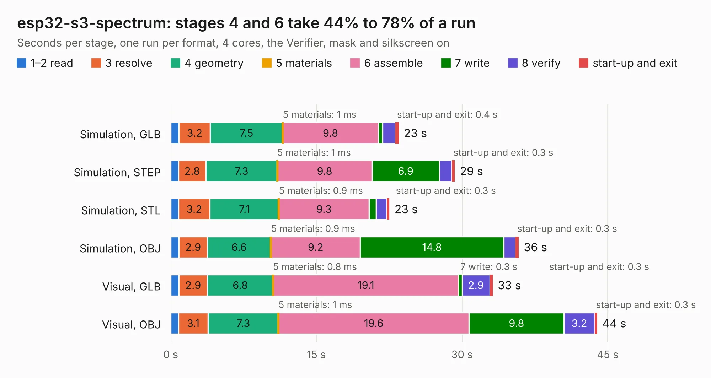

# 445. esp32-s3-spectrum

Board 445 of the 3,124 of [Corpus Testing](../Corpus-Testing.md), on [Corpus Page 5](../CorpusTestingPages/Corpus-Testing-05.md#445-esp32-s3-spectrum).

| Mode and format | 1–2 read | 3 resolve | 4 geometry | 5 materials | 6 assemble | 7 write | 8 verify | start-up and exit | Total |
|---|---:|---:|---:|---:|---:|---:|---:|---:|---:|
| Simulation, GLB | 0.9 | 3.2 | 7.5 | 1&nbsp;ms | 9.8 | 0.4 | 1.3 | 0.4 | 23.5 |
| Simulation, STEP | 0.8 | 2.8 | 7.3 | 1&nbsp;ms | 9.8 | 6.9 | 1.3 | 0.3 | 29.3 |
| Simulation, STL | 0.8 | 3.2 | 7.1 | 0.9&nbsp;ms | 9.3 | 0.7 | 1.1 | 0.3 | 22.5 |
| Simulation, OBJ | 0.9 | 2.9 | 6.6 | 0.9&nbsp;ms | 9.2 | 14.8 | 1.2 | 0.3 | 35.8 |
| Visual, GLB | 0.8 | 2.9 | 6.8 | 0.8&nbsp;ms | 19.1 | 0.3 | 2.9 | 0.3 | 33.2 |
| Visual, OBJ | 0.8 | 3.1 | 7.3 | 1&nbsp;ms | 19.6 | 9.8 | 3.2 | 0.3 | 43.9 |

<table align="center"><tr><td valign="top">

| Board | Repo: [atomic14/esp32-zxspectrum-hardware](https://github.com/atomic14/esp32-zxspectrum-hardware) Board: `esp32-s3-spectrum.kicad_pcb` |
|---|---|
| Complexity | 363&nbsp;/&nbsp;1000 (size&nbsp;208, features&nbsp;155) |
| KESE&nbsp;features | through vias, slotted holes, custom pads, rounded, trapezoid or chamfered pads, filled zones, copper drawings, curved board outline, knockout text, TrueType text, stack-up, dielectric εr and tanδ, mask and silkscreen colours |
| Tested | 9th November 2026 |
| Copper&nbsp;layers | 4 |
| File&nbsp;format | KiCad 8 (20240108) |
| Parts,&nbsp;tracks,&nbsp;vias | 71, 1,417, 364 |
| Triangles,&nbsp;simulation | 2,152,274 in 133 parts |
| Verifier | PASS in all six runs |

</td><td valign="top">

<table>
<tr><th>File type</th><th>File size</th><th>Peak memory used</th></tr>
<tr><th colspan="3" align="left">Simulation</th></tr>
<tr><td>GLB</td><td align="right">74&nbsp;MB</td><td align="right">757&nbsp;MB</td></tr>
<tr><td>STEP</td><td align="right">309&nbsp;MB</td><td align="right">991&nbsp;MB</td></tr>
<tr><td>STL</td><td align="right">108&nbsp;MB</td><td align="right">813&nbsp;MB</td></tr>
<tr><td>OBJ</td><td align="right">223&nbsp;MB</td><td align="right">1.5&nbsp;GB</td></tr>
<tr><th colspan="3" align="left">Visual</th></tr>
<tr><td>GLB</td><td align="right">48&nbsp;MB</td><td align="right">1.1&nbsp;GB</td></tr>
<tr><td>OBJ</td><td align="right">149&nbsp;MB</td><td align="right">1.1&nbsp;GB</td></tr>
</table>

</td></tr></table>

| Previous | Next |
|:---|---:|
| [444. Atari TT030](b0444b_Atari-TT030-PCB_Atari-TT030.md) | [446. argo-v2](b0446b_Argo_argo-v2.md) |
