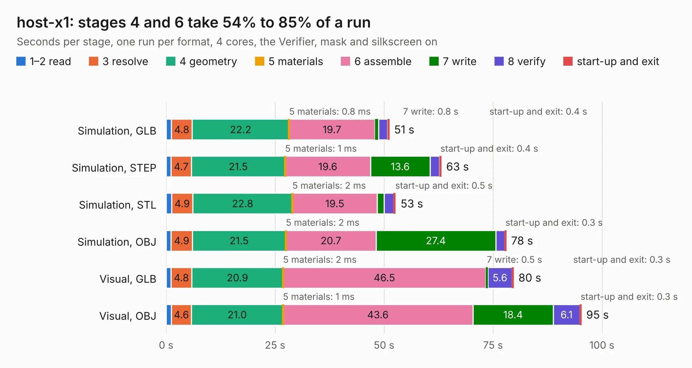

# 445. host-x1

Board 445 of the 3,112 of [Corpus Testing](../Corpus-Testing.md), on [Corpus Page 5](../CorpusTestingPages/Corpus-Testing-05.md#445-host-x1).

| Mode and format | 1–2 read | 3 resolve | 4 geometry | 5 materials | 6 assemble | 7 write | 8 verify | start-up and exit | Total |
|---|---:|---:|---:|---:|---:|---:|---:|---:|---:|
| Simulation, GLB | 1.2 | 4.8 | 22.2 | 0.8&nbsp;ms | 19.7 | 0.8 | 2.1 | 0.4 | 51.2 |
| Simulation, STEP | 1.1 | 4.7 | 21.5 | 1&nbsp;ms | 19.6 | 13.6 | 2.2 | 0.4 | 63.1 |
| Simulation, STL | 1.2 | 4.9 | 22.8 | 2&nbsp;ms | 19.5 | 1.6 | 2.2 | 0.5 | 52.7 |
| Simulation, OBJ | 1.1 | 4.9 | 21.5 | 2&nbsp;ms | 20.7 | 27.4 | 2.1 | 0.3 | 78.0 |
| Visual, GLB | 1.1 | 4.8 | 20.9 | 2&nbsp;ms | 46.5 | 0.5 | 5.6 | 0.3 | 79.7 |
| Visual, OBJ | 1.2 | 4.6 | 21.0 | 1&nbsp;ms | 43.6 | 18.4 | 6.1 | 0.3 | 95.3 |

<table align="center"><tr><td valign="top">

| Board | Repo: [azonenberg/starshipraider](https://github.com/azonenberg/starshipraider) Board: `host-x1.kicad_pcb` |
|---|---|
| Folder | boards / CLARKE / host-x1 |
| Complexity | 346&nbsp;/&nbsp;1000 (size&nbsp;301, features&nbsp;45) |
| KESE&nbsp;features | through vias, filled zones, copper text |
| Tested | 9th November 2026 |
| Copper&nbsp;layers | 4 |
| File&nbsp;format | KiCad 5 (20170123) |
| Parts,&nbsp;tracks,&nbsp;vias | 215, 9,819, 597 |
| Triangles,&nbsp;simulation | 4,209,626 in 285 parts |
| Verifier | PASS in all six runs |

</td><td valign="top">

<table>
<tr><th>File type</th><th>File size</th><th>Peak memory used</th></tr>
<tr><th colspan="3" align="left">Simulation</th></tr>
<tr><td>GLB</td><td align="right">146&nbsp;MB</td><td align="right">1.4&nbsp;GB</td></tr>
<tr><td>STEP</td><td align="right">639&nbsp;MB</td><td align="right">1.6&nbsp;GB</td></tr>
<tr><td>STL</td><td align="right">211&nbsp;MB</td><td align="right">1.4&nbsp;GB</td></tr>
<tr><td>OBJ</td><td align="right">450&nbsp;MB</td><td align="right">2.8&nbsp;GB</td></tr>
<tr><th colspan="3" align="left">Visual</th></tr>
<tr><td>GLB</td><td align="right">96&nbsp;MB</td><td align="right">1.6&nbsp;GB</td></tr>
<tr><td>OBJ</td><td align="right">306&nbsp;MB</td><td align="right">2.1&nbsp;GB</td></tr>
</table>

</td></tr></table>

| Previous | Next |
|:---|---:|
| [444. hmcad-characterization](b0444b_starshipraider_hmcad-characterization.md) | [446. iob-characterization-v02](b0446b_starshipraider_iob-characterization-v02.md) |
