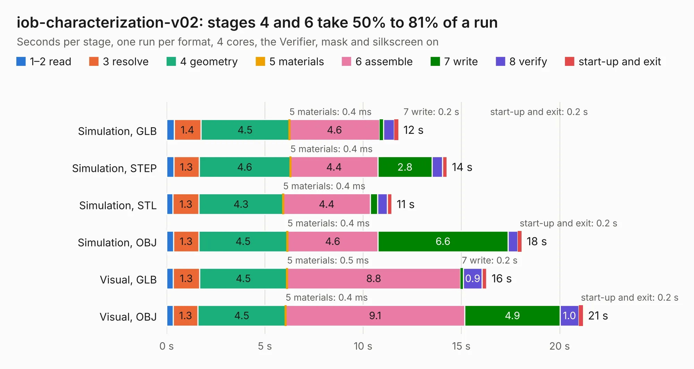

# 445. iob-characterization-v02

Board 445 of the 3,107 of [Corpus Testing](../Corpus-Testing.md), on [Corpus Page 5](../CorpusTestingPages/Corpus-Testing-05.md#445-iob-characterization-v02).

| Mode and format | 1–2 read | 3 resolve | 4 geometry | 5 materials | 6 assemble | 7 write | 8 verify | start-up and exit | Total |
|---|---:|---:|---:|---:|---:|---:|---:|---:|---:|
| Simulation, GLB | 0.4 | 1.4 | 4.5 | 0.4&nbsp;ms | 4.6 | 0.2 | 0.5 | 0.2 | 11.8 |
| Simulation, STEP | 0.4 | 1.3 | 4.6 | 0.4&nbsp;ms | 4.4 | 2.8 | 0.5 | 0.2 | 14.3 |
| Simulation, STL | 0.3 | 1.3 | 4.3 | 0.4&nbsp;ms | 4.4 | 0.4 | 0.5 | 0.2 | 11.5 |
| Simulation, OBJ | 0.4 | 1.3 | 4.5 | 0.4&nbsp;ms | 4.6 | 6.6 | 0.5 | 0.2 | 18.1 |
| Visual, GLB | 0.3 | 1.3 | 4.5 | 0.5&nbsp;ms | 8.8 | 0.2 | 0.9 | 0.2 | 16.3 |
| Visual, OBJ | 0.3 | 1.3 | 4.5 | 0.4&nbsp;ms | 9.1 | 4.9 | 1.0 | 0.2 | 21.2 |

<table align="center"><tr><td valign="top">

| Board | Repo: [azonenberg/starshipraider](https://github.com/azonenberg/starshipraider) Board: `iob-characterization-v02.kicad_pcb` |
|---|---|
| Folder | boards / CLARKE / iob-characterization-v02 |
| Complexity | 299&nbsp;/&nbsp;1000 (size&nbsp;254, features&nbsp;45) |
| KESE&nbsp;features | through vias, filled zones, copper text |
| Tested | 9th November 2026 |
| Copper&nbsp;layers | 4 |
| File&nbsp;format | KiCad 5 (20171130) |
| Parts,&nbsp;tracks,&nbsp;vias | 122, 1,673, 269 |
| Triangles,&nbsp;simulation | 1,364,762 in 159 parts |
| Verifier | PASS in all six runs |

</td><td valign="top">

<table>
<tr><th>File type</th><th>File size</th><th>Peak memory used</th></tr>
<tr><th colspan="3" align="left">Simulation</th></tr>
<tr><td>GLB</td><td align="right">48&nbsp;MB</td><td align="right">639&nbsp;MB</td></tr>
<tr><td>STEP</td><td align="right">165&nbsp;MB</td><td align="right">718&nbsp;MB</td></tr>
<tr><td>STL</td><td align="right">68&nbsp;MB</td><td align="right">578&nbsp;MB</td></tr>
<tr><td>OBJ</td><td align="right">143&nbsp;MB</td><td align="right">945&nbsp;MB</td></tr>
<tr><th colspan="3" align="left">Visual</th></tr>
<tr><td>GLB</td><td align="right">32&nbsp;MB</td><td align="right">722&nbsp;MB</td></tr>
<tr><td>OBJ</td><td align="right">98&nbsp;MB</td><td align="right">752&nbsp;MB</td></tr>
</table>

</td></tr></table>

| Previous | Next |
|:---|---:|
| [444. host-x1](b0444b_starshipraider_host-x1.md) | [446. probecard-mmcx](b0446b_starshipraider_probecard-mmcx.md) |
