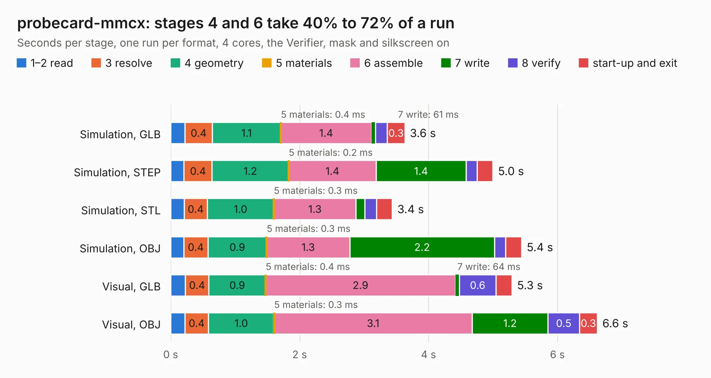

# 445. probecard-mmcx

Board 445 of the 3,103 of [Corpus Testing](../Corpus-Testing.md), on [Corpus Page 5](../CorpusTestingPages/Corpus-Testing-05.md#445-probecard-mmcx).

| Mode and format | 1–2 read | 3 resolve | 4 geometry | 5 materials | 6 assemble | 7 write | 8 verify | start-up and exit | Total |
|---|---:|---:|---:|---:|---:|---:|---:|---:|---:|
| Simulation, GLB | 0.2 | 0.4 | 1.1 | 0.4&nbsp;ms | 1.4 | 61&nbsp;ms | 0.2 | 0.3 | 3.6 |
| Simulation, STEP | 0.2 | 0.4 | 1.2 | 0.2&nbsp;ms | 1.4 | 1.4 | 0.2 | 0.2 | 5.0 |
| Simulation, STL | 0.2 | 0.4 | 1.0 | 0.3&nbsp;ms | 1.3 | 0.1 | 0.2 | 0.2 | 3.4 |
| Simulation, OBJ | 0.2 | 0.4 | 0.9 | 0.3&nbsp;ms | 1.3 | 2.2 | 0.2 | 0.2 | 5.4 |
| Visual, GLB | 0.2 | 0.4 | 0.9 | 0.4&nbsp;ms | 2.9 | 64&nbsp;ms | 0.6 | 0.2 | 5.3 |
| Visual, OBJ | 0.2 | 0.4 | 1.0 | 0.3&nbsp;ms | 3.1 | 1.2 | 0.5 | 0.3 | 6.6 |

<table align="center"><tr><td valign="top">

| Board | Repo: [azonenberg/starshipraider](https://github.com/azonenberg/starshipraider) Board: `probecard-mmcx.kicad_pcb` |
|---|---|
| Folder | boards / CLARKE / probecard-mmcx |
| Complexity | 211&nbsp;/&nbsp;1000 (size&nbsp;176, features&nbsp;35) |
| KESE&nbsp;features | through vias, filled zones |
| Tested | 9th November 2026 |
| Copper&nbsp;layers | 4 |
| File&nbsp;format | KiCad 5 (20171130) |
| Parts,&nbsp;tracks,&nbsp;vias | 14, 824, 63 |
| Triangles,&nbsp;simulation | 347,308 in 50 parts |
| Verifier | PASS in all six runs |

</td><td valign="top">

<table>
<tr><th>File type</th><th>File size</th><th>Peak memory used</th></tr>
<tr><th colspan="3" align="left">Simulation</th></tr>
<tr><td>GLB</td><td align="right">12&nbsp;MB</td><td align="right">309&nbsp;MB</td></tr>
<tr><td>STEP</td><td align="right">48&nbsp;MB</td><td align="right">297&nbsp;MB</td></tr>
<tr><td>STL</td><td align="right">17&nbsp;MB</td><td align="right">295&nbsp;MB</td></tr>
<tr><td>OBJ</td><td align="right">35&nbsp;MB</td><td align="right">293&nbsp;MB</td></tr>
<tr><th colspan="3" align="left">Visual</th></tr>
<tr><td>GLB</td><td align="right">9.2&nbsp;MB</td><td align="right">286&nbsp;MB</td></tr>
<tr><td>OBJ</td><td align="right">27&nbsp;MB</td><td align="right">280&nbsp;MB</td></tr>
</table>

</td></tr></table>

| Previous | Next |
|:---|---:|
| [444. iob-characterization-v02](b0444b_starshipraider_iob-characterization-v02.md) | [446. probecard-pinheader](b0446b_starshipraider_probecard-pinheader.md) |
