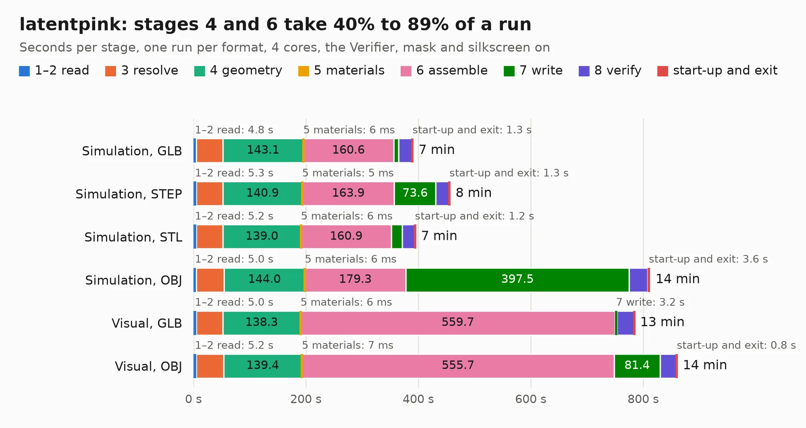

# 447. latentpink

Board 447 of the 3,127 of [Corpus Testing](../Corpus-Testing.md), on [Corpus Page 5](../CorpusTestingPages/Corpus-Testing-05.md#447-latentpink).

| Mode and format | 1–2 read | 3 resolve | 4 geometry | 5 materials | 6 assemble | 7 write | 8 verify | start-up and exit | Total |
|---|---:|---:|---:|---:|---:|---:|---:|---:|---:|
| Simulation, GLB | 4.8 | 47.4 | 143.1 | 6&nbsp;ms | 160.6 | 9.1 | 23.9 | 1.3 | 390.2 |
| Simulation, STEP | 5.3 | 47.2 | 140.9 | 5&nbsp;ms | 163.9 | 73.6 | 23.7 | 1.3 | 456.0 |
| Simulation, STL | 5.2 | 47.1 | 139.0 | 6&nbsp;ms | 160.9 | 19.0 | 22.2 | 1.2 | 394.5 |
| Simulation, OBJ | 5.0 | 49.2 | 144.0 | 6&nbsp;ms | 179.3 | 397.5 | 33.2 | 3.6 | 811.8 |
| Visual, GLB | 5.0 | 47.0 | 138.3 | 6&nbsp;ms | 559.7 | 3.2 | 30.5 | 0.7 | 784.4 |
| Visual, OBJ | 5.2 | 48.2 | 139.4 | 7&nbsp;ms | 555.7 | 81.4 | 29.6 | 0.8 | 860.2 |

<table align="center"><tr><td valign="top">

| Board | Repo: [azonenberg/latentpacket](https://github.com/azonenberg/latentpacket) Board: `latentpink.kicad_pcb` |
|---|---|
| Folder | latentpink / pcb |
| Complexity | 480&nbsp;/&nbsp;1000 (size&nbsp;360, features&nbsp;120) |
| KESE&nbsp;features | through vias, rounded, trapezoid or chamfered pads, arc tracks, filled zones, copper text, stack-up, dielectric εr and tanδ, copper finish, mask and silkscreen colours |
| Tested | 9th November 2026 to 11th November 2026 |
| Copper&nbsp;layers | 8 |
| File&nbsp;format | KiCad 6 (20211014) |
| Parts,&nbsp;tracks,&nbsp;vias | 809, 18,528, 4,034 |
| Triangles,&nbsp;simulation | 35,643,884 in 971 parts |
| Verifier | PASS in all six runs |
| Run&nbsp;again | Simulation, OBJ: failed in the corpus run, run again with no memory cap and no time limit (swap added to a 16 GB machine), and passed |

</td><td valign="top">

<table>
<tr><th>File type</th><th>File size</th><th>Peak memory used</th></tr>
<tr><th colspan="3" align="left">Simulation</th></tr>
<tr><td>GLB</td><td align="right">1.2&nbsp;GB</td><td align="right">6.1&nbsp;GB</td></tr>
<tr><td>STEP</td><td align="right">3.6&nbsp;GB</td><td align="right">8.8&nbsp;GB</td></tr>
<tr><td>STL</td><td align="right">1.8&nbsp;GB</td><td align="right">6.7&nbsp;GB</td></tr>
<tr><td>OBJ</td><td align="right">4.0&nbsp;GB</td><td align="right">22&nbsp;GB</td></tr>
<tr><th colspan="3" align="left">Visual</th></tr>
<tr><td>GLB</td><td align="right">481&nbsp;MB</td><td align="right">8.1&nbsp;GB</td></tr>
<tr><td>OBJ</td><td align="right">1.6&nbsp;GB</td><td align="right">11&nbsp;GB</td></tr>
</table>

</td></tr></table>

| Previous | Next |
|:---|---:|
| [446. argo-v2](b0446b_Argo_argo-v2.md) | [448. entry-afe-characterization](b0448b_starshipraider_entry-afe-characterization.md) |
