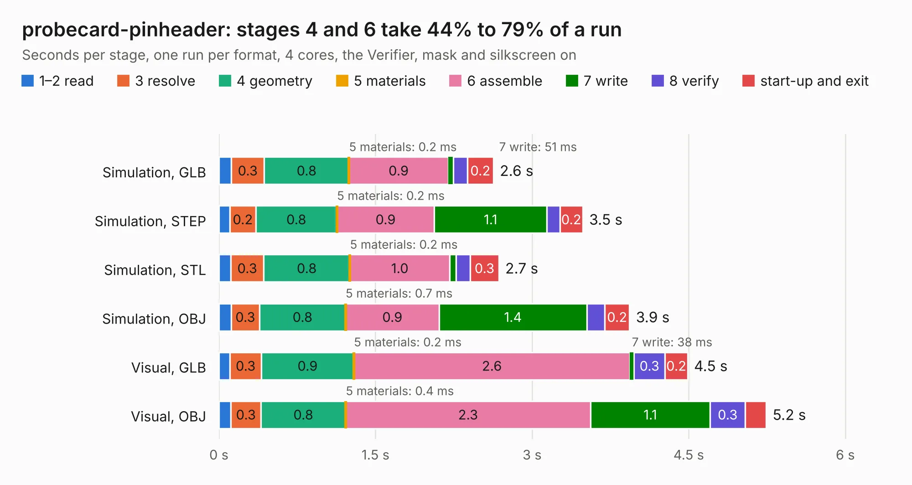

# 447. probecard-pinheader

Board 447 of the 3,105 of [Corpus Testing](../Corpus-Testing.md), on [Corpus Page 5](../CorpusTestingPages/Corpus-Testing-05.md#447-probecard-pinheader).

| Mode and format | 1–2 read | 3 resolve | 4 geometry | 5 materials | 6 assemble | 7 write | 8 verify | start-up and exit | Total |
|---|---:|---:|---:|---:|---:|---:|---:|---:|---:|
| Simulation, GLB | 0.1 | 0.3 | 0.8 | 0.2&nbsp;ms | 0.9 | 51&nbsp;ms | 0.1 | 0.2 | 2.6 |
| Simulation, STEP | 0.1 | 0.2 | 0.8 | 0.2&nbsp;ms | 0.9 | 1.1 | 0.1 | 0.2 | 3.5 |
| Simulation, STL | 0.1 | 0.3 | 0.8 | 0.2&nbsp;ms | 1.0 | 61&nbsp;ms | 0.1 | 0.3 | 2.7 |
| Simulation, OBJ | 0.1 | 0.3 | 0.8 | 0.7&nbsp;ms | 0.9 | 1.4 | 0.2 | 0.2 | 3.9 |
| Visual, GLB | 0.1 | 0.3 | 0.9 | 0.2&nbsp;ms | 2.6 | 38&nbsp;ms | 0.3 | 0.2 | 4.5 |
| Visual, OBJ | 0.1 | 0.3 | 0.8 | 0.4&nbsp;ms | 2.3 | 1.1 | 0.3 | 0.2 | 5.2 |

<table align="center"><tr><td valign="top">

| Board | Repo: [azonenberg/starshipraider](https://github.com/azonenberg/starshipraider) Board: `probecard-pinheader.kicad_pcb` |
|---|---|
| Folder | boards / CLARKE / probecard-pinheader |
| Complexity | 197&nbsp;/&nbsp;1000 (size&nbsp;162, features&nbsp;35) |
| KESE&nbsp;features | through vias, filled zones |
| Tested | 9th November 2026 |
| Copper&nbsp;layers | 4 |
| File&nbsp;format | KiCad 5 (20171130) |
| Parts,&nbsp;tracks,&nbsp;vias | 6, 521, 58 |
| Triangles,&nbsp;simulation | 293,160 in 50 parts |
| Verifier | PASS in all six runs |

</td><td valign="top">

<table>
<tr><th>File type</th><th>File size</th><th>Peak memory used</th></tr>
<tr><th colspan="3" align="left">Simulation</th></tr>
<tr><td>GLB</td><td align="right">10&nbsp;MB</td><td align="right">255&nbsp;MB</td></tr>
<tr><td>STEP</td><td align="right">36&nbsp;MB</td><td align="right">278&nbsp;MB</td></tr>
<tr><td>STL</td><td align="right">15&nbsp;MB</td><td align="right">241&nbsp;MB</td></tr>
<tr><td>OBJ</td><td align="right">30&nbsp;MB</td><td align="right">260&nbsp;MB</td></tr>
<tr><th colspan="3" align="left">Visual</th></tr>
<tr><td>GLB</td><td align="right">7.6&nbsp;MB</td><td align="right">251&nbsp;MB</td></tr>
<tr><td>OBJ</td><td align="right">23&nbsp;MB</td><td align="right">254&nbsp;MB</td></tr>
</table>

</td></tr></table>

| Previous | Next |
|:---|---:|
| [446. probecard-mmcx](b0446b_starshipraider_probecard-mmcx.md) | [448. maxwell-main](b0448b_starshipraider_maxwell-main.md) |
