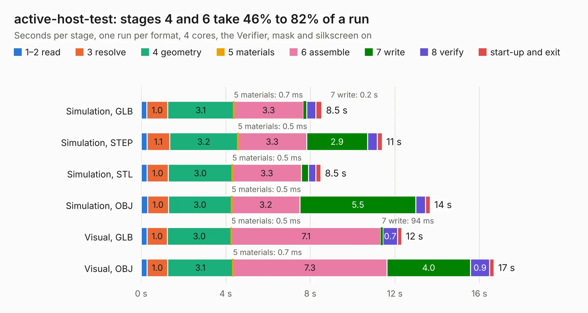

# 448. active-host-test

Board 448 of the 3,102 of [Corpus Testing](../Corpus-Testing.md), on [Corpus Page 5](../CorpusTestingPages/Corpus-Testing-05.md#448-active-host-test).

| Mode and format | 1–2 read | 3 resolve | 4 geometry | 5 materials | 6 assemble | 7 write | 8 verify | start-up and exit | Total |
|---|---:|---:|---:|---:|---:|---:|---:|---:|---:|
| Simulation, GLB | 0.3 | 1.0 | 3.1 | 0.7&nbsp;ms | 3.3 | 0.2 | 0.4 | 0.3 | 8.5 |
| Simulation, STEP | 0.3 | 1.1 | 3.2 | 0.5&nbsp;ms | 3.3 | 2.9 | 0.5 | 0.2 | 11.4 |
| Simulation, STL | 0.3 | 1.0 | 3.0 | 0.5&nbsp;ms | 3.3 | 0.3 | 0.4 | 0.2 | 8.5 |
| Simulation, OBJ | 0.3 | 1.0 | 3.0 | 0.5&nbsp;ms | 3.2 | 5.5 | 0.5 | 0.2 | 13.7 |
| Visual, GLB | 0.3 | 1.0 | 3.0 | 0.5&nbsp;ms | 7.1 | 94&nbsp;ms | 0.7 | 0.2 | 12.3 |
| Visual, OBJ | 0.3 | 1.0 | 3.1 | 0.7&nbsp;ms | 7.3 | 4.0 | 0.9 | 0.2 | 16.7 |

<table align="center"><tr><td valign="top">

| Board | Repo: [azonenberg/starshipraider](https://github.com/azonenberg/starshipraider) Board: `active-host-test.kicad_pcb` |
|---|---|
| Folder | boards / probes / active-host-test |
| Complexity | 301&nbsp;/&nbsp;1000 (size&nbsp;246, features&nbsp;55) |
| KESE&nbsp;features | through vias, slotted holes, rounded, trapezoid or chamfered pads, filled zones |
| Tested | 9th November 2026 |
| Copper&nbsp;layers | 4 |
| File&nbsp;format | KiCad 5 (20171130) |
| Parts,&nbsp;tracks,&nbsp;vias | 81, 654, 108 |
| Triangles,&nbsp;simulation | 953,894 in 151 parts |
| Verifier | PASS in all six runs |

</td><td valign="top">

<table>
<tr><th>File type</th><th>File size</th><th>Peak memory used</th></tr>
<tr><th colspan="3" align="left">Simulation</th></tr>
<tr><td>GLB</td><td align="right">33&nbsp;MB</td><td align="right">429&nbsp;MB</td></tr>
<tr><td>STEP</td><td align="right">128&nbsp;MB</td><td align="right">544&nbsp;MB</td></tr>
<tr><td>STL</td><td align="right">48&nbsp;MB</td><td align="right">422&nbsp;MB</td></tr>
<tr><td>OBJ</td><td align="right">96&nbsp;MB</td><td align="right">665&nbsp;MB</td></tr>
<tr><th colspan="3" align="left">Visual</th></tr>
<tr><td>GLB</td><td align="right">22&nbsp;MB</td><td align="right">515&nbsp;MB</td></tr>
<tr><td>OBJ</td><td align="right">66&nbsp;MB</td><td align="right">622&nbsp;MB</td></tr>
</table>

</td></tr></table>

| Previous | Next |
|:---|---:|
| [447. la-pod](b0447b_starshipraider_la-pod.md) | [449. active-probe-test](b0449b_starshipraider_active-probe-test.md) |
