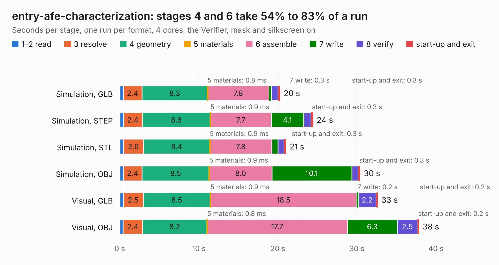

# 449. entry-afe-characterization

Board 449 of the 3,139 of [Corpus Testing](../Corpus-Testing.md), on [Corpus Page 5](../CorpusTestingPages/Corpus-Testing-05.md#449-entry-afe-characterization).

| Mode and format | 1–2 read | 3 resolve | 4 geometry | 5 materials | 6 assemble | 7 write | 8 verify | start-up and exit | Total |
|---|---:|---:|---:|---:|---:|---:|---:|---:|---:|
| Simulation, GLB | 0.4 | 2.4 | 8.3 | 0.8&nbsp;ms | 7.8 | 0.3 | 0.8 | 0.3 | 20.3 |
| Simulation, STEP | 0.5 | 2.4 | 8.6 | 0.9&nbsp;ms | 7.7 | 4.1 | 0.9 | 0.3 | 24.5 |
| Simulation, STL | 0.4 | 2.6 | 8.4 | 0.9&nbsp;ms | 7.8 | 0.8 | 0.8 | 0.3 | 21.0 |
| Simulation, OBJ | 0.4 | 2.4 | 8.5 | 0.9&nbsp;ms | 8.0 | 10.1 | 0.8 | 0.3 | 30.4 |
| Visual, GLB | 0.4 | 2.5 | 8.5 | 0.9&nbsp;ms | 18.5 | 0.2 | 2.2 | 0.2 | 32.7 |
| Visual, OBJ | 0.4 | 2.4 | 8.2 | 0.8&nbsp;ms | 17.7 | 6.3 | 2.5 | 0.2 | 37.9 |

<table align="center"><tr><td valign="top">

| Board | Repo: [azonenberg/starshipraider](https://github.com/azonenberg/starshipraider) Board: `entry-afe-characterization.kicad_pcb` |
|---|---|
| Folder | boards / BLONDEL / entry-afe-characterization |
| Complexity | 333&nbsp;/&nbsp;1000 (size&nbsp;273, features&nbsp;60) |
| KESE&nbsp;features | through vias, custom pads, filled zones, copper drawings |
| Tested | 9th November 2026 |
| Copper&nbsp;layers | 4 |
| File&nbsp;format | KiCad 5 (20171130) |
| Parts,&nbsp;tracks,&nbsp;vias | 198, 2,553, 440 |
| Triangles,&nbsp;simulation | 2,344,926 in 130 parts |
| Verifier | PASS in all six runs |

</td><td valign="top">

<table>
<tr><th>File type</th><th>File size</th><th>Peak memory used</th></tr>
<tr><th colspan="3" align="left">Simulation</th></tr>
<tr><td>GLB</td><td align="right">82&nbsp;MB</td><td align="right">801&nbsp;MB</td></tr>
<tr><td>STEP</td><td align="right">274&nbsp;MB</td><td align="right">991&nbsp;MB</td></tr>
<tr><td>STL</td><td align="right">117&nbsp;MB</td><td align="right">790&nbsp;MB</td></tr>
<tr><td>OBJ</td><td align="right">249&nbsp;MB</td><td align="right">1.6&nbsp;GB</td></tr>
<tr><th colspan="3" align="left">Visual</th></tr>
<tr><td>GLB</td><td align="right">49&nbsp;MB</td><td align="right">935&nbsp;MB</td></tr>
<tr><td>OBJ</td><td align="right">152&nbsp;MB</td><td align="right">1.1&nbsp;GB</td></tr>
</table>

</td></tr></table>

| Previous | Next |
|:---|---:|
| [448. latentpink](b0448b_latentpacket_latentpink.md) | [450. hmcad-characterization](b0450b_starshipraider_hmcad-characterization.md) |
