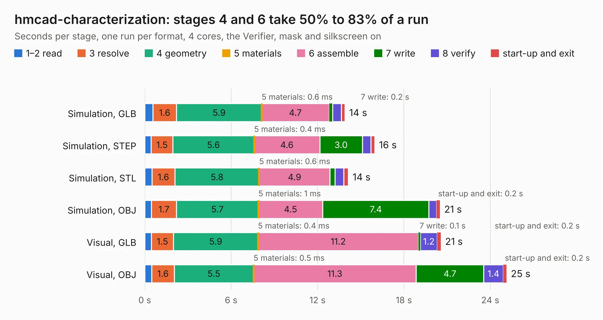

# 450. hmcad-characterization

Board 450 of the 3,131 of [Corpus Testing](../Corpus-Testing.md), on [Corpus Page 5](../CorpusTestingPages/Corpus-Testing-05.md#450-hmcad-characterization).

| Mode and format | 1–2 read | 3 resolve | 4 geometry | 5 materials | 6 assemble | 7 write | 8 verify | start-up and exit | Total |
|---|---:|---:|---:|---:|---:|---:|---:|---:|---:|
| Simulation, GLB | 0.6 | 1.6 | 5.9 | 0.6&nbsp;ms | 4.7 | 0.2 | 0.6 | 0.3 | 13.9 |
| Simulation, STEP | 0.4 | 1.5 | 5.6 | 0.4&nbsp;ms | 4.6 | 3.0 | 0.6 | 0.3 | 16.0 |
| Simulation, STL | 0.5 | 1.6 | 5.8 | 0.6&nbsp;ms | 4.9 | 0.4 | 0.6 | 0.3 | 14.1 |
| Simulation, OBJ | 0.5 | 1.7 | 5.7 | 1&nbsp;ms | 4.5 | 7.4 | 0.5 | 0.2 | 20.5 |
| Visual, GLB | 0.5 | 1.5 | 5.9 | 0.4&nbsp;ms | 11.2 | 0.1 | 1.2 | 0.2 | 20.6 |
| Visual, OBJ | 0.5 | 1.6 | 5.5 | 0.5&nbsp;ms | 11.3 | 4.7 | 1.4 | 0.2 | 25.1 |

<table align="center"><tr><td valign="top">

| Board | Repo: [azonenberg/starshipraider](https://github.com/azonenberg/starshipraider) Board: `hmcad-characterization.kicad_pcb` |
|---|---|
| Folder | boards / BLONDEL / hmcad-characterization |
| Complexity | 286&nbsp;/&nbsp;1000 (size&nbsp;251, features&nbsp;35) |
| KESE&nbsp;features | through vias, filled zones |
| Tested | 9th November 2026 |
| Copper&nbsp;layers | 4 |
| File&nbsp;format | KiCad 5 (20171130) |
| Parts,&nbsp;tracks,&nbsp;vias | 57, 2,886, 220 |
| Triangles,&nbsp;simulation | 1,340,912 in 76 parts |
| Verifier | PASS in all six runs |

</td><td valign="top">

<table>
<tr><th>File type</th><th>File size</th><th>Peak memory used</th></tr>
<tr><th colspan="3" align="left">Simulation</th></tr>
<tr><td>GLB</td><td align="right">47&nbsp;MB</td><td align="right">505&nbsp;MB</td></tr>
<tr><td>STEP</td><td align="right">188&nbsp;MB</td><td align="right">606&nbsp;MB</td></tr>
<tr><td>STL</td><td align="right">67&nbsp;MB</td><td align="right">528&nbsp;MB</td></tr>
<tr><td>OBJ</td><td align="right">139&nbsp;MB</td><td align="right">930&nbsp;MB</td></tr>
<tr><th colspan="3" align="left">Visual</th></tr>
<tr><td>GLB</td><td align="right">28&nbsp;MB</td><td align="right">610&nbsp;MB</td></tr>
<tr><td>OBJ</td><td align="right">84&nbsp;MB</td><td align="right">685&nbsp;MB</td></tr>
</table>

</td></tr></table>

| Previous | Next |
|:---|---:|
| [449. entry-afe-characterization](b0449b_starshipraider_entry-afe-characterization.md) | [451. host-x1](b0451b_starshipraider_host-x1.md) |
