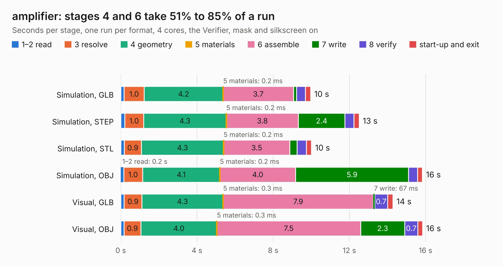

# 453. amplifier

Board 453 of the 3,106 of [Corpus Testing](../Corpus-Testing.md), on [Corpus Page 5](../CorpusTestingPages/Corpus-Testing-05.md#453-amplifier).

| Mode and format | 1–2 read | 3 resolve | 4 geometry | 5 materials | 6 assemble | 7 write | 8 verify | start-up and exit | Total |
|---|---:|---:|---:|---:|---:|---:|---:|---:|---:|
| Simulation, GLB | 0.2 | 1.0 | 4.2 | 0.2&nbsp;ms | 3.7 | 0.2 | 0.5 | 0.3 | 10.0 |
| Simulation, STEP | 0.2 | 1.0 | 4.3 | 0.2&nbsp;ms | 3.8 | 2.4 | 0.5 | 0.3 | 12.5 |
| Simulation, STL | 0.2 | 0.9 | 4.3 | 0.2&nbsp;ms | 3.5 | 0.4 | 0.5 | 0.3 | 10.0 |
| Simulation, OBJ | 0.2 | 1.0 | 4.1 | 0.2&nbsp;ms | 4.0 | 5.9 | 0.5 | 0.3 | 15.8 |
| Visual, GLB | 0.2 | 0.9 | 4.3 | 0.3&nbsp;ms | 7.9 | 67&nbsp;ms | 0.7 | 0.3 | 14.3 |
| Visual, OBJ | 0.2 | 0.9 | 4.0 | 0.3&nbsp;ms | 7.5 | 2.3 | 0.7 | 0.2 | 15.8 |

<table align="center"><tr><td valign="top">

| Board | Repo: [azonenberg/starshipraider](https://github.com/azonenberg/starshipraider) Board: `amplifier.kicad_pcb` |
|---|---|
| Folder | boards / probes / akl-ad3 / amplifier |
| Complexity | 221&nbsp;/&nbsp;1000 (size&nbsp;186, features&nbsp;35) |
| KESE&nbsp;features | through vias, filled zones |
| Tested | 9th November 2026 |
| Copper&nbsp;layers | 4 |
| File&nbsp;format | KiCad 5 (20171130) |
| Parts,&nbsp;tracks,&nbsp;vias | 30, 515, 218 |
| Triangles,&nbsp;simulation | 995,906 in 28 parts |
| Verifier | PASS in all six runs |

</td><td valign="top">

<table>
<tr><th>File type</th><th>File size</th><th>Peak memory used</th></tr>
<tr><th colspan="3" align="left">Simulation</th></tr>
<tr><td>GLB</td><td align="right">34&nbsp;MB</td><td align="right">468&nbsp;MB</td></tr>
<tr><td>STEP</td><td align="right">94&nbsp;MB</td><td align="right">529&nbsp;MB</td></tr>
<tr><td>STL</td><td align="right">50&nbsp;MB</td><td align="right">475&nbsp;MB</td></tr>
<tr><td>OBJ</td><td align="right">100&nbsp;MB</td><td align="right">709&nbsp;MB</td></tr>
<tr><th colspan="3" align="left">Visual</th></tr>
<tr><td>GLB</td><td align="right">14&nbsp;MB</td><td align="right">466&nbsp;MB</td></tr>
<tr><td>OBJ</td><td align="right">43&nbsp;MB</td><td align="right">468&nbsp;MB</td></tr>
</table>

</td></tr></table>

| Previous | Next |
|:---|---:|
| [452. akl-ad1](b0452b_starshipraider_akl-ad1.md) | [454. tip](b0454b_starshipraider_tip.md) |
