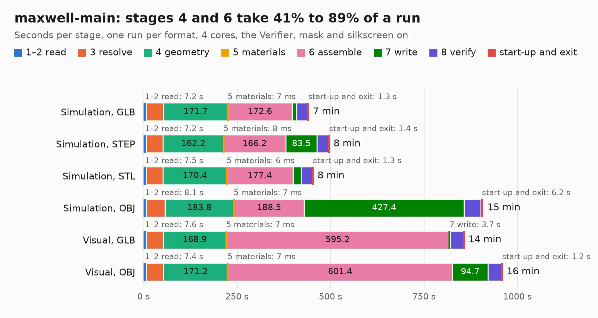

# 453. maxwell-main

Board 453 of the 3,121 of [Corpus Testing](../Corpus-Testing.md), on [Corpus Page 5](../CorpusTestingPages/Corpus-Testing-05.md#453-maxwell-main).

| Mode and format | 1–2 read | 3 resolve | 4 geometry | 5 materials | 6 assemble | 7 write | 8 verify | start-up and exit | Total |
|---|---:|---:|---:|---:|---:|---:|---:|---:|---:|
| Simulation, GLB | 7.2 | 46.2 | 171.7 | 7&nbsp;ms | 172.6 | 12.0 | 30.2 | 1.3 | 441.2 |
| Simulation, STEP | 7.2 | 44.6 | 162.2 | 8&nbsp;ms | 166.2 | 83.5 | 31.5 | 1.4 | 496.7 |
| Simulation, STL | 7.5 | 44.4 | 170.4 | 6&nbsp;ms | 177.4 | 22.9 | 29.9 | 1.3 | 453.8 |
| Simulation, OBJ | 8.1 | 49.3 | 183.8 | 7&nbsp;ms | 188.5 | 427.4 | 44.9 | 6.2 | 908.3 |
| Visual, GLB | 7.6 | 44.8 | 168.9 | 7&nbsp;ms | 595.2 | 3.7 | 36.3 | 0.9 | 857.4 |
| Visual, OBJ | 7.4 | 46.2 | 171.2 | 7&nbsp;ms | 601.4 | 94.7 | 37.4 | 1.2 | 959.6 |

<table align="center"><tr><td valign="top">

| Board | Repo: [azonenberg/starshipraider](https://github.com/azonenberg/starshipraider) Board: `maxwell-main.kicad_pcb` |
|---|---|
| Folder | boards / MAXWELL / maxwell-main |
| Complexity | 415&nbsp;/&nbsp;1000 (size&nbsp;370, features&nbsp;45) |
| KESE&nbsp;features | through vias, rounded, trapezoid or chamfered pads, filled zones |
| Tested | 9th November 2026 to 11th November 2026 |
| Copper&nbsp;layers | 8 |
| File&nbsp;format | KiCad 5 (20171130) |
| Parts,&nbsp;tracks,&nbsp;vias | 910, 53,306, 3,708 |
| Triangles,&nbsp;simulation | 36,532,372 in 936 parts |
| Verifier | PASS in all six runs |
| Run&nbsp;again | Simulation, OBJ: failed in the corpus run, run again with no memory cap and no time limit (swap added to a 16 GB machine), and passed |

</td><td valign="top">

<table>
<tr><th>File type</th><th>File size</th><th>Peak memory used</th></tr>
<tr><th colspan="3" align="left">Simulation</th></tr>
<tr><td>GLB</td><td align="right">1.2&nbsp;GB</td><td align="right">6.3&nbsp;GB</td></tr>
<tr><td>STEP</td><td align="right">3.7&nbsp;GB</td><td align="right">9.1&nbsp;GB</td></tr>
<tr><td>STL</td><td align="right">1.8&nbsp;GB</td><td align="right">7.2&nbsp;GB</td></tr>
<tr><td>OBJ</td><td align="right">4.2&nbsp;GB</td><td align="right">23&nbsp;GB</td></tr>
<tr><th colspan="3" align="left">Visual</th></tr>
<tr><td>GLB</td><td align="right">496&nbsp;MB</td><td align="right">8.4&nbsp;GB</td></tr>
<tr><td>OBJ</td><td align="right">1.7&nbsp;GB</td><td align="right">10&nbsp;GB</td></tr>
</table>

</td></tr></table>

| Previous | Next |
|:---|---:|
| [452. probecard-pinheader](b0452b_starshipraider_probecard-pinheader.md) | [454. la-pod](b0454b_starshipraider_la-pod.md) |
