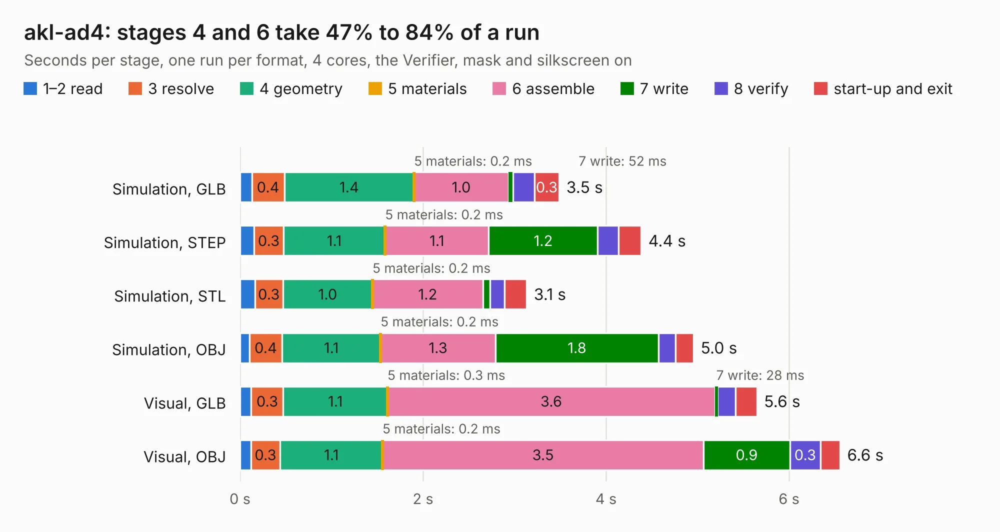

# 455. akl-ad4

Board 455 of the 3,103 of [Corpus Testing](../Corpus-Testing.md), on [Corpus Page 5](../CorpusTestingPages/Corpus-Testing-05.md#455-akl-ad4).

| Mode and format | 1–2 read | 3 resolve | 4 geometry | 5 materials | 6 assemble | 7 write | 8 verify | start-up and exit | Total |
|---|---:|---:|---:|---:|---:|---:|---:|---:|---:|
| Simulation, GLB | 0.1 | 0.4 | 1.4 | 0.2&nbsp;ms | 1.0 | 52&nbsp;ms | 0.2 | 0.3 | 3.5 |
| Simulation, STEP | 0.2 | 0.3 | 1.1 | 0.2&nbsp;ms | 1.1 | 1.2 | 0.2 | 0.2 | 4.4 |
| Simulation, STL | 0.2 | 0.3 | 1.0 | 0.2&nbsp;ms | 1.2 | 78&nbsp;ms | 0.2 | 0.2 | 3.1 |
| Simulation, OBJ | 0.1 | 0.4 | 1.1 | 0.2&nbsp;ms | 1.3 | 1.8 | 0.2 | 0.2 | 5.0 |
| Visual, GLB | 0.1 | 0.3 | 1.1 | 0.3&nbsp;ms | 3.6 | 28&nbsp;ms | 0.2 | 0.2 | 5.6 |
| Visual, OBJ | 0.1 | 0.3 | 1.1 | 0.2&nbsp;ms | 3.5 | 0.9 | 0.3 | 0.2 | 6.6 |

<table align="center"><tr><td valign="top">

| Board | Repo: [azonenberg/starshipraider](https://github.com/azonenberg/starshipraider) Board: `akl-ad4.kicad_pcb` |
|---|---|
| Folder | boards / probes / akl-ad4 |
| Complexity | 264&nbsp;/&nbsp;1000 (size&nbsp;169, features&nbsp;95) |
| KESE&nbsp;features | through vias, custom pads, filled zones, copper drawings, stack-up, dielectric εr and tanδ, mask and silkscreen colours |
| Tested | 9th November 2026 |
| Copper&nbsp;layers | 4 |
| File&nbsp;format | KiCad 6 (20211014) |
| Parts,&nbsp;tracks,&nbsp;vias | 30, 222, 62 |
| Triangles,&nbsp;simulation | 308,998 in 38 parts |
| Verifier | PASS in all six runs |

</td><td valign="top">

<table>
<tr><th>File type</th><th>File size</th><th>Peak memory used</th></tr>
<tr><th colspan="3" align="left">Simulation</th></tr>
<tr><td>GLB</td><td align="right">11&nbsp;MB</td><td align="right">252&nbsp;MB</td></tr>
<tr><td>STEP</td><td align="right">38&nbsp;MB</td><td align="right">254&nbsp;MB</td></tr>
<tr><td>STL</td><td align="right">15&nbsp;MB</td><td align="right">249&nbsp;MB</td></tr>
<tr><td>OBJ</td><td align="right">31&nbsp;MB</td><td align="right">262&nbsp;MB</td></tr>
<tr><th colspan="3" align="left">Visual</th></tr>
<tr><td>GLB</td><td align="right">6.4&nbsp;MB</td><td align="right">243&nbsp;MB</td></tr>
<tr><td>OBJ</td><td align="right">18&nbsp;MB</td><td align="right">241&nbsp;MB</td></tr>
</table>

</td></tr></table>

| Previous | Next |
|:---|---:|
| [454. vna-amplifier](b0454b_starshipraider_vna-amplifier.md) | [456. akl-av1](b0456b_starshipraider_akl-av1.md) |
