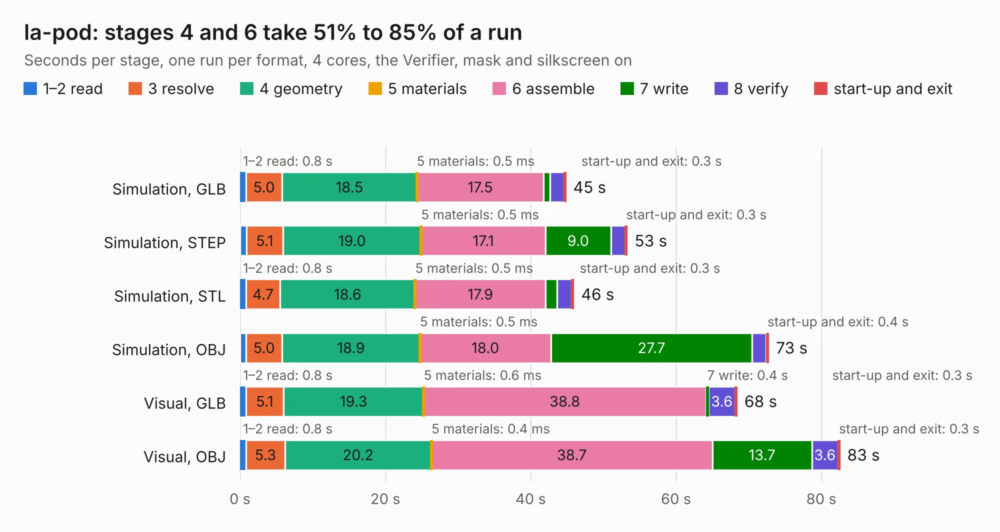

# 455. la-pod

Board 455 of the 3,128 of [Corpus Testing](../Corpus-Testing.md), on [Corpus Page 5](../CorpusTestingPages/Corpus-Testing-05.md#455-la-pod).

| Mode and format | 1–2 read | 3 resolve | 4 geometry | 5 materials | 6 assemble | 7 write | 8 verify | start-up and exit | Total |
|---|---:|---:|---:|---:|---:|---:|---:|---:|---:|
| Simulation, GLB | 0.8 | 5.0 | 18.5 | 0.5&nbsp;ms | 17.5 | 0.9 | 1.9 | 0.3 | 44.9 |
| Simulation, STEP | 0.9 | 5.1 | 19.0 | 0.5&nbsp;ms | 17.1 | 9.0 | 1.9 | 0.3 | 53.3 |
| Simulation, STL | 0.8 | 4.7 | 18.6 | 0.5&nbsp;ms | 17.9 | 1.6 | 2.0 | 0.3 | 46.0 |
| Simulation, OBJ | 0.8 | 5.0 | 18.9 | 0.5&nbsp;ms | 18.0 | 27.7 | 1.9 | 0.4 | 72.8 |
| Visual, GLB | 0.8 | 5.1 | 19.3 | 0.6&nbsp;ms | 38.8 | 0.4 | 3.6 | 0.3 | 68.4 |
| Visual, OBJ | 0.8 | 5.3 | 20.2 | 0.4&nbsp;ms | 38.7 | 13.7 | 3.6 | 0.3 | 82.6 |

<table align="center"><tr><td valign="top">

| Board | Repo: [azonenberg/starshipraider](https://github.com/azonenberg/starshipraider) Board: `la-pod.kicad_pcb` |
|---|---|
| Folder | boards / MEAD |
| Complexity | 318&nbsp;/&nbsp;1000 (size&nbsp;238, features&nbsp;80) |
| KESE&nbsp;features | through vias, custom pads, rounded, trapezoid or chamfered pads, filled zones, copper drawings, copper text |
| Tested | 9th November 2026 |
| Copper&nbsp;layers | 4 |
| File&nbsp;format | KiCad 5 (20171130) |
| Parts,&nbsp;tracks,&nbsp;vias | 194, 5,003, 995 |
| Triangles,&nbsp;simulation | 4,824,904 in 124 parts |
| Verifier | PASS in all six runs |

</td><td valign="top">

<table>
<tr><th>File type</th><th>File size</th><th>Peak memory used</th></tr>
<tr><th colspan="3" align="left">Simulation</th></tr>
<tr><td>GLB</td><td align="right">165&nbsp;MB</td><td align="right">1.5&nbsp;GB</td></tr>
<tr><td>STEP</td><td align="right">540&nbsp;MB</td><td align="right">1.7&nbsp;GB</td></tr>
<tr><td>STL</td><td align="right">241&nbsp;MB</td><td align="right">1.6&nbsp;GB</td></tr>
<tr><td>OBJ</td><td align="right">514&nbsp;MB</td><td align="right">3.1&nbsp;GB</td></tr>
<tr><th colspan="3" align="left">Visual</th></tr>
<tr><td>GLB</td><td align="right">85&nbsp;MB</td><td align="right">1.5&nbsp;GB</td></tr>
<tr><td>OBJ</td><td align="right">271&nbsp;MB</td><td align="right">1.9&nbsp;GB</td></tr>
</table>

</td></tr></table>

| Previous | Next |
|:---|---:|
| [454. maxwell-main](b0454b_starshipraider_maxwell-main.md) | [456. active-host-test](b0456b_starshipraider_active-host-test.md) |
