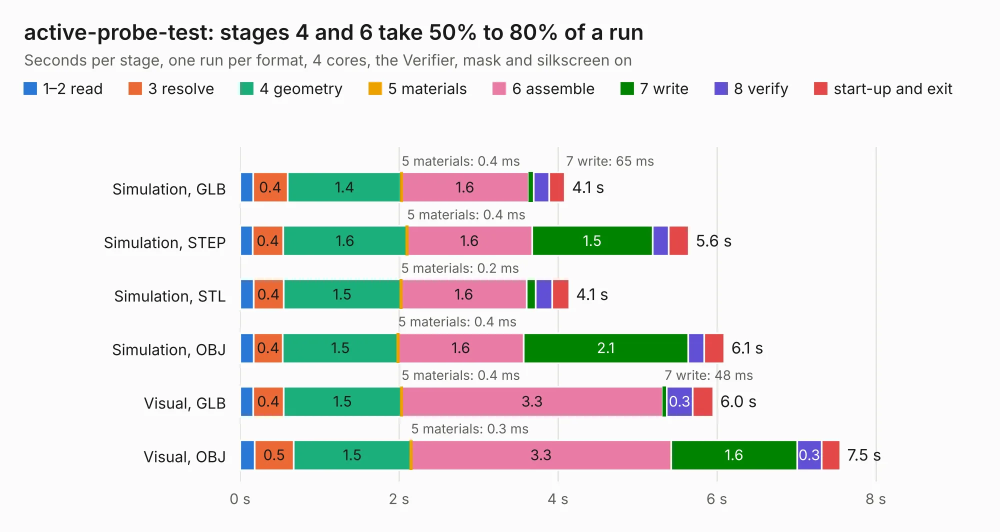

# 456. active-probe-test

Board 456 of the 3,122 of [Corpus Testing](../Corpus-Testing.md), on [Corpus Page 5](../CorpusTestingPages/Corpus-Testing-05.md#456-active-probe-test).

| Mode and format | 1–2 read | 3 resolve | 4 geometry | 5 materials | 6 assemble | 7 write | 8 verify | start-up and exit | Total |
|---|---:|---:|---:|---:|---:|---:|---:|---:|---:|
| Simulation, GLB | 0.2 | 0.4 | 1.4 | 0.4&nbsp;ms | 1.6 | 65&nbsp;ms | 0.2 | 0.2 | 4.1 |
| Simulation, STEP | 0.2 | 0.4 | 1.6 | 0.4&nbsp;ms | 1.6 | 1.5 | 0.2 | 0.3 | 5.6 |
| Simulation, STL | 0.2 | 0.4 | 1.5 | 0.2&nbsp;ms | 1.6 | 0.1 | 0.2 | 0.2 | 4.1 |
| Simulation, OBJ | 0.2 | 0.4 | 1.5 | 0.4&nbsp;ms | 1.6 | 2.1 | 0.2 | 0.3 | 6.1 |
| Visual, GLB | 0.2 | 0.4 | 1.5 | 0.4&nbsp;ms | 3.3 | 48&nbsp;ms | 0.3 | 0.3 | 6.0 |
| Visual, OBJ | 0.2 | 0.5 | 1.5 | 0.3&nbsp;ms | 3.3 | 1.6 | 0.3 | 0.2 | 7.5 |

<table align="center"><tr><td valign="top">

| Board | Repo: [azonenberg/starshipraider](https://github.com/azonenberg/starshipraider) Board: `active-probe-test.kicad_pcb` |
|---|---|
| Folder | boards / probes / active-probe-test |
| Complexity | 214&nbsp;/&nbsp;1000 (size&nbsp;159, features&nbsp;55) |
| KESE&nbsp;features | through vias, slotted holes, rounded, trapezoid or chamfered pads, filled zones |
| Tested | 9th November 2026 |
| Copper&nbsp;layers | 2 |
| File&nbsp;format | KiCad 5 (20171130) |
| Parts,&nbsp;tracks,&nbsp;vias | 41, 349, 46 |
| Triangles,&nbsp;simulation | 380,072 in 55 parts |
| Verifier | PASS in all six runs |

</td><td valign="top">

<table>
<tr><th>File type</th><th>File size</th><th>Peak memory used</th></tr>
<tr><th colspan="3" align="left">Simulation</th></tr>
<tr><td>GLB</td><td align="right">13&nbsp;MB</td><td align="right">267&nbsp;MB</td></tr>
<tr><td>STEP</td><td align="right">62&nbsp;MB</td><td align="right">314&nbsp;MB</td></tr>
<tr><td>STL</td><td align="right">19&nbsp;MB</td><td align="right">269&nbsp;MB</td></tr>
<tr><td>OBJ</td><td align="right">38&nbsp;MB</td><td align="right">311&nbsp;MB</td></tr>
<tr><th colspan="3" align="left">Visual</th></tr>
<tr><td>GLB</td><td align="right">10&nbsp;MB</td><td align="right">322&nbsp;MB</td></tr>
<tr><td>OBJ</td><td align="right">30&nbsp;MB</td><td align="right">310&nbsp;MB</td></tr>
</table>

</td></tr></table>

| Previous | Next |
|:---|---:|
| [455. active-host-test](b0455b_starshipraider_active-host-test.md) | [457. akl-ad1](b0457b_starshipraider_akl-ad1.md) |
