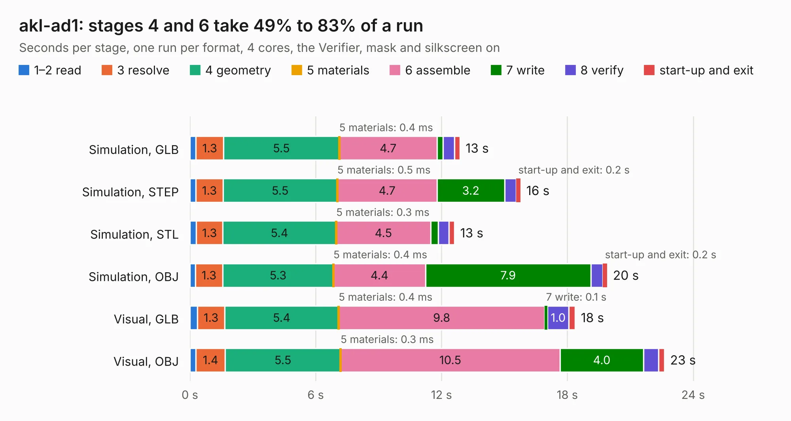

# 457. akl-ad1

Board 457 of the 3,118 of [Corpus Testing](../Corpus-Testing.md), on [Corpus Page 5](../CorpusTestingPages/Corpus-Testing-05.md#457-akl-ad1).

| Mode and format | 1–2 read | 3 resolve | 4 geometry | 5 materials | 6 assemble | 7 write | 8 verify | start-up and exit | Total |
|---|---:|---:|---:|---:|---:|---:|---:|---:|---:|
| Simulation, GLB | 0.3 | 1.3 | 5.5 | 0.4&nbsp;ms | 4.7 | 0.3 | 0.6 | 0.3 | 12.9 |
| Simulation, STEP | 0.3 | 1.3 | 5.5 | 0.5&nbsp;ms | 4.7 | 3.2 | 0.5 | 0.2 | 15.8 |
| Simulation, STL | 0.3 | 1.3 | 5.4 | 0.3&nbsp;ms | 4.5 | 0.4 | 0.5 | 0.3 | 12.6 |
| Simulation, OBJ | 0.3 | 1.3 | 5.3 | 0.4&nbsp;ms | 4.4 | 7.9 | 0.6 | 0.2 | 19.9 |
| Visual, GLB | 0.4 | 1.3 | 5.4 | 0.4&nbsp;ms | 9.8 | 0.1 | 1.0 | 0.3 | 18.4 |
| Visual, OBJ | 0.3 | 1.4 | 5.5 | 0.3&nbsp;ms | 10.5 | 4.0 | 0.7 | 0.3 | 22.6 |

<table align="center"><tr><td valign="top">

| Board | Repo: [azonenberg/starshipraider](https://github.com/azonenberg/starshipraider) Board: `akl-ad1.kicad_pcb` |
|---|---|
| Folder | boards / probes / akl-ad1 |
| Complexity | 254&nbsp;/&nbsp;1000 (size&nbsp;194, features&nbsp;60) |
| KESE&nbsp;features | through vias, custom pads, filled zones, copper drawings |
| Tested | 9th November 2026 |
| Copper&nbsp;layers | 4 |
| File&nbsp;format | KiCad 5 (20171130) |
| Parts,&nbsp;tracks,&nbsp;vias | 38, 702, 292 |
| Triangles,&nbsp;simulation | 1,301,788 in 41 parts |
| Verifier | PASS in all six runs |

</td><td valign="top">

<table>
<tr><th>File type</th><th>File size</th><th>Peak memory used</th></tr>
<tr><th colspan="3" align="left">Simulation</th></tr>
<tr><td>GLB</td><td align="right">44&nbsp;MB</td><td align="right">551&nbsp;MB</td></tr>
<tr><td>STEP</td><td align="right">134&nbsp;MB</td><td align="right">651&nbsp;MB</td></tr>
<tr><td>STL</td><td align="right">65&nbsp;MB</td><td align="right">535&nbsp;MB</td></tr>
<tr><td>OBJ</td><td align="right">133&nbsp;MB</td><td align="right">898&nbsp;MB</td></tr>
<tr><th colspan="3" align="left">Visual</th></tr>
<tr><td>GLB</td><td align="right">23&nbsp;MB</td><td align="right">569&nbsp;MB</td></tr>
<tr><td>OBJ</td><td align="right">69&nbsp;MB</td><td align="right">590&nbsp;MB</td></tr>
</table>

</td></tr></table>

| Previous | Next |
|:---|---:|
| [456. active-probe-test](b0456b_starshipraider_active-probe-test.md) | [458. amplifier](b0458b_starshipraider_amplifier.md) |
