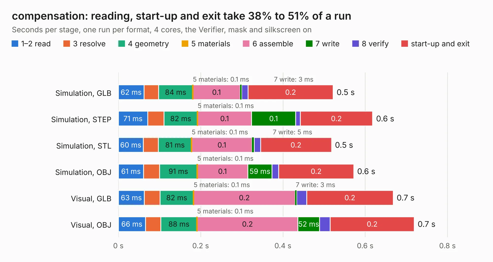

# 457. compensation

Board 457 of the 3,102 of [Corpus Testing](../Corpus-Testing.md), on [Corpus Page 5](../CorpusTestingPages/Corpus-Testing-05.md#457-compensation).

| Mode and format | 1–2 read | 3 resolve | 4 geometry | 5 materials | 6 assemble | 7 write | 8 verify | start-up and exit | Total |
|---|---:|---:|---:|---:|---:|---:|---:|---:|---:|
| Simulation, GLB | 62&nbsp;ms | 35&nbsp;ms | 84&nbsp;ms | 0.1&nbsp;ms | 0.1 | 3&nbsp;ms | 16&nbsp;ms | 0.2 | 0.5 |
| Simulation, STEP | 71&nbsp;ms | 40&nbsp;ms | 82&nbsp;ms | 0.1&nbsp;ms | 0.1 | 0.1 | 11&nbsp;ms | 0.2 | 0.6 |
| Simulation, STL | 60&nbsp;ms | 37&nbsp;ms | 81&nbsp;ms | 0.1&nbsp;ms | 0.1 | 5&nbsp;ms | 15&nbsp;ms | 0.2 | 0.5 |
| Simulation, OBJ | 61&nbsp;ms | 39&nbsp;ms | 91&nbsp;ms | 0.1&nbsp;ms | 0.1 | 59&nbsp;ms | 16&nbsp;ms | 0.2 | 0.6 |
| Visual, GLB | 63&nbsp;ms | 38&nbsp;ms | 82&nbsp;ms | 0.1&nbsp;ms | 0.2 | 3&nbsp;ms | 25&nbsp;ms | 0.2 | 0.7 |
| Visual, OBJ | 66&nbsp;ms | 38&nbsp;ms | 88&nbsp;ms | 0.1&nbsp;ms | 0.2 | 52&nbsp;ms | 26&nbsp;ms | 0.2 | 0.7 |

<table align="center"><tr><td valign="top">

| Board | Repo: [azonenberg/starshipraider](https://github.com/azonenberg/starshipraider) Board: `compensation.kicad_pcb` |
|---|---|
| Folder | boards / probes / akl-pr1 / compensation |
| Complexity | 134&nbsp;/&nbsp;1000 (size&nbsp;69, features&nbsp;65) |
| KESE&nbsp;features | through vias, filled zones, stack-up, dielectric εr and tanδ |
| Tested | 9th November 2026 |
| Copper&nbsp;layers | 2 |
| File&nbsp;format | KiCad 6 (20211014) |
| Parts,&nbsp;tracks,&nbsp;vias | 2, 8, 1 |
| Triangles,&nbsp;simulation | 14,080 in 13 parts |
| Verifier | PASS in all six runs |

</td><td valign="top">

<table>
<tr><th>File type</th><th>File size</th><th>Peak memory used</th></tr>
<tr><th colspan="3" align="left">Simulation</th></tr>
<tr><td>GLB</td><td align="right">547&nbsp;kB</td><td align="right">63&nbsp;MB</td></tr>
<tr><td>STEP</td><td align="right">2.6&nbsp;MB</td><td align="right">65&nbsp;MB</td></tr>
<tr><td>STL</td><td align="right">705&nbsp;kB</td><td align="right">63&nbsp;MB</td></tr>
<tr><td>OBJ</td><td align="right">1.4&nbsp;MB</td><td align="right">65&nbsp;MB</td></tr>
<tr><th colspan="3" align="left">Visual</th></tr>
<tr><td>GLB</td><td align="right">432&nbsp;kB</td><td align="right">82&nbsp;MB</td></tr>
<tr><td>OBJ</td><td align="right">1.1&nbsp;MB</td><td align="right">81&nbsp;MB</td></tr>
</table>

</td></tr></table>

| Previous | Next |
|:---|---:|
| [456. akl-pd1](b0456b_starshipraider_akl-pd1.md) | [458. head](b0458b_starshipraider_head.md) |
