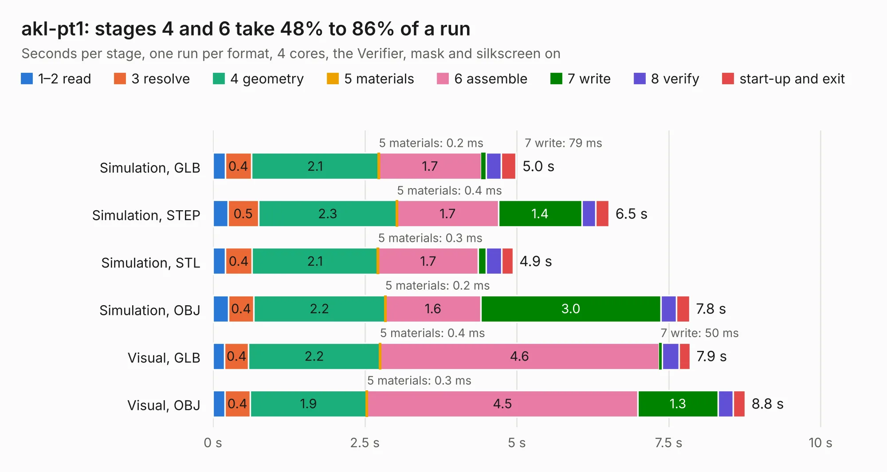

# 461. akl-pt1

Board 461 of the 3,108 of [Corpus Testing](../Corpus-Testing.md), on [Corpus Page 5](../CorpusTestingPages/Corpus-Testing-05.md#461-akl-pt1).

| Mode and format | 1–2 read | 3 resolve | 4 geometry | 5 materials | 6 assemble | 7 write | 8 verify | start-up and exit | Total |
|---|---:|---:|---:|---:|---:|---:|---:|---:|---:|
| Simulation, GLB | 0.2 | 0.4 | 2.1 | 0.2&nbsp;ms | 1.7 | 79&nbsp;ms | 0.3 | 0.2 | 5.0 |
| Simulation, STEP | 0.2 | 0.5 | 2.3 | 0.4&nbsp;ms | 1.7 | 1.4 | 0.2 | 0.2 | 6.5 |
| Simulation, STL | 0.2 | 0.4 | 2.1 | 0.3&nbsp;ms | 1.7 | 0.1 | 0.3 | 0.2 | 4.9 |
| Simulation, OBJ | 0.3 | 0.4 | 2.2 | 0.2&nbsp;ms | 1.6 | 3.0 | 0.3 | 0.2 | 7.8 |
| Visual, GLB | 0.2 | 0.4 | 2.2 | 0.4&nbsp;ms | 4.6 | 50&nbsp;ms | 0.3 | 0.2 | 7.9 |
| Visual, OBJ | 0.2 | 0.4 | 1.9 | 0.3&nbsp;ms | 4.5 | 1.3 | 0.2 | 0.2 | 8.8 |

<table align="center"><tr><td valign="top">

| Board | Repo: [azonenberg/starshipraider](https://github.com/azonenberg/starshipraider) Board: `akl-pt1.kicad_pcb` |
|---|---|
| Folder | boards / probes / akl-pt1 |
| Complexity | 186&nbsp;/&nbsp;1000 (size&nbsp;151, features&nbsp;35) |
| KESE&nbsp;features | through vias, filled zones |
| Tested | 9th November 2026 |
| Copper&nbsp;layers | 4 |
| File&nbsp;format | KiCad 6 (20211014) |
| Parts,&nbsp;tracks,&nbsp;vias | 3, 139, 131 |
| Triangles,&nbsp;simulation | 529,138 in 15 parts |
| Verifier | PASS in all six runs |

</td><td valign="top">

<table>
<tr><th>File type</th><th>File size</th><th>Peak memory used</th></tr>
<tr><th colspan="3" align="left">Simulation</th></tr>
<tr><td>GLB</td><td align="right">18&nbsp;MB</td><td align="right">348&nbsp;MB</td></tr>
<tr><td>STEP</td><td align="right">55&nbsp;MB</td><td align="right">380&nbsp;MB</td></tr>
<tr><td>STL</td><td align="right">26&nbsp;MB</td><td align="right">349&nbsp;MB</td></tr>
<tr><td>OBJ</td><td align="right">53&nbsp;MB</td><td align="right">405&nbsp;MB</td></tr>
<tr><th colspan="3" align="left">Visual</th></tr>
<tr><td>GLB</td><td align="right">8.7&nbsp;MB</td><td align="right">318&nbsp;MB</td></tr>
<tr><td>OBJ</td><td align="right">26&nbsp;MB</td><td align="right">329&nbsp;MB</td></tr>
</table>

</td></tr></table>

| Previous | Next |
|:---|---:|
| [460. head](b0460b_starshipraider_head.md) | [462. akl-pt2](b0462b_starshipraider_akl-pt2.md) |
