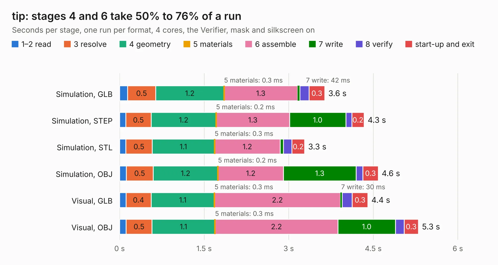

# 461 tip

Board 461 of the 3,138 of [Corpus Testing](../Corpus-Testing.md), on [Corpus Page 5](../CorpusTestingPages/Corpus-Testing-05.md#461-tip).

| Mode and format | 1–2 read | 3 resolve | 4 geometry | 5 materials | 6 assemble | 7 write | 8 verify | start-up and exit | Total |
|---|---:|---:|---:|---:|---:|---:|---:|---:|---:|
| Simulation, GLB | 0.1 | 0.5 | 1.2 | 0.3&nbsp;ms | 1.3 | 42&nbsp;ms | 0.2 | 0.3 | 3.6 |
| Simulation, STEP | 0.1 | 0.5 | 1.2 | 0.2&nbsp;ms | 1.3 | 1.0 | 0.1 | 0.2 | 4.3 |
| Simulation, STL | 0.1 | 0.5 | 1.1 | 0.3&nbsp;ms | 1.2 | 58&nbsp;ms | 0.2 | 0.2 | 3.3 |
| Simulation, OBJ | 0.1 | 0.5 | 1.2 | 0.2&nbsp;ms | 1.2 | 1.3 | 0.1 | 0.3 | 4.6 |
| Visual, GLB | 0.1 | 0.4 | 1.1 | 0.3&nbsp;ms | 2.2 | 30&nbsp;ms | 0.2 | 0.3 | 4.4 |
| Visual, OBJ | 0.1 | 0.5 | 1.1 | 0.3&nbsp;ms | 2.2 | 1.0 | 0.2 | 0.3 | 5.3 |

<table align="center"><tr><td valign="top">

| Board | Repo: [azonenberg/starshipraider](https://github.com/azonenberg/starshipraider) Board: `tip.kicad_pcb` |
|---|---|
| Folder | boards / probes / akl-ad3 / tip |
| Complexity | 184&nbsp;/&nbsp;1000 (size&nbsp;149, features&nbsp;35) |
| KESE&nbsp;features | through vias, filled zones |
| Tested | 9th November 2026 |
| Copper&nbsp;layers | 2 |
| File&nbsp;format | KiCad 5 (20171130) |
| Parts,&nbsp;tracks,&nbsp;vias | 7, 256, 188 |
| Triangles,&nbsp;simulation | 210,136 in 19 parts |
| Verifier | PASS in all six runs |

</td><td valign="top">

<table>
<tr><th>File type</th><th>File size</th><th>Peak memory used</th></tr>
<tr><th colspan="3" align="left">Simulation</th></tr>
<tr><td>GLB</td><td align="right">7.2&nbsp;MB</td><td align="right">240&nbsp;MB</td></tr>
<tr><td>STEP</td><td align="right">15&nbsp;MB</td><td align="right">266&nbsp;MB</td></tr>
<tr><td>STL</td><td align="right">11&nbsp;MB</td><td align="right">243&nbsp;MB</td></tr>
<tr><td>OBJ</td><td align="right">20&nbsp;MB</td><td align="right">241&nbsp;MB</td></tr>
<tr><th colspan="3" align="left">Visual</th></tr>
<tr><td>GLB</td><td align="right">6.2&nbsp;MB</td><td align="right">253&nbsp;MB</td></tr>
<tr><td>OBJ</td><td align="right">18&nbsp;MB</td><td align="right">255&nbsp;MB</td></tr>
</table>

</td></tr></table>

| Previous | Next |
|:---|---:|
| [460 amplifier](b0460b_starshipraider_amplifier.md) | [462 vna-amplifier](b0462b_starshipraider_vna-amplifier.md) |
