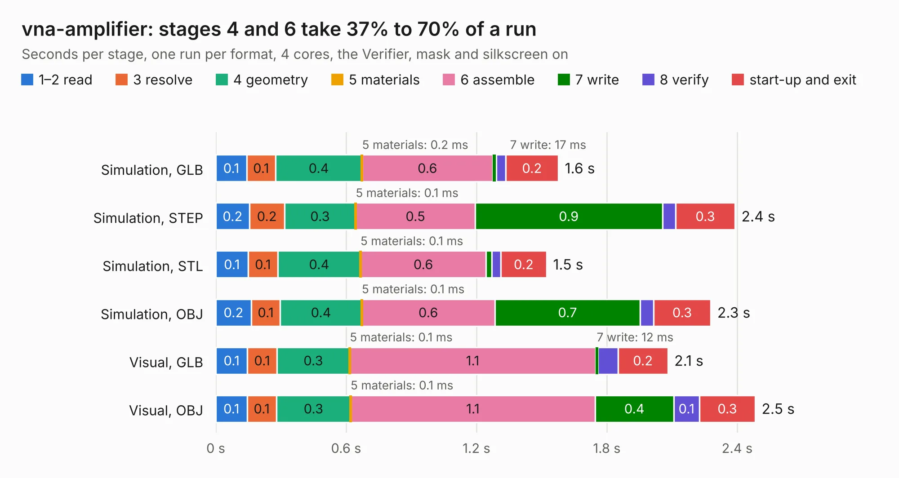

# 461. vna-amplifier

Board 461 of the 3,127 of [Corpus Testing](../Corpus-Testing.md), on [Corpus Page 5](../CorpusTestingPages/Corpus-Testing-05.md#461-vna-amplifier).

| Mode and format | 1–2 read | 3 resolve | 4 geometry | 5 materials | 6 assemble | 7 write | 8 verify | start-up and exit | Total |
|---|---:|---:|---:|---:|---:|---:|---:|---:|---:|
| Simulation, GLB | 0.1 | 0.1 | 0.4 | 0.2&nbsp;ms | 0.6 | 17&nbsp;ms | 42&nbsp;ms | 0.2 | 1.6 |
| Simulation, STEP | 0.2 | 0.2 | 0.3 | 0.1&nbsp;ms | 0.5 | 0.9 | 61&nbsp;ms | 0.3 | 2.4 |
| Simulation, STL | 0.1 | 0.1 | 0.4 | 0.1&nbsp;ms | 0.6 | 25&nbsp;ms | 42&nbsp;ms | 0.2 | 1.5 |
| Simulation, OBJ | 0.2 | 0.1 | 0.4 | 0.1&nbsp;ms | 0.6 | 0.7 | 60&nbsp;ms | 0.3 | 2.3 |
| Visual, GLB | 0.1 | 0.1 | 0.3 | 0.1&nbsp;ms | 1.1 | 12&nbsp;ms | 92&nbsp;ms | 0.2 | 2.1 |
| Visual, OBJ | 0.1 | 0.1 | 0.3 | 0.1&nbsp;ms | 1.1 | 0.4 | 0.1 | 0.3 | 2.5 |

<table align="center"><tr><td valign="top">

| Board | Repo: [azonenberg/starshipraider](https://github.com/azonenberg/starshipraider) Board: `vna-amplifier.kicad_pcb` |
|---|---|
| Folder | boards / probes / akl-ad3 / vna-amplifier |
| Complexity | 152&nbsp;/&nbsp;1000 (size&nbsp;117, features&nbsp;35) |
| KESE&nbsp;features | through vias, filled zones |
| Tested | 9th November 2026 |
| Copper&nbsp;layers | 4 |
| File&nbsp;format | KiCad 5 (20171130) |
| Parts,&nbsp;tracks,&nbsp;vias | 3, 39, 8 |
| Triangles,&nbsp;simulation | 93,052 in 15 parts |
| Verifier | PASS in all six runs |

</td><td valign="top">

<table>
<tr><th>File type</th><th>File size</th><th>Peak memory used</th></tr>
<tr><th colspan="3" align="left">Simulation</th></tr>
<tr><td>GLB</td><td align="right">3.3&nbsp;MB</td><td align="right">180&nbsp;MB</td></tr>
<tr><td>STEP</td><td align="right">14&nbsp;MB</td><td align="right">187&nbsp;MB</td></tr>
<tr><td>STL</td><td align="right">4.7&nbsp;MB</td><td align="right">181&nbsp;MB</td></tr>
<tr><td>OBJ</td><td align="right">9.0&nbsp;MB</td><td align="right">182&nbsp;MB</td></tr>
<tr><th colspan="3" align="left">Visual</th></tr>
<tr><td>GLB</td><td align="right">2.1&nbsp;MB</td><td align="right">153&nbsp;MB</td></tr>
<tr><td>OBJ</td><td align="right">5.8&nbsp;MB</td><td align="right">155&nbsp;MB</td></tr>
</table>

</td></tr></table>

| Previous | Next |
|:---|---:|
| [460. tip](b0460b_starshipraider_tip.md) | [462. akl-ad4](b0462b_starshipraider_akl-ad4.md) |
