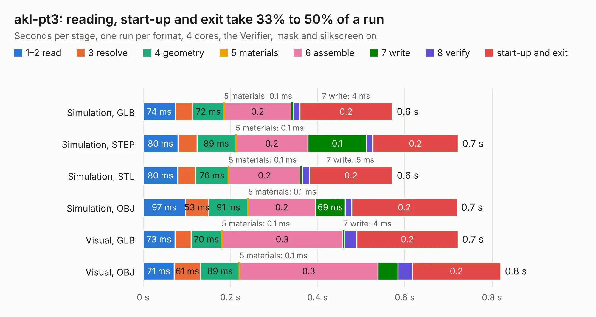

# 463. akl-pt3

Board 463 of the 3,105 of [Corpus Testing](../Corpus-Testing.md), on [Corpus Page 5](../CorpusTestingPages/Corpus-Testing-05.md#463-akl-pt3).

| Mode and format | 1–2 read | 3 resolve | 4 geometry | 5 materials | 6 assemble | 7 write | 8 verify | start-up and exit | Total |
|---|---:|---:|---:|---:|---:|---:|---:|---:|---:|
| Simulation, GLB | 74&nbsp;ms | 39&nbsp;ms | 72&nbsp;ms | 0.1&nbsp;ms | 0.2 | 4&nbsp;ms | 15&nbsp;ms | 0.2 | 0.6 |
| Simulation, STEP | 80&nbsp;ms | 44&nbsp;ms | 89&nbsp;ms | 0.1&nbsp;ms | 0.2 | 0.1 | 15&nbsp;ms | 0.2 | 0.7 |
| Simulation, STL | 80&nbsp;ms | 41&nbsp;ms | 76&nbsp;ms | 0.1&nbsp;ms | 0.2 | 5&nbsp;ms | 16&nbsp;ms | 0.2 | 0.6 |
| Simulation, OBJ | 97&nbsp;ms | 53&nbsp;ms | 91&nbsp;ms | 0.1&nbsp;ms | 0.2 | 69&nbsp;ms | 15&nbsp;ms | 0.2 | 0.7 |
| Visual, GLB | 73&nbsp;ms | 37&nbsp;ms | 70&nbsp;ms | 0.1&nbsp;ms | 0.3 | 4&nbsp;ms | 29&nbsp;ms | 0.2 | 0.7 |
| Visual, OBJ | 71&nbsp;ms | 61&nbsp;ms | 89&nbsp;ms | 0.1&nbsp;ms | 0.3 | 46&nbsp;ms | 33&nbsp;ms | 0.2 | 0.8 |

<table align="center"><tr><td valign="top">

| Board | Repo: [azonenberg/starshipraider](https://github.com/azonenberg/starshipraider) Board: `akl-pt3.kicad_pcb` |
|---|---|
| Folder | boards / probes / akl-pt3 |
| Complexity | 117&nbsp;/&nbsp;1000 (size&nbsp;82, features&nbsp;35) |
| KESE&nbsp;features | through vias, filled zones |
| Tested | 9th November 2026 |
| Copper&nbsp;layers | 2 |
| File&nbsp;format | KiCad 5 (20171130) |
| Parts,&nbsp;tracks,&nbsp;vias | 4, 9, 3 |
| Triangles,&nbsp;simulation | 12,174 in 13 parts |
| Verifier | PASS in all six runs |

</td><td valign="top">

<table>
<tr><th>File type</th><th>File size</th><th>Peak memory used</th></tr>
<tr><th colspan="3" align="left">Simulation</th></tr>
<tr><td>GLB</td><td align="right">450&nbsp;kB</td><td align="right">60&nbsp;MB</td></tr>
<tr><td>STEP</td><td align="right">1.5&nbsp;MB</td><td align="right">62&nbsp;MB</td></tr>
<tr><td>STL</td><td align="right">610&nbsp;kB</td><td align="right">64&nbsp;MB</td></tr>
<tr><td>OBJ</td><td align="right">1.1&nbsp;MB</td><td align="right">63&nbsp;MB</td></tr>
<tr><th colspan="3" align="left">Visual</th></tr>
<tr><td>GLB</td><td align="right">305&nbsp;kB</td><td align="right">71&nbsp;MB</td></tr>
<tr><td>OBJ</td><td align="right">747&nbsp;kB</td><td align="right">76&nbsp;MB</td></tr>
</table>

</td></tr></table>

| Previous | Next |
|:---|---:|
| [462. akl-pt2](b0462b_starshipraider_akl-pt2.md) | [464. akl-pt5](b0464b_starshipraider_akl-pt5.md) |
