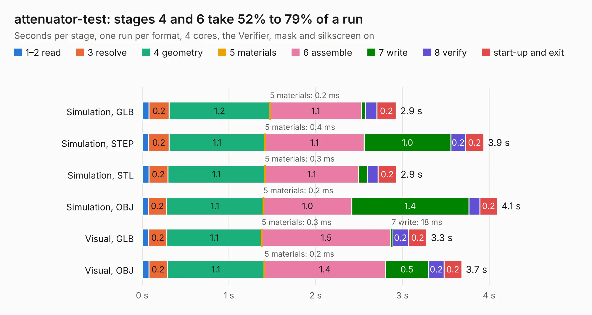

# 464. attenuator-test

Board 464 of the 3,102 of [Corpus Testing](../Corpus-Testing.md), on [Corpus Page 5](../CorpusTestingPages/Corpus-Testing-05.md#464-attenuator-test).

| Mode and format | 1–2 read | 3 resolve | 4 geometry | 5 materials | 6 assemble | 7 write | 8 verify | start-up and exit | Total |
|---|---:|---:|---:|---:|---:|---:|---:|---:|---:|
| Simulation, GLB | 78&nbsp;ms | 0.2 | 1.2 | 0.2&nbsp;ms | 1.1 | 46&nbsp;ms | 0.1 | 0.2 | 2.9 |
| Simulation, STEP | 75&nbsp;ms | 0.2 | 1.1 | 0.4&nbsp;ms | 1.1 | 1.0 | 0.2 | 0.2 | 3.9 |
| Simulation, STL | 77&nbsp;ms | 0.2 | 1.1 | 0.3&nbsp;ms | 1.1 | 0.1 | 0.1 | 0.2 | 2.9 |
| Simulation, OBJ | 72&nbsp;ms | 0.2 | 1.1 | 0.2&nbsp;ms | 1.0 | 1.4 | 0.1 | 0.2 | 4.1 |
| Visual, GLB | 76&nbsp;ms | 0.2 | 1.1 | 0.3&nbsp;ms | 1.5 | 18&nbsp;ms | 0.2 | 0.2 | 3.3 |
| Visual, OBJ | 79&nbsp;ms | 0.2 | 1.1 | 0.2&nbsp;ms | 1.4 | 0.5 | 0.2 | 0.2 | 3.7 |

<table align="center"><tr><td valign="top">

| Board | Repo: [azonenberg/starshipraider](https://github.com/azonenberg/starshipraider) Board: `attenuator-test.kicad_pcb` |
|---|---|
| Folder | boards / probes / attenuator-test |
| Complexity | 185&nbsp;/&nbsp;1000 (size&nbsp;150, features&nbsp;35) |
| KESE&nbsp;features | through vias, filled zones |
| Tested | 9th November 2026 |
| Copper&nbsp;layers | 4 |
| File&nbsp;format | KiCad 5 (20171130) |
| Parts,&nbsp;tracks,&nbsp;vias | 5, 96, 90 |
| Triangles,&nbsp;simulation | 341,232 in 15 parts |
| Verifier | PASS in all six runs |

</td><td valign="top">

<table>
<tr><th>File type</th><th>File size</th><th>Peak memory used</th></tr>
<tr><th colspan="3" align="left">Simulation</th></tr>
<tr><td>GLB</td><td align="right">11&nbsp;MB</td><td align="right">294&nbsp;MB</td></tr>
<tr><td>STEP</td><td align="right">30&nbsp;MB</td><td align="right">310&nbsp;MB</td></tr>
<tr><td>STL</td><td align="right">17&nbsp;MB</td><td align="right">277&nbsp;MB</td></tr>
<tr><td>OBJ</td><td align="right">33&nbsp;MB</td><td align="right">288&nbsp;MB</td></tr>
<tr><th colspan="3" align="left">Visual</th></tr>
<tr><td>GLB</td><td align="right">4.4&nbsp;MB</td><td align="right">211&nbsp;MB</td></tr>
<tr><td>OBJ</td><td align="right">12&nbsp;MB</td><td align="right">214&nbsp;MB</td></tr>
</table>

</td></tr></table>

| Previous | Next |
|:---|---:|
| [463. akl-pt6](b0463b_starshipraider_akl-pt6.md) | [465. bnc-test](b0465b_starshipraider_bnc-test.md) |
