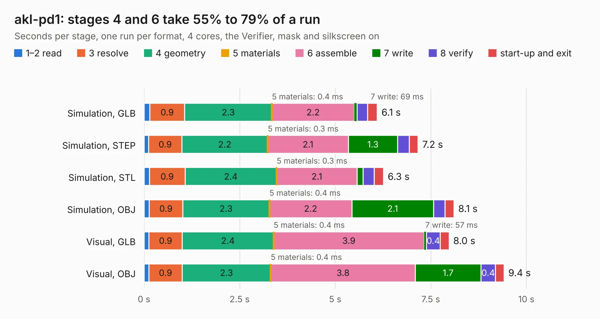

# 465. akl-pd1

Board 465 of the 3,139 of [Corpus Testing](../Corpus-Testing.md), on [Corpus Page 5](../CorpusTestingPages/Corpus-Testing-05.md#465-akl-pd1).

| Mode and format | 1–2 read | 3 resolve | 4 geometry | 5 materials | 6 assemble | 7 write | 8 verify | start-up and exit | Total |
|---|---:|---:|---:|---:|---:|---:|---:|---:|---:|
| Simulation, GLB | 0.1 | 0.9 | 2.3 | 0.4&nbsp;ms | 2.2 | 69&nbsp;ms | 0.3 | 0.3 | 6.1 |
| Simulation, STEP | 0.1 | 0.9 | 2.2 | 0.3&nbsp;ms | 2.1 | 1.3 | 0.3 | 0.2 | 7.2 |
| Simulation, STL | 0.1 | 0.9 | 2.4 | 0.3&nbsp;ms | 2.1 | 0.2 | 0.3 | 0.2 | 6.3 |
| Simulation, OBJ | 0.1 | 0.9 | 2.3 | 0.4&nbsp;ms | 2.2 | 2.1 | 0.3 | 0.2 | 8.1 |
| Visual, GLB | 0.1 | 0.9 | 2.4 | 0.4&nbsp;ms | 3.9 | 57&nbsp;ms | 0.4 | 0.2 | 8.0 |
| Visual, OBJ | 0.1 | 0.9 | 2.3 | 0.4&nbsp;ms | 3.8 | 1.7 | 0.4 | 0.2 | 9.4 |

<table align="center"><tr><td valign="top">

| Board | Repo: [azonenberg/starshipraider](https://github.com/azonenberg/starshipraider) Board: `akl-pd1.kicad_pcb` |
|---|---|
| Folder | boards / probes / akl-pd1 |
| Complexity | 207&nbsp;/&nbsp;1000 (size&nbsp;162, features&nbsp;45) |
| KESE&nbsp;features | through vias, filled zones, curved board outline |
| Tested | 9th November 2026 |
| Copper&nbsp;layers | 2 |
| File&nbsp;format | KiCad 5 (20171130) |
| Parts,&nbsp;tracks,&nbsp;vias | 7, 479, 431 |
| Triangles,&nbsp;simulation | 443,906 in 20 parts |
| Verifier | PASS in all six runs |

</td><td valign="top">

<table>
<tr><th>File type</th><th>File size</th><th>Peak memory used</th></tr>
<tr><th colspan="3" align="left">Simulation</th></tr>
<tr><td>GLB</td><td align="right">15&nbsp;MB</td><td align="right">334&nbsp;MB</td></tr>
<tr><td>STEP</td><td align="right">26&nbsp;MB</td><td align="right">402&nbsp;MB</td></tr>
<tr><td>STL</td><td align="right">22&nbsp;MB</td><td align="right">343&nbsp;MB</td></tr>
<tr><td>OBJ</td><td align="right">43&nbsp;MB</td><td align="right">359&nbsp;MB</td></tr>
<tr><th colspan="3" align="left">Visual</th></tr>
<tr><td>GLB</td><td align="right">12&nbsp;MB</td><td align="right">384&nbsp;MB</td></tr>
<tr><td>OBJ</td><td align="right">35&nbsp;MB</td><td align="right">367&nbsp;MB</td></tr>
</table>

</td></tr></table>

| Previous | Next |
|:---|---:|
| [464. akl-av1](b0464b_starshipraider_akl-av1.md) | [466. compensation](b0466b_starshipraider_compensation.md) |
