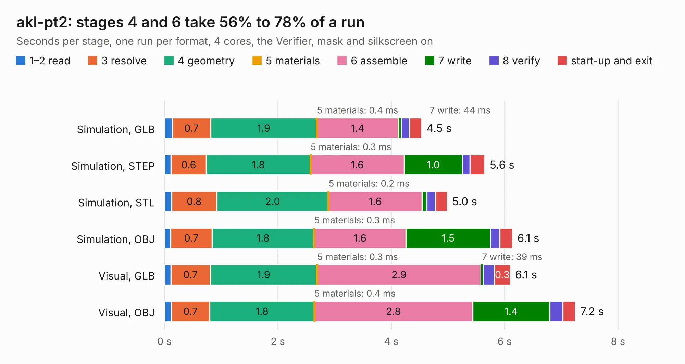

# 469. akl-pt2

Board 469 of the 3,131 of [Corpus Testing](../Corpus-Testing.md), on [Corpus Page 5](../CorpusTestingPages/Corpus-Testing-05.md#469-akl-pt2).

| Mode and format | 1–2 read | 3 resolve | 4 geometry | 5 materials | 6 assemble | 7 write | 8 verify | start-up and exit | Total |
|---|---:|---:|---:|---:|---:|---:|---:|---:|---:|
| Simulation, GLB | 0.1 | 0.7 | 1.9 | 0.4&nbsp;ms | 1.4 | 44&nbsp;ms | 0.1 | 0.2 | 4.5 |
| Simulation, STEP | 0.1 | 0.6 | 1.8 | 0.3&nbsp;ms | 1.6 | 1.0 | 0.1 | 0.3 | 5.6 |
| Simulation, STL | 0.1 | 0.8 | 2.0 | 0.2&nbsp;ms | 1.6 | 85&nbsp;ms | 0.2 | 0.2 | 5.0 |
| Simulation, OBJ | 0.1 | 0.7 | 1.8 | 0.3&nbsp;ms | 1.6 | 1.5 | 0.2 | 0.2 | 6.1 |
| Visual, GLB | 0.1 | 0.7 | 1.9 | 0.3&nbsp;ms | 2.9 | 39&nbsp;ms | 0.2 | 0.3 | 6.1 |
| Visual, OBJ | 0.1 | 0.7 | 1.8 | 0.4&nbsp;ms | 2.8 | 1.4 | 0.2 | 0.2 | 7.2 |

<table align="center"><tr><td valign="top">

| Board | Repo: [azonenberg/starshipraider](https://github.com/azonenberg/starshipraider) Board: `akl-pt2.kicad_pcb` |
|---|---|
| Folder | boards / probes / akl-pt2 |
| Complexity | 195&nbsp;/&nbsp;1000 (size&nbsp;150, features&nbsp;45) |
| KESE&nbsp;features | through vias, filled zones, curved board outline |
| Tested | 9th November 2026 |
| Copper&nbsp;layers | 2 |
| File&nbsp;format | KiCad 5 (20171130) |
| Parts,&nbsp;tracks,&nbsp;vias | 4, 305, 298 |
| Triangles,&nbsp;simulation | 279,582 in 17 parts |
| Verifier | PASS in all six runs |

</td><td valign="top">

<table>
<tr><th>File type</th><th>File size</th><th>Peak memory used</th></tr>
<tr><th colspan="3" align="left">Simulation</th></tr>
<tr><td>GLB</td><td align="right">9.5&nbsp;MB</td><td align="right">265&nbsp;MB</td></tr>
<tr><td>STEP</td><td align="right">12&nbsp;MB</td><td align="right">297&nbsp;MB</td></tr>
<tr><td>STL</td><td align="right">14&nbsp;MB</td><td align="right">265&nbsp;MB</td></tr>
<tr><td>OBJ</td><td align="right">27&nbsp;MB</td><td align="right">261&nbsp;MB</td></tr>
<tr><th colspan="3" align="left">Visual</th></tr>
<tr><td>GLB</td><td align="right">7.4&nbsp;MB</td><td align="right">269&nbsp;MB</td></tr>
<tr><td>OBJ</td><td align="right">22&nbsp;MB</td><td align="right">276&nbsp;MB</td></tr>
</table>

</td></tr></table>

| Previous | Next |
|:---|---:|
| [468. akl-pt1](b0468b_starshipraider_akl-pt1.md) | [470. akl-pt3](b0470b_starshipraider_akl-pt3.md) |
