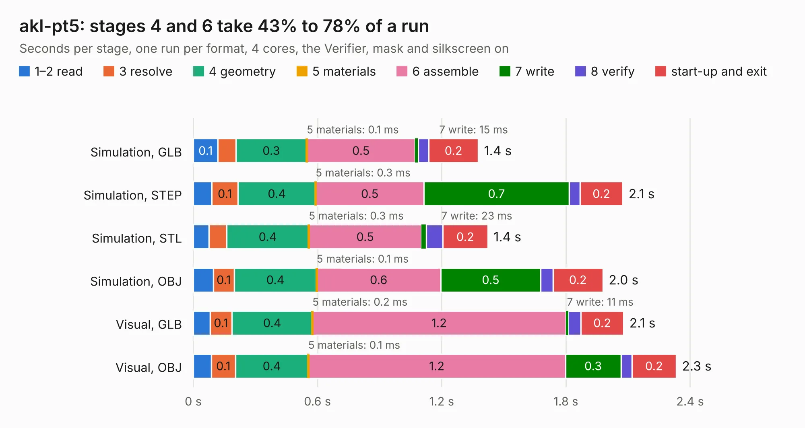

# 470. akl-pt5

Board 470 of the 3,128 of [Corpus Testing](../Corpus-Testing.md), on [Corpus Page 5](../CorpusTestingPages/Corpus-Testing-05.md#470-akl-pt5).

| Mode and format | 1–2 read | 3 resolve | 4 geometry | 5 materials | 6 assemble | 7 write | 8 verify | start-up and exit | Total |
|---|---:|---:|---:|---:|---:|---:|---:|---:|---:|
| Simulation, GLB | 0.1 | 86&nbsp;ms | 0.3 | 0.1&nbsp;ms | 0.5 | 15&nbsp;ms | 50&nbsp;ms | 0.2 | 1.4 |
| Simulation, STEP | 89&nbsp;ms | 0.1 | 0.4 | 0.3&nbsp;ms | 0.5 | 0.7 | 53&nbsp;ms | 0.2 | 2.1 |
| Simulation, STL | 76&nbsp;ms | 86&nbsp;ms | 0.4 | 0.3&nbsp;ms | 0.5 | 23&nbsp;ms | 79&nbsp;ms | 0.2 | 1.4 |
| Simulation, OBJ | 97&nbsp;ms | 0.1 | 0.4 | 0.1&nbsp;ms | 0.6 | 0.5 | 59&nbsp;ms | 0.2 | 2.0 |
| Visual, GLB | 81&nbsp;ms | 0.1 | 0.4 | 0.2&nbsp;ms | 1.2 | 11&nbsp;ms | 61&nbsp;ms | 0.2 | 2.1 |
| Visual, OBJ | 87&nbsp;ms | 0.1 | 0.4 | 0.1&nbsp;ms | 1.2 | 0.3 | 53&nbsp;ms | 0.2 | 2.3 |

<table align="center"><tr><td valign="top">

| Board | Repo: [azonenberg/starshipraider](https://github.com/azonenberg/starshipraider) Board: `akl-pt5.kicad_pcb` |
|---|---|
| Folder | boards / probes / akl-pt5 |
| Complexity | 207&nbsp;/&nbsp;1000 (size&nbsp;112, features&nbsp;95) |
| KESE&nbsp;features | through vias, custom pads, filled zones, copper drawings, stack-up, dielectric εr and tanδ, mask and silkscreen colours |
| Tested | 9th November 2026 |
| Copper&nbsp;layers | 4 |
| File&nbsp;format | KiCad 6 (20211014) |
| Parts,&nbsp;tracks,&nbsp;vias | 1, 20, 18 |
| Triangles,&nbsp;simulation | 81,990 in 18 parts |
| Verifier | PASS in all six runs |

</td><td valign="top">

<table>
<tr><th>File type</th><th>File size</th><th>Peak memory used</th></tr>
<tr><th colspan="3" align="left">Simulation</th></tr>
<tr><td>GLB</td><td align="right">2.8&nbsp;MB</td><td align="right">175&nbsp;MB</td></tr>
<tr><td>STEP</td><td align="right">9.1&nbsp;MB</td><td align="right">180&nbsp;MB</td></tr>
<tr><td>STL</td><td align="right">4.1&nbsp;MB</td><td align="right">173&nbsp;MB</td></tr>
<tr><td>OBJ</td><td align="right">7.8&nbsp;MB</td><td align="right">181&nbsp;MB</td></tr>
<tr><th colspan="3" align="left">Visual</th></tr>
<tr><td>GLB</td><td align="right">1.6&nbsp;MB</td><td align="right">156&nbsp;MB</td></tr>
<tr><td>OBJ</td><td align="right">4.5&nbsp;MB</td><td align="right">156&nbsp;MB</td></tr>
</table>

</td></tr></table>

| Previous | Next |
|:---|---:|
| [469. akl-pt3](b0469b_starshipraider_akl-pt3.md) | [471. akl-pt6](b0471b_starshipraider_akl-pt6.md) |
