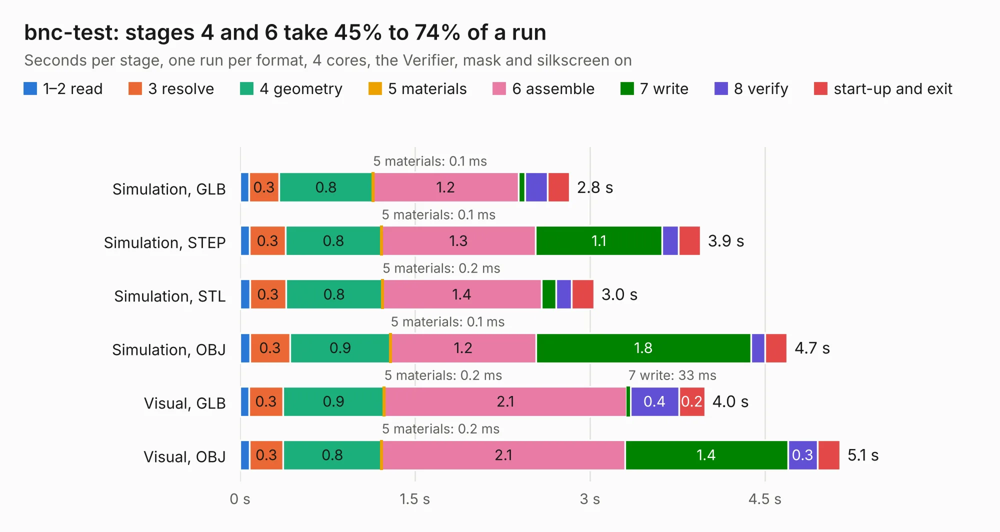

# 470. bnc-test

Board 470 of the 3,116 of [Corpus Testing](../Corpus-Testing.md), on [Corpus Page 5](../CorpusTestingPages/Corpus-Testing-05.md#470-bnc-test).

| Mode and format | 1–2 read | 3 resolve | 4 geometry | 5 materials | 6 assemble | 7 write | 8 verify | start-up and exit | Total |
|---|---:|---:|---:|---:|---:|---:|---:|---:|---:|
| Simulation, GLB | 75&nbsp;ms | 0.3 | 0.8 | 0.1&nbsp;ms | 1.2 | 55&nbsp;ms | 0.2 | 0.2 | 2.8 |
| Simulation, STEP | 83&nbsp;ms | 0.3 | 0.8 | 0.1&nbsp;ms | 1.3 | 1.1 | 0.1 | 0.2 | 3.9 |
| Simulation, STL | 86&nbsp;ms | 0.3 | 0.8 | 0.2&nbsp;ms | 1.4 | 0.1 | 0.1 | 0.2 | 3.0 |
| Simulation, OBJ | 85&nbsp;ms | 0.3 | 0.9 | 0.1&nbsp;ms | 1.2 | 1.8 | 0.1 | 0.2 | 4.7 |
| Visual, GLB | 76&nbsp;ms | 0.3 | 0.9 | 0.2&nbsp;ms | 2.1 | 33&nbsp;ms | 0.4 | 0.2 | 4.0 |
| Visual, OBJ | 83&nbsp;ms | 0.3 | 0.8 | 0.2&nbsp;ms | 2.1 | 1.4 | 0.3 | 0.2 | 5.1 |

<table align="center"><tr><td valign="top">

| Board | Repo: [azonenberg/starshipraider](https://github.com/azonenberg/starshipraider) Board: `bnc-test.kicad_pcb` |
|---|---|
| Folder | boards / probes / bnc-test |
| Complexity | 178&nbsp;/&nbsp;1000 (size&nbsp;143, features&nbsp;35) |
| KESE&nbsp;features | through vias, filled zones |
| Tested | 9th November 2026 |
| Copper&nbsp;layers | 4 |
| File&nbsp;format | KiCad 5 (20171130) |
| Parts,&nbsp;tracks,&nbsp;vias | 2, 116, 94 |
| Triangles,&nbsp;simulation | 350,408 in 14 parts |
| Verifier | PASS in all six runs |

</td><td valign="top">

<table>
<tr><th>File type</th><th>File size</th><th>Peak memory used</th></tr>
<tr><th colspan="3" align="left">Simulation</th></tr>
<tr><td>GLB</td><td align="right">11&nbsp;MB</td><td align="right">294&nbsp;MB</td></tr>
<tr><td>STEP</td><td align="right">34&nbsp;MB</td><td align="right">316&nbsp;MB</td></tr>
<tr><td>STL</td><td align="right">18&nbsp;MB</td><td align="right">263&nbsp;MB</td></tr>
<tr><td>OBJ</td><td align="right">34&nbsp;MB</td><td align="right">283&nbsp;MB</td></tr>
<tr><th colspan="3" align="left">Visual</th></tr>
<tr><td>GLB</td><td align="right">8.1&nbsp;MB</td><td align="right">271&nbsp;MB</td></tr>
<tr><td>OBJ</td><td align="right">24&nbsp;MB</td><td align="right">272&nbsp;MB</td></tr>
</table>

</td></tr></table>

| Previous | Next |
|:---|---:|
| [469. attenuator-test](b0469b_starshipraider_attenuator-test.md) | [471. fixture-akl-pt2](b0471b_starshipraider_fixture-akl-pt2.md) |
