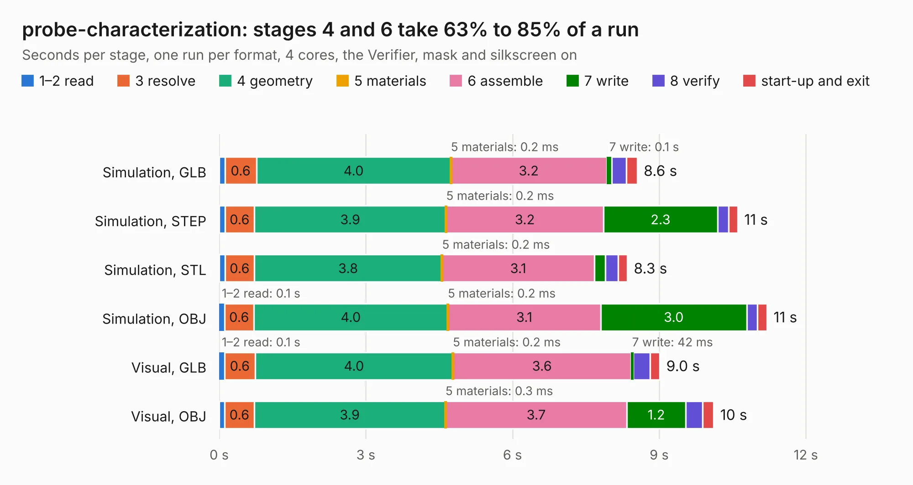

# 470. probe-characterization

Board 470 of the 3,102 of [Corpus Testing](../Corpus-Testing.md), on [Corpus Page 5](../CorpusTestingPages/Corpus-Testing-05.md#470-probe-characterization).

| Mode and format | 1–2 read | 3 resolve | 4 geometry | 5 materials | 6 assemble | 7 write | 8 verify | start-up and exit | Total |
|---|---:|---:|---:|---:|---:|---:|---:|---:|---:|
| Simulation, GLB | 0.1 | 0.6 | 4.0 | 0.2&nbsp;ms | 3.2 | 0.1 | 0.3 | 0.2 | 8.6 |
| Simulation, STEP | 0.1 | 0.6 | 3.9 | 0.2&nbsp;ms | 3.2 | 2.3 | 0.2 | 0.2 | 10.6 |
| Simulation, STL | 0.1 | 0.6 | 3.8 | 0.2&nbsp;ms | 3.1 | 0.2 | 0.3 | 0.2 | 8.3 |
| Simulation, OBJ | 0.1 | 0.6 | 4.0 | 0.2&nbsp;ms | 3.1 | 3.0 | 0.2 | 0.2 | 11.2 |
| Visual, GLB | 0.1 | 0.6 | 4.0 | 0.2&nbsp;ms | 3.6 | 42&nbsp;ms | 0.3 | 0.2 | 9.0 |
| Visual, OBJ | 0.1 | 0.6 | 3.9 | 0.3&nbsp;ms | 3.7 | 1.2 | 0.3 | 0.2 | 10.1 |

<table align="center"><tr><td valign="top">

| Board | Repo: [azonenberg/starshipraider](https://github.com/azonenberg/starshipraider) Board: `probe-characterization.kicad_pcb` |
|---|---|
| Folder | boards / probes / probe-characterization |
| Complexity | 203&nbsp;/&nbsp;1000 (size&nbsp;168, features&nbsp;35) |
| KESE&nbsp;features | through vias, filled zones |
| Tested | 9th November 2026 |
| Copper&nbsp;layers | 2 |
| File&nbsp;format | KiCad 5 (20171130) |
| Parts,&nbsp;tracks,&nbsp;vias | 15, 552, 350 |
| Triangles,&nbsp;simulation | 752,014 in 15 parts |
| Verifier | PASS in all six runs |

</td><td valign="top">

<table>
<tr><th>File type</th><th>File size</th><th>Peak memory used</th></tr>
<tr><th colspan="3" align="left">Simulation</th></tr>
<tr><td>GLB</td><td align="right">26&nbsp;MB</td><td align="right">401&nbsp;MB</td></tr>
<tr><td>STEP</td><td align="right">78&nbsp;MB</td><td align="right">512&nbsp;MB</td></tr>
<tr><td>STL</td><td align="right">38&nbsp;MB</td><td align="right">403&nbsp;MB</td></tr>
<tr><td>OBJ</td><td align="right">75&nbsp;MB</td><td align="right">537&nbsp;MB</td></tr>
<tr><th colspan="3" align="left">Visual</th></tr>
<tr><td>GLB</td><td align="right">10&nbsp;MB</td><td align="right">411&nbsp;MB</td></tr>
<tr><td>OBJ</td><td align="right">30&nbsp;MB</td><td align="right">408&nbsp;MB</td></tr>
</table>

</td></tr></table>

| Previous | Next |
|:---|---:|
| [469. sma-test](b0469b_starshipraider_boards-probes-oshpark-sma-test-sma-test_sma-test.md) | [471. resistor-carrier](b0471b_starshipraider_resistor-carrier.md) |
