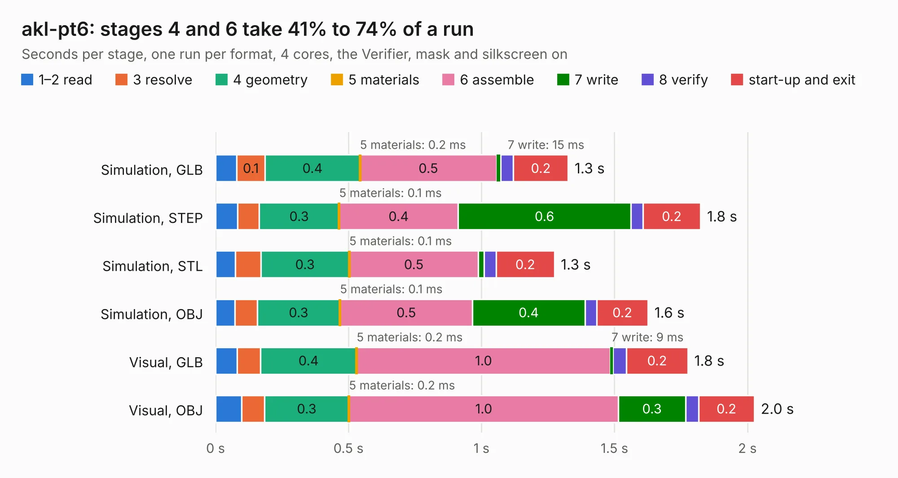

# 471. akl-pt6

Board 471 of the 3,125 of [Corpus Testing](../Corpus-Testing.md), on [Corpus Page 5](../CorpusTestingPages/Corpus-Testing-05.md#471-akl-pt6).

| Mode and format | 1–2 read | 3 resolve | 4 geometry | 5 materials | 6 assemble | 7 write | 8 verify | start-up and exit | Total |
|---|---:|---:|---:|---:|---:|---:|---:|---:|---:|
| Simulation, GLB | 79&nbsp;ms | 0.1 | 0.4 | 0.2&nbsp;ms | 0.5 | 15&nbsp;ms | 47&nbsp;ms | 0.2 | 1.3 |
| Simulation, STEP | 83&nbsp;ms | 81&nbsp;ms | 0.3 | 0.1&nbsp;ms | 0.4 | 0.6 | 45&nbsp;ms | 0.2 | 1.8 |
| Simulation, STL | 74&nbsp;ms | 96&nbsp;ms | 0.3 | 0.1&nbsp;ms | 0.5 | 22&nbsp;ms | 45&nbsp;ms | 0.2 | 1.3 |
| Simulation, OBJ | 72&nbsp;ms | 85&nbsp;ms | 0.3 | 0.1&nbsp;ms | 0.5 | 0.4 | 45&nbsp;ms | 0.2 | 1.6 |
| Visual, GLB | 81&nbsp;ms | 88&nbsp;ms | 0.4 | 0.2&nbsp;ms | 1.0 | 9&nbsp;ms | 51&nbsp;ms | 0.2 | 1.8 |
| Visual, OBJ | 99&nbsp;ms | 85&nbsp;ms | 0.3 | 0.2&nbsp;ms | 1.0 | 0.3 | 49&nbsp;ms | 0.2 | 2.0 |

<table align="center"><tr><td valign="top">

| Board | Repo: [azonenberg/starshipraider](https://github.com/azonenberg/starshipraider) Board: `akl-pt6.kicad_pcb` |
|---|---|
| Folder | boards / probes / akl-pt6 |
| Complexity | 214&nbsp;/&nbsp;1000 (size&nbsp;119, features&nbsp;95) |
| KESE&nbsp;features | through vias, custom pads, filled zones, copper drawings, stack-up, dielectric εr and tanδ, mask and silkscreen colours |
| Tested | 9th November 2026 |
| Copper&nbsp;layers | 4 |
| File&nbsp;format | KiCad 6 (20211014) |
| Parts,&nbsp;tracks,&nbsp;vias | 3, 17, 19 |
| Triangles,&nbsp;simulation | 81,620 in 19 parts |
| Verifier | PASS in all six runs |

</td><td valign="top">

<table>
<tr><th>File type</th><th>File size</th><th>Peak memory used</th></tr>
<tr><th colspan="3" align="left">Simulation</th></tr>
<tr><td>GLB</td><td align="right">2.7&nbsp;MB</td><td align="right">178&nbsp;MB</td></tr>
<tr><td>STEP</td><td align="right">8.1&nbsp;MB</td><td align="right">179&nbsp;MB</td></tr>
<tr><td>STL</td><td align="right">4.1&nbsp;MB</td><td align="right">176&nbsp;MB</td></tr>
<tr><td>OBJ</td><td align="right">7.7&nbsp;MB</td><td align="right">177&nbsp;MB</td></tr>
<tr><th colspan="3" align="left">Visual</th></tr>
<tr><td>GLB</td><td align="right">1.5&nbsp;MB</td><td align="right">153&nbsp;MB</td></tr>
<tr><td>OBJ</td><td align="right">4.1&nbsp;MB</td><td align="right">153&nbsp;MB</td></tr>
</table>

</td></tr></table>

| Previous | Next |
|:---|---:|
| [470. akl-pt5](b0470b_starshipraider_akl-pt5.md) | [472. attenuator-test](b0472b_starshipraider_attenuator-test.md) |
