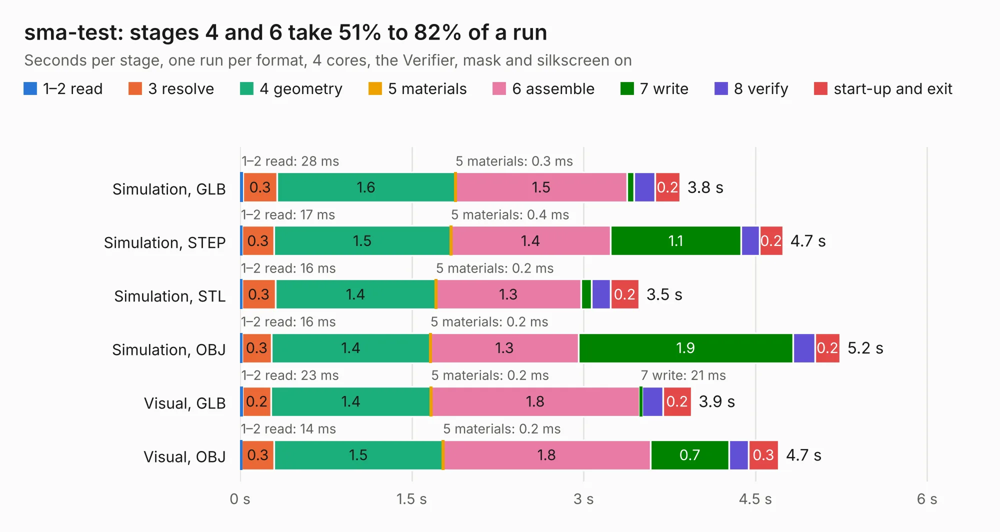

# 472. sma-test

Board 472 of the 3,112 of [Corpus Testing](../Corpus-Testing.md), on [Corpus Page 5](../CorpusTestingPages/Corpus-Testing-05.md#472-sma-test).

| Mode and format | 1–2 read | 3 resolve | 4 geometry | 5 materials | 6 assemble | 7 write | 8 verify | start-up and exit | Total |
|---|---:|---:|---:|---:|---:|---:|---:|---:|---:|
| Simulation, GLB | 28&nbsp;ms | 0.3 | 1.6 | 0.3&nbsp;ms | 1.5 | 62&nbsp;ms | 0.2 | 0.2 | 3.8 |
| Simulation, STEP | 17&nbsp;ms | 0.3 | 1.5 | 0.4&nbsp;ms | 1.4 | 1.1 | 0.2 | 0.2 | 4.7 |
| Simulation, STL | 16&nbsp;ms | 0.3 | 1.4 | 0.2&nbsp;ms | 1.3 | 93&nbsp;ms | 0.2 | 0.2 | 3.5 |
| Simulation, OBJ | 16&nbsp;ms | 0.3 | 1.4 | 0.2&nbsp;ms | 1.3 | 1.9 | 0.2 | 0.2 | 5.2 |
| Visual, GLB | 23&nbsp;ms | 0.2 | 1.4 | 0.2&nbsp;ms | 1.8 | 21&nbsp;ms | 0.2 | 0.2 | 3.9 |
| Visual, OBJ | 14&nbsp;ms | 0.3 | 1.5 | 0.2&nbsp;ms | 1.8 | 0.7 | 0.2 | 0.3 | 4.7 |

<table align="center"><tr><td valign="top">

| Board | Repo: [azonenberg/starshipraider](https://github.com/azonenberg/starshipraider) Board: `sma-test.kicad_pcb` |
|---|---|
| Folder | boards / probes / oshpark-sma-test / sma-test |
| Complexity | 177&nbsp;/&nbsp;1000 (size&nbsp;142, features&nbsp;35) |
| KESE&nbsp;features | through vias, filled zones |
| Tested | 9th November 2026 |
| Copper&nbsp;layers | 4 |
| File&nbsp;format | KiCad 5 (20171130) |
| Parts,&nbsp;tracks,&nbsp;vias | 2, 93, 91 |
| Triangles,&nbsp;simulation | 329,496 in 11 parts |
| Verifier | PASS in all six runs |

</td><td valign="top">

<table>
<tr><th>File type</th><th>File size</th><th>Peak memory used</th></tr>
<tr><th colspan="3" align="left">Simulation</th></tr>
<tr><td>GLB</td><td align="right">11&nbsp;MB</td><td align="right">237&nbsp;MB</td></tr>
<tr><td>STEP</td><td align="right">28&nbsp;MB</td><td align="right">277&nbsp;MB</td></tr>
<tr><td>STL</td><td align="right">16&nbsp;MB</td><td align="right">249&nbsp;MB</td></tr>
<tr><td>OBJ</td><td align="right">32&nbsp;MB</td><td align="right">248&nbsp;MB</td></tr>
<tr><th colspan="3" align="left">Visual</th></tr>
<tr><td>GLB</td><td align="right">4.0&nbsp;MB</td><td align="right">166&nbsp;MB</td></tr>
<tr><td>OBJ</td><td align="right">11&nbsp;MB</td><td align="right">176&nbsp;MB</td></tr>
</table>

</td></tr></table>

| Previous | Next |
|:---|---:|
| [471. la-pod-mmcx](b0471b_starshipraider_la-pod-mmcx.md) | [473. probe-characterization](b0473b_starshipraider_probe-characterization.md) |
