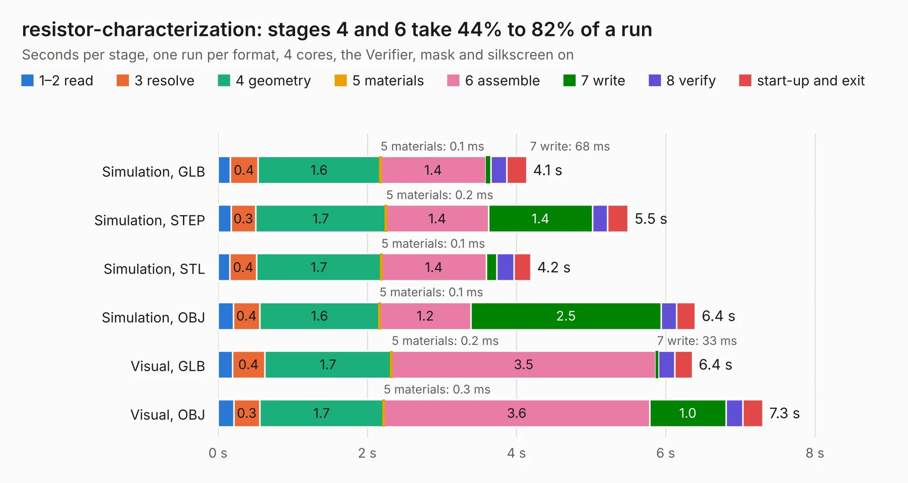

# 472. resistor-characterization

Board 472 of the 3,101 of [Corpus Testing](../Corpus-Testing.md), on [Corpus Page 5](../CorpusTestingPages/Corpus-Testing-05.md#472-resistor-characterization).

| Mode and format | 1–2 read | 3 resolve | 4 geometry | 5 materials | 6 assemble | 7 write | 8 verify | start-up and exit | Total |
|---|---:|---:|---:|---:|---:|---:|---:|---:|---:|
| Simulation, GLB | 0.2 | 0.4 | 1.6 | 0.1&nbsp;ms | 1.4 | 68&nbsp;ms | 0.2 | 0.3 | 4.1 |
| Simulation, STEP | 0.2 | 0.3 | 1.7 | 0.2&nbsp;ms | 1.4 | 1.4 | 0.2 | 0.3 | 5.5 |
| Simulation, STL | 0.2 | 0.4 | 1.7 | 0.1&nbsp;ms | 1.4 | 0.1 | 0.2 | 0.2 | 4.2 |
| Simulation, OBJ | 0.2 | 0.4 | 1.6 | 0.1&nbsp;ms | 1.2 | 2.5 | 0.2 | 0.3 | 6.4 |
| Visual, GLB | 0.2 | 0.4 | 1.7 | 0.2&nbsp;ms | 3.5 | 33&nbsp;ms | 0.2 | 0.2 | 6.4 |
| Visual, OBJ | 0.2 | 0.3 | 1.7 | 0.3&nbsp;ms | 3.6 | 1.0 | 0.2 | 0.3 | 7.3 |

<table align="center"><tr><td valign="top">

| Board | Repo: [azonenberg/starshipraider](https://github.com/azonenberg/starshipraider) Board: `resistor-characterization.kicad_pcb` |
|---|---|
| Folder | boards / probes / resistor-characterization |
| Complexity | 229&nbsp;/&nbsp;1000 (size&nbsp;144, features&nbsp;85) |
| KESE&nbsp;features | through vias, filled zones, stack-up, dielectric εr and tanδ, copper finish, mask and silkscreen colours |
| Tested | 9th November 2026 |
| Copper&nbsp;layers | 4 |
| File&nbsp;format | KiCad 6 (20211014) |
| Parts,&nbsp;tracks,&nbsp;vias | 4, 41, 84 |
| Triangles,&nbsp;simulation | 379,086 in 18 parts |
| Verifier | PASS in all six runs |

</td><td valign="top">

<table>
<tr><th>File type</th><th>File size</th><th>Peak memory used</th></tr>
<tr><th colspan="3" align="left">Simulation</th></tr>
<tr><td>GLB</td><td align="right">12&nbsp;MB</td><td align="right">253&nbsp;MB</td></tr>
<tr><td>STEP</td><td align="right">38&nbsp;MB</td><td align="right">284&nbsp;MB</td></tr>
<tr><td>STL</td><td align="right">19&nbsp;MB</td><td align="right">253&nbsp;MB</td></tr>
<tr><td>OBJ</td><td align="right">37&nbsp;MB</td><td align="right">297&nbsp;MB</td></tr>
<tr><th colspan="3" align="left">Visual</th></tr>
<tr><td>GLB</td><td align="right">6.2&nbsp;MB</td><td align="right">267&nbsp;MB</td></tr>
<tr><td>OBJ</td><td align="right">18&nbsp;MB</td><td align="right">247&nbsp;MB</td></tr>
</table>

</td></tr></table>

| Previous | Next |
|:---|---:|
| [471. resistor-carrier](b0471b_starshipraider_resistor-carrier.md) | [473. sma-test](b0473b_starshipraider_boards-probes-sma-test_sma-test.md) |
