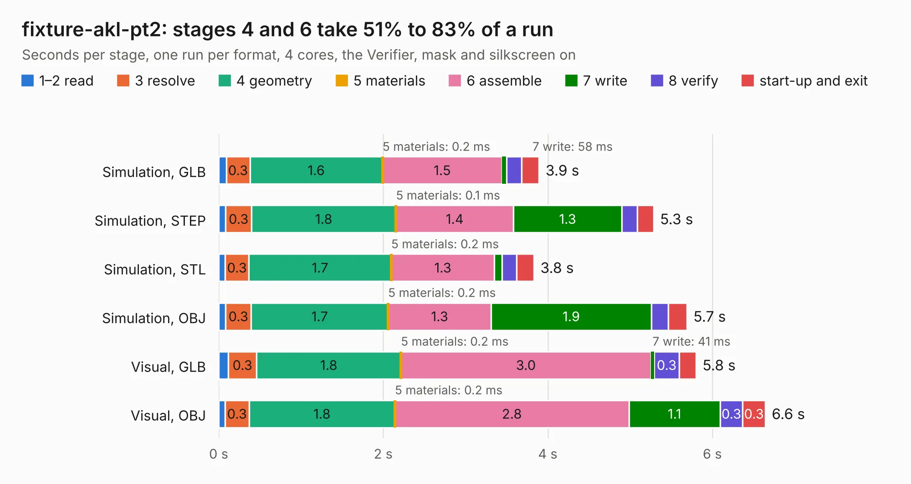

# 474. fixture-akl-pt2

Board 474 of the 3,127 of [Corpus Testing](../Corpus-Testing.md), on [Corpus Page 5](../CorpusTestingPages/Corpus-Testing-05.md#474-fixture-akl-pt2).

| Mode and format | 1–2 read | 3 resolve | 4 geometry | 5 materials | 6 assemble | 7 write | 8 verify | start-up and exit | Total |
|---|---:|---:|---:|---:|---:|---:|---:|---:|---:|
| Simulation, GLB | 92&nbsp;ms | 0.3 | 1.6 | 0.2&nbsp;ms | 1.5 | 58&nbsp;ms | 0.2 | 0.2 | 3.9 |
| Simulation, STEP | 85&nbsp;ms | 0.3 | 1.8 | 0.1&nbsp;ms | 1.4 | 1.3 | 0.2 | 0.2 | 5.3 |
| Simulation, STL | 80&nbsp;ms | 0.3 | 1.7 | 0.2&nbsp;ms | 1.3 | 94&nbsp;ms | 0.2 | 0.2 | 3.8 |
| Simulation, OBJ | 84&nbsp;ms | 0.3 | 1.7 | 0.2&nbsp;ms | 1.3 | 1.9 | 0.2 | 0.2 | 5.7 |
| Visual, GLB | 0.1 | 0.3 | 1.8 | 0.2&nbsp;ms | 3.0 | 41&nbsp;ms | 0.3 | 0.2 | 5.8 |
| Visual, OBJ | 77&nbsp;ms | 0.3 | 1.8 | 0.2&nbsp;ms | 2.8 | 1.1 | 0.3 | 0.3 | 6.6 |

<table align="center"><tr><td valign="top">

| Board | Repo: [azonenberg/starshipraider](https://github.com/azonenberg/starshipraider) Board: `fixture-akl-pt2.kicad_pcb` |
|---|---|
| Folder | boards / probes / fixture-akl-pt2 |
| Complexity | 184&nbsp;/&nbsp;1000 (size&nbsp;149, features&nbsp;35) |
| KESE&nbsp;features | through vias, filled zones |
| Tested | 9th November 2026 |
| Copper&nbsp;layers | 4 |
| File&nbsp;format | KiCad 5 (20171130) |
| Parts,&nbsp;tracks,&nbsp;vias | 3, 128, 115 |
| Triangles,&nbsp;simulation | 404,734 in 15 parts |
| Verifier | PASS in all six runs |

</td><td valign="top">

<table>
<tr><th>File type</th><th>File size</th><th>Peak memory used</th></tr>
<tr><th colspan="3" align="left">Simulation</th></tr>
<tr><td>GLB</td><td align="right">13&nbsp;MB</td><td align="right">287&nbsp;MB</td></tr>
<tr><td>STEP</td><td align="right">38&nbsp;MB</td><td align="right">340&nbsp;MB</td></tr>
<tr><td>STL</td><td align="right">20&nbsp;MB</td><td align="right">299&nbsp;MB</td></tr>
<tr><td>OBJ</td><td align="right">39&nbsp;MB</td><td align="right">318&nbsp;MB</td></tr>
<tr><th colspan="3" align="left">Visual</th></tr>
<tr><td>GLB</td><td align="right">6.9&nbsp;MB</td><td align="right">273&nbsp;MB</td></tr>
<tr><td>OBJ</td><td align="right">20&nbsp;MB</td><td align="right">277&nbsp;MB</td></tr>
</table>

</td></tr></table>

| Previous | Next |
|:---|---:|
| [473. bnc-test](b0473b_starshipraider_bnc-test.md) | [475. integralstick-mead](b0475b_starshipraider_integralstick-mead.md) |
