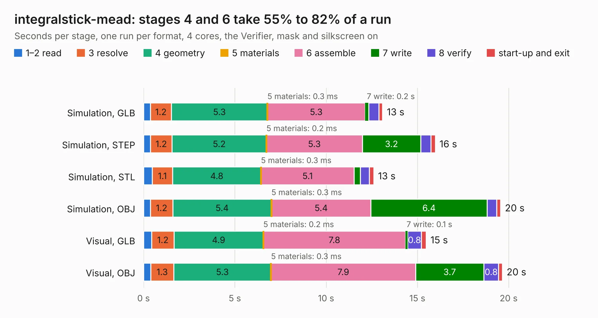

# 476. integralstick-mead

Board 476 of the 3,131 of [Corpus Testing](../Corpus-Testing.md), on [Corpus Page 5](../CorpusTestingPages/Corpus-Testing-05.md#476-integralstick-mead).

| Mode and format | 1–2 read | 3 resolve | 4 geometry | 5 materials | 6 assemble | 7 write | 8 verify | start-up and exit | Total |
|---|---:|---:|---:|---:|---:|---:|---:|---:|---:|
| Simulation, GLB | 0.4 | 1.2 | 5.3 | 0.3&nbsp;ms | 5.3 | 0.2 | 0.6 | 0.2 | 13.1 |
| Simulation, STEP | 0.4 | 1.2 | 5.2 | 0.2&nbsp;ms | 5.3 | 3.2 | 0.6 | 0.2 | 16.0 |
| Simulation, STL | 0.5 | 1.1 | 4.8 | 0.3&nbsp;ms | 5.1 | 0.3 | 0.5 | 0.2 | 12.6 |
| Simulation, OBJ | 0.4 | 1.2 | 5.4 | 0.3&nbsp;ms | 5.4 | 6.4 | 0.5 | 0.2 | 19.6 |
| Visual, GLB | 0.5 | 1.2 | 4.9 | 0.2&nbsp;ms | 7.8 | 0.1 | 0.8 | 0.3 | 15.5 |
| Visual, OBJ | 0.4 | 1.3 | 5.3 | 0.3&nbsp;ms | 7.9 | 3.7 | 0.8 | 0.2 | 19.7 |

<table align="center"><tr><td valign="top">

| Board | Repo: [azonenberg/starshipraider](https://github.com/azonenberg/starshipraider) Board: `integralstick-mead.kicad_pcb` |
|---|---|
| Folder | boards / probes / integralstick-mead |
| Complexity | 244&nbsp;/&nbsp;1000 (size&nbsp;199, features&nbsp;45) |
| KESE&nbsp;features | through vias, rounded, trapezoid or chamfered pads, filled zones |
| Tested | 9th November 2026 |
| Copper&nbsp;layers | 4 |
| File&nbsp;format | KiCad 5 (20171130) |
| Parts,&nbsp;tracks,&nbsp;vias | 15, 3,442, 152 |
| Triangles,&nbsp;simulation | 1,189,638 in 45 parts |
| Verifier | PASS in all six runs |

</td><td valign="top">

<table>
<tr><th>File type</th><th>File size</th><th>Peak memory used</th></tr>
<tr><th colspan="3" align="left">Simulation</th></tr>
<tr><td>GLB</td><td align="right">41&nbsp;MB</td><td align="right">453&nbsp;MB</td></tr>
<tr><td>STEP</td><td align="right">199&nbsp;MB</td><td align="right">592&nbsp;MB</td></tr>
<tr><td>STL</td><td align="right">59&nbsp;MB</td><td align="right">453&nbsp;MB</td></tr>
<tr><td>OBJ</td><td align="right">123&nbsp;MB</td><td align="right">853&nbsp;MB</td></tr>
<tr><th colspan="3" align="left">Visual</th></tr>
<tr><td>GLB</td><td align="right">23&nbsp;MB</td><td align="right">569&nbsp;MB</td></tr>
<tr><td>OBJ</td><td align="right">70&nbsp;MB</td><td align="right">564&nbsp;MB</td></tr>
</table>

</td></tr></table>

| Previous | Next |
|:---|---:|
| [475. fixture-akl-pt2](b0475b_starshipraider_fixture-akl-pt2.md) | [477. la-pod-mmcx](b0477b_starshipraider_la-pod-mmcx.md) |
