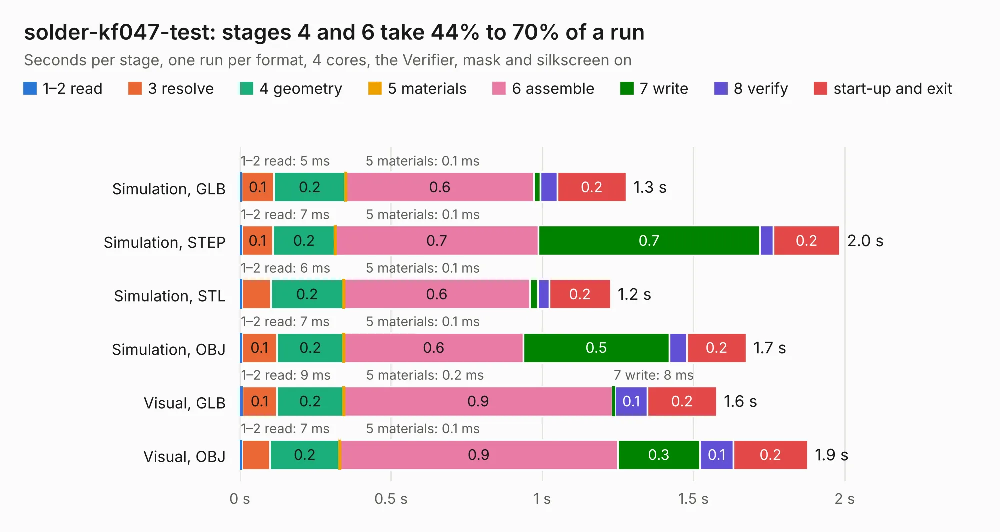

# 477. solder-kf047-test

Board 477 of the 3,107 of [Corpus Testing](../Corpus-Testing.md), on [Corpus Page 5](../CorpusTestingPages/Corpus-Testing-05.md#477-solder-kf047-test).

| Mode and format | 1–2 read | 3 resolve | 4 geometry | 5 materials | 6 assemble | 7 write | 8 verify | start-up and exit | Total |
|---|---:|---:|---:|---:|---:|---:|---:|---:|---:|
| Simulation, GLB | 5&nbsp;ms | 0.1 | 0.2 | 0.1&nbsp;ms | 0.6 | 21&nbsp;ms | 55&nbsp;ms | 0.2 | 1.3 |
| Simulation, STEP | 7&nbsp;ms | 0.1 | 0.2 | 0.1&nbsp;ms | 0.7 | 0.7 | 45&nbsp;ms | 0.2 | 2.0 |
| Simulation, STL | 6&nbsp;ms | 96&nbsp;ms | 0.2 | 0.1&nbsp;ms | 0.6 | 26&nbsp;ms | 38&nbsp;ms | 0.2 | 1.2 |
| Simulation, OBJ | 7&nbsp;ms | 0.1 | 0.2 | 0.1&nbsp;ms | 0.6 | 0.5 | 58&nbsp;ms | 0.2 | 1.7 |
| Visual, GLB | 9&nbsp;ms | 0.1 | 0.2 | 0.2&nbsp;ms | 0.9 | 8&nbsp;ms | 0.1 | 0.2 | 1.6 |
| Visual, OBJ | 7&nbsp;ms | 93&nbsp;ms | 0.2 | 0.1&nbsp;ms | 0.9 | 0.3 | 0.1 | 0.2 | 1.9 |

<table align="center"><tr><td valign="top">

| Board | Repo: [azonenberg/starshipraider](https://github.com/azonenberg/starshipraider) Board: `solder-kf047-test.kicad_pcb` |
|---|---|
| Folder | boards / probes / solder-kf047-test |
| Complexity | 188&nbsp;/&nbsp;1000 (size&nbsp;118, features&nbsp;70) |
| KESE&nbsp;features | through vias, filled zones, stack-up, dielectric εr and tanδ, mask and silkscreen colours |
| Tested | 9th November 2026 |
| Copper&nbsp;layers | 4 |
| File&nbsp;format | KiCad 8 (20240108) |
| Parts,&nbsp;tracks,&nbsp;vias | 1, 3, 35 |
| Triangles,&nbsp;simulation | 96,710 in 12 parts |
| Verifier | PASS in all six runs |

</td><td valign="top">

<table>
<tr><th>File type</th><th>File size</th><th>Peak memory used</th></tr>
<tr><th colspan="3" align="left">Simulation</th></tr>
<tr><td>GLB</td><td align="right">3.1&nbsp;MB</td><td align="right">166&nbsp;MB</td></tr>
<tr><td>STEP</td><td align="right">6.5&nbsp;MB</td><td align="right">167&nbsp;MB</td></tr>
<tr><td>STL</td><td align="right">4.8&nbsp;MB</td><td align="right">166&nbsp;MB</td></tr>
<tr><td>OBJ</td><td align="right">8.9&nbsp;MB</td><td align="right">166&nbsp;MB</td></tr>
<tr><th colspan="3" align="left">Visual</th></tr>
<tr><td>GLB</td><td align="right">1.6&nbsp;MB</td><td align="right">131&nbsp;MB</td></tr>
<tr><td>OBJ</td><td align="right">4.3&nbsp;MB</td><td align="right">131&nbsp;MB</td></tr>
</table>

</td></tr></table>

| Previous | Next |
|:---|---:|
| [476. smpm-test](b0476b_starshipraider_smpm-test.md) | [478. tip-holder-base](b0478b_starshipraider_tip-holder-base.md) |
