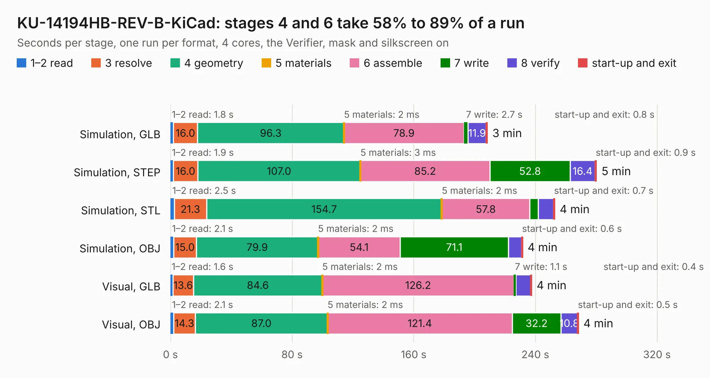

# 480. KU-14194HB-REV-B-KiCad

Board 480 of the 3,100 of [Corpus Testing](../Corpus-Testing.md), on [Corpus Page 5](../CorpusTestingPages/Corpus-Testing-05.md#480-ku-14194hb-rev-b-kicad).

| Mode and format | 1–2 read | 3 resolve | 4 geometry | 5 materials | 6 assemble | 7 write | 8 verify | start-up and exit | Total |
|---|---:|---:|---:|---:|---:|---:|---:|---:|---:|
| Simulation, GLB | 1.8 | 16.0 | 96.3 | 2&nbsp;ms | 78.9 | 2.7 | 11.9 | 0.8 | 208.4 |
| Simulation, STEP | 1.9 | 16.0 | 107.0 | 3&nbsp;ms | 85.2 | 52.8 | 16.4 | 0.9 | 280.2 |
| Simulation, STL | 2.5 | 21.3 | 154.7 | 2&nbsp;ms | 57.8 | 5.7 | 10.0 | 0.7 | 252.7 |
| Simulation, OBJ | 2.1 | 15.0 | 79.9 | 2&nbsp;ms | 54.1 | 71.1 | 8.8 | 0.6 | 231.6 |
| Visual, GLB | 1.6 | 13.6 | 84.6 | 2&nbsp;ms | 126.2 | 1.1 | 10.0 | 0.4 | 237.5 |
| Visual, OBJ | 2.1 | 14.3 | 87.0 | 2&nbsp;ms | 121.4 | 32.2 | 10.8 | 0.5 | 268.3 |

<table align="center"><tr><td valign="top">

| Board | Repo: [baldengineer/bit-preserve](https://github.com/baldengineer/bit-preserve) Board: `KU-14194HB-REV-B-KiCad.kicad_pcb` |
|---|---|
| Folder | Commodore / C64 / KU-14194HB-RevB-KiCad |
| Complexity | 268&nbsp;/&nbsp;1000 (size&nbsp;223, features&nbsp;45) |
| KESE&nbsp;features | through vias, filled zones, copper drawings |
| Tested | 9th November 2026 |
| Copper&nbsp;layers | 2 |
| File&nbsp;format | KiCad 5 (20171130) |
| Parts,&nbsp;tracks,&nbsp;vias | 220, 6,422, 635 |
| Triangles,&nbsp;simulation | 10,051,830 in 262 parts |
| Verifier | PASS in all six runs |

</td><td valign="top">

<table>
<tr><th>File type</th><th>File size</th><th>Peak memory used</th></tr>
<tr><th colspan="3" align="left">Simulation</th></tr>
<tr><td>GLB</td><td align="right">346&nbsp;MB</td><td align="right">2.7&nbsp;GB</td></tr>
<tr><td>STEP</td><td align="right">1.8&nbsp;GB</td><td align="right">3.6&nbsp;GB</td></tr>
<tr><td>STL</td><td align="right">503&nbsp;MB</td><td align="right">2.9&nbsp;GB</td></tr>
<tr><td>OBJ</td><td align="right">1.1&nbsp;GB</td><td align="right">6.4&nbsp;GB</td></tr>
<tr><th colspan="3" align="left">Visual</th></tr>
<tr><td>GLB</td><td align="right">164&nbsp;MB</td><td align="right">2.8&nbsp;GB</td></tr>
<tr><td>OBJ</td><td align="right">522&nbsp;MB</td><td align="right">3.4&nbsp;GB</td></tr>
</table>

</td></tr></table>

| Previous | Next |
|:---|---:|
| [479. PCPI_AppliCard](b0479b_bit-preserve_PCPI-AppliCard.md) | [481. Commodore Plus 4](b0481b_bit-preserve_Commodore-Plus-4.md) |
