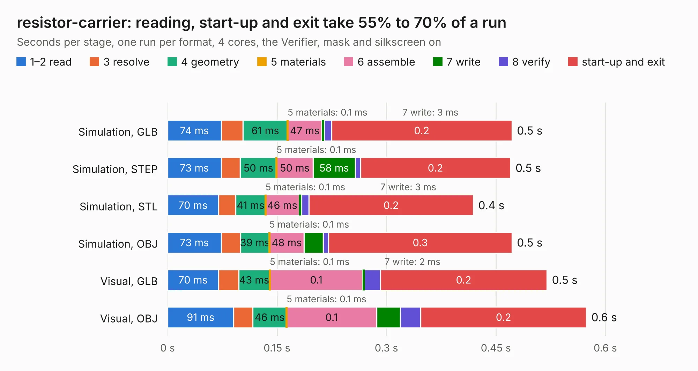

# 480. resistor-carrier

Board 480 of the 3,138 of [Corpus Testing](../Corpus-Testing.md), on [Corpus Page 5](../CorpusTestingPages/Corpus-Testing-05.md#480-resistor-carrier).

| Mode and format | 1–2 read | 3 resolve | 4 geometry | 5 materials | 6 assemble | 7 write | 8 verify | start-up and exit | Total |
|---|---:|---:|---:|---:|---:|---:|---:|---:|---:|
| Simulation, GLB | 74&nbsp;ms | 30&nbsp;ms | 61&nbsp;ms | 0.1&nbsp;ms | 47&nbsp;ms | 3&nbsp;ms | 10&nbsp;ms | 0.2 | 0.5 |
| Simulation, STEP | 73&nbsp;ms | 26&nbsp;ms | 50&nbsp;ms | 0.1&nbsp;ms | 50&nbsp;ms | 58&nbsp;ms | 7&nbsp;ms | 0.2 | 0.5 |
| Simulation, STL | 70&nbsp;ms | 24&nbsp;ms | 41&nbsp;ms | 0.1&nbsp;ms | 46&nbsp;ms | 3&nbsp;ms | 10&nbsp;ms | 0.2 | 0.4 |
| Simulation, OBJ | 73&nbsp;ms | 27&nbsp;ms | 39&nbsp;ms | 0.1&nbsp;ms | 48&nbsp;ms | 26&nbsp;ms | 7&nbsp;ms | 0.3 | 0.5 |
| Visual, GLB | 70&nbsp;ms | 28&nbsp;ms | 43&nbsp;ms | 0.1&nbsp;ms | 0.1 | 2&nbsp;ms | 22&nbsp;ms | 0.2 | 0.5 |
| Visual, OBJ | 91&nbsp;ms | 26&nbsp;ms | 46&nbsp;ms | 0.1&nbsp;ms | 0.1 | 33&nbsp;ms | 28&nbsp;ms | 0.2 | 0.6 |

<table align="center"><tr><td valign="top">

| Board | Repo: [azonenberg/starshipraider](https://github.com/azonenberg/starshipraider) Board: `resistor-carrier.kicad_pcb` |
|---|---|
| Folder | boards / probes / resistor-carrier |
| Complexity | 97&nbsp;/&nbsp;1000 (size&nbsp;42, features&nbsp;55) |
| KESE&nbsp;features | filled zones, stack-up, dielectric εr and tanδ, mask and silkscreen colours |
| Tested | 9th November 2026 |
| Copper&nbsp;layers | 2 |
| File&nbsp;format | KiCad 6 (20211014) |
| Parts,&nbsp;tracks,&nbsp;vias | 1, 2, 0 |
| Triangles,&nbsp;simulation | 5,004 in 8 parts |
| Verifier | PASS in all six runs |

</td><td valign="top">

<table>
<tr><th>File type</th><th>File size</th><th>Peak memory used</th></tr>
<tr><th colspan="3" align="left">Simulation</th></tr>
<tr><td>GLB</td><td align="right">200&nbsp;kB</td><td align="right">63&nbsp;MB</td></tr>
<tr><td>STEP</td><td align="right">913&nbsp;kB</td><td align="right">60&nbsp;MB</td></tr>
<tr><td>STL</td><td align="right">251&nbsp;kB</td><td align="right">60&nbsp;MB</td></tr>
<tr><td>OBJ</td><td align="right">495&nbsp;kB</td><td align="right">61&nbsp;MB</td></tr>
<tr><th colspan="3" align="left">Visual</th></tr>
<tr><td>GLB</td><td align="right">184&nbsp;kB</td><td align="right">74&nbsp;MB</td></tr>
<tr><td>OBJ</td><td align="right">460&nbsp;kB</td><td align="right">74&nbsp;MB</td></tr>
</table>

</td></tr></table>

| Previous | Next |
|:---|---:|
| [479. probe-characterization](b0479b_starshipraider_probe-characterization.md) | [481. resistor-characterization](b0481b_starshipraider_resistor-characterization.md) |
