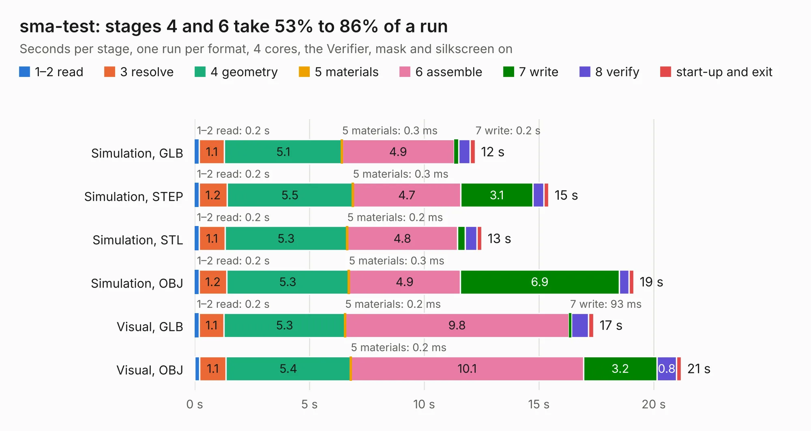

# 481. sma-test

Board 481 of the 3,126 of [Corpus Testing](../Corpus-Testing.md), on [Corpus Page 5](../CorpusTestingPages/Corpus-Testing-05.md#481-sma-test).

| Mode and format | 1–2 read | 3 resolve | 4 geometry | 5 materials | 6 assemble | 7 write | 8 verify | start-up and exit | Total |
|---|---:|---:|---:|---:|---:|---:|---:|---:|---:|
| Simulation, GLB | 0.2 | 1.1 | 5.1 | 0.3&nbsp;ms | 4.9 | 0.2 | 0.5 | 0.2 | 12.2 |
| Simulation, STEP | 0.2 | 1.2 | 5.5 | 0.3&nbsp;ms | 4.7 | 3.1 | 0.5 | 0.2 | 15.4 |
| Simulation, STL | 0.2 | 1.1 | 5.3 | 0.2&nbsp;ms | 4.8 | 0.3 | 0.5 | 0.2 | 12.5 |
| Simulation, OBJ | 0.2 | 1.2 | 5.3 | 0.3&nbsp;ms | 4.9 | 6.9 | 0.4 | 0.2 | 19.1 |
| Visual, GLB | 0.2 | 1.1 | 5.3 | 0.2&nbsp;ms | 9.8 | 93&nbsp;ms | 0.7 | 0.2 | 17.4 |
| Visual, OBJ | 0.2 | 1.1 | 5.4 | 0.2&nbsp;ms | 10.1 | 3.2 | 0.8 | 0.2 | 21.2 |

<table align="center"><tr><td valign="top">

| Board | Repo: [azonenberg/starshipraider](https://github.com/azonenberg/starshipraider) Board: `sma-test.kicad_pcb` |
|---|---|
| Folder | boards / probes / sma-test |
| Complexity | 214&nbsp;/&nbsp;1000 (size&nbsp;179, features&nbsp;35) |
| KESE&nbsp;features | through vias, filled zones |
| Tested | 9th November 2026 |
| Copper&nbsp;layers | 4 |
| File&nbsp;format | KiCad 5 (20171130) |
| Parts,&nbsp;tracks,&nbsp;vias | 11, 428, 334 |
| Triangles,&nbsp;simulation | 1,422,556 in 19 parts |
| Verifier | PASS in all six runs |

</td><td valign="top">

<table>
<tr><th>File type</th><th>File size</th><th>Peak memory used</th></tr>
<tr><th colspan="3" align="left">Simulation</th></tr>
<tr><td>GLB</td><td align="right">48&nbsp;MB</td><td align="right">620&nbsp;MB</td></tr>
<tr><td>STEP</td><td align="right">136&nbsp;MB</td><td align="right">764&nbsp;MB</td></tr>
<tr><td>STL</td><td align="right">71&nbsp;MB</td><td align="right">622&nbsp;MB</td></tr>
<tr><td>OBJ</td><td align="right">143&nbsp;MB</td><td align="right">960&nbsp;MB</td></tr>
<tr><th colspan="3" align="left">Visual</th></tr>
<tr><td>GLB</td><td align="right">22&nbsp;MB</td><td align="right">679&nbsp;MB</td></tr>
<tr><td>OBJ</td><td align="right">66&nbsp;MB</td><td align="right">666&nbsp;MB</td></tr>
</table>

</td></tr></table>

| Previous | Next |
|:---|---:|
| [480. resistor-characterization](b0480b_starshipraider_resistor-characterization.md) | [482. smpm-test](b0482b_starshipraider_smpm-test.md) |
