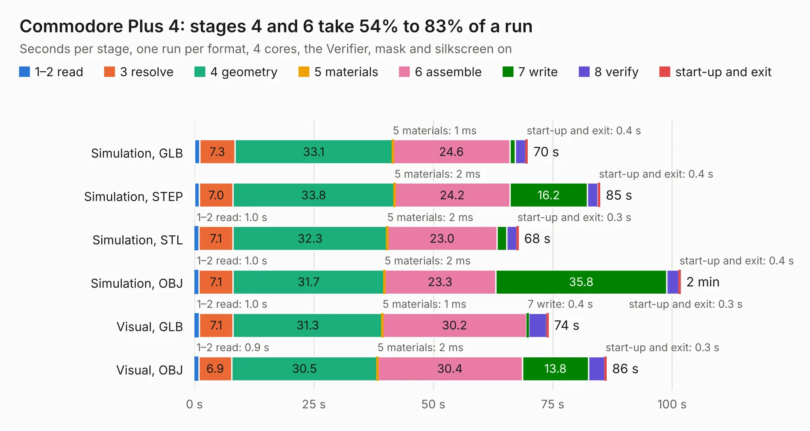

# 482. Commodore Plus 4

Board 482 of the 3,102 of [Corpus Testing](../Corpus-Testing.md), on [Corpus Page 5](../CorpusTestingPages/Corpus-Testing-05.md#482-commodore-plus-4).

| Mode and format | 1–2 read | 3 resolve | 4 geometry | 5 materials | 6 assemble | 7 write | 8 verify | start-up and exit | Total |
|---|---:|---:|---:|---:|---:|---:|---:|---:|---:|
| Simulation, GLB | 1.1 | 7.3 | 33.1 | 1&nbsp;ms | 24.6 | 1.1 | 2.2 | 0.4 | 69.8 |
| Simulation, STEP | 1.1 | 7.0 | 33.8 | 2&nbsp;ms | 24.2 | 16.2 | 2.2 | 0.4 | 84.9 |
| Simulation, STL | 1.0 | 7.1 | 32.3 | 2&nbsp;ms | 23.0 | 2.0 | 2.1 | 0.3 | 67.8 |
| Simulation, OBJ | 1.0 | 7.1 | 31.7 | 2&nbsp;ms | 23.3 | 35.8 | 2.5 | 0.4 | 101.7 |
| Visual, GLB | 1.0 | 7.1 | 31.3 | 1&nbsp;ms | 30.2 | 0.4 | 3.8 | 0.3 | 74.1 |
| Visual, OBJ | 0.9 | 6.9 | 30.5 | 2&nbsp;ms | 30.4 | 13.8 | 3.4 | 0.3 | 86.2 |

<table align="center"><tr><td valign="top">

| Board | Repo: [baldengineer/bit-preserve](https://github.com/baldengineer/bit-preserve) Board: `Commodore Plus 4.kicad_pcb` |
|---|---|
| Folder | Commodore / Plus4 |
| Complexity | 110&nbsp;/&nbsp;1000 (size&nbsp;75, features&nbsp;35) |
| KESE&nbsp;features | slotted holes, custom pads, copper drawings |
| Tested | 9th November 2026 |
| Copper&nbsp;layers | 2 |
| File&nbsp;format | KiCad 5 (20171130) |
| Parts,&nbsp;tracks,&nbsp;vias | 216, 0, 0 |
| Triangles,&nbsp;simulation | 5,682,046 in 249 parts |
| Note | mostly unrouted |
| Verifier | PASS in all six runs |

</td><td valign="top">

<table>
<tr><th>File type</th><th>File size</th><th>Peak memory used</th></tr>
<tr><th colspan="3" align="left">Simulation</th></tr>
<tr><td>GLB</td><td align="right">190&nbsp;MB</td><td align="right">1.5&nbsp;GB</td></tr>
<tr><td>STEP</td><td align="right">901&nbsp;MB</td><td align="right">2.1&nbsp;GB</td></tr>
<tr><td>STL</td><td align="right">284&nbsp;MB</td><td align="right">1.6&nbsp;GB</td></tr>
<tr><td>OBJ</td><td align="right">606&nbsp;MB</td><td align="right">4.8&nbsp;GB</td></tr>
<tr><th colspan="3" align="left">Visual</th></tr>
<tr><td>GLB</td><td align="right">86&nbsp;MB</td><td align="right">1.6&nbsp;GB</td></tr>
<tr><td>OBJ</td><td align="right">270&nbsp;MB</td><td align="right">1.9&nbsp;GB</td></tr>
</table>

</td></tr></table>

| Previous | Next |
|:---|---:|
| [481. KU-14194HB-REV-B-KiCad](b0481b_bit-preserve_KU-14194HB-REV-B-KiCad.md) | [483. coco2](b0483b_bit-preserve_Tandy-RS-TRS-80-Color-Computer-Color-Computer-2-26-302x-coco2_coco2.md) |
