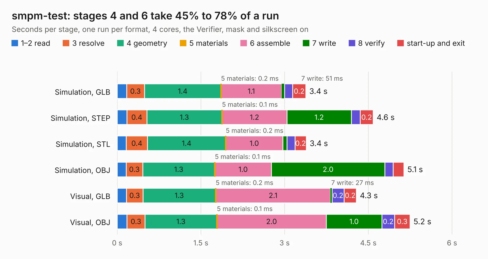

# 483 smpm-test

Board 483 of the 3,138 of [Corpus Testing](../Corpus-Testing.md), on [Corpus Page 5](../CorpusTestingPages/Corpus-Testing-05.md#483-smpm-test).

| Mode and format | 1–2 read | 3 resolve | 4 geometry | 5 materials | 6 assemble | 7 write | 8 verify | start-up and exit | Total |
|---|---:|---:|---:|---:|---:|---:|---:|---:|---:|
| Simulation, GLB | 0.2 | 0.3 | 1.4 | 0.2&nbsp;ms | 1.1 | 51&nbsp;ms | 0.1 | 0.2 | 3.4 |
| Simulation, STEP | 0.2 | 0.4 | 1.3 | 0.1&nbsp;ms | 1.2 | 1.2 | 0.2 | 0.2 | 4.6 |
| Simulation, STL | 0.2 | 0.4 | 1.4 | 0.2&nbsp;ms | 1.0 | 76&nbsp;ms | 0.1 | 0.2 | 3.4 |
| Simulation, OBJ | 0.2 | 0.3 | 1.3 | 0.1&nbsp;ms | 1.0 | 2.0 | 0.1 | 0.2 | 5.1 |
| Visual, GLB | 0.2 | 0.3 | 1.3 | 0.2&nbsp;ms | 2.1 | 27&nbsp;ms | 0.2 | 0.2 | 4.3 |
| Visual, OBJ | 0.2 | 0.3 | 1.3 | 0.1&nbsp;ms | 2.0 | 1.0 | 0.2 | 0.3 | 5.2 |

<table align="center"><tr><td valign="top">

| Board | Repo: [azonenberg/starshipraider](https://github.com/azonenberg/starshipraider) Board: `smpm-test.kicad_pcb` |
|---|---|
| Folder | boards / probes / smpm-test |
| Complexity | 252&nbsp;/&nbsp;1000 (size&nbsp;142, features&nbsp;110) |
| KESE&nbsp;features | through vias, custom pads, filled zones, copper drawings, stack-up, dielectric εr and tanδ, copper finish, mask and silkscreen colours |
| Tested | 9th November 2026 |
| Copper&nbsp;layers | 4 |
| File&nbsp;format | KiCad 6 (20211014) |
| Parts,&nbsp;tracks,&nbsp;vias | 4, 50, 72 |
| Triangles,&nbsp;simulation | 341,168 in 18 parts |
| Verifier | PASS in all six runs |

</td><td valign="top">

<table>
<tr><th>File type</th><th>File size</th><th>Peak memory used</th></tr>
<tr><th colspan="3" align="left">Simulation</th></tr>
<tr><td>GLB</td><td align="right">11&nbsp;MB</td><td align="right">272&nbsp;MB</td></tr>
<tr><td>STEP</td><td align="right">37&nbsp;MB</td><td align="right">287&nbsp;MB</td></tr>
<tr><td>STL</td><td align="right">17&nbsp;MB</td><td align="right">275&nbsp;MB</td></tr>
<tr><td>OBJ</td><td align="right">34&nbsp;MB</td><td align="right">279&nbsp;MB</td></tr>
<tr><th colspan="3" align="left">Visual</th></tr>
<tr><td>GLB</td><td align="right">6.1&nbsp;MB</td><td align="right">229&nbsp;MB</td></tr>
<tr><td>OBJ</td><td align="right">18&nbsp;MB</td><td align="right">232&nbsp;MB</td></tr>
</table>

</td></tr></table>

| Previous | Next |
|:---|---:|
| [482 sma-test](b0482b_starshipraider_boards-probes-sma-test_sma-test.md) | [484 solder-kf047-test](b0484b_starshipraider_solder-kf047-test.md) |
