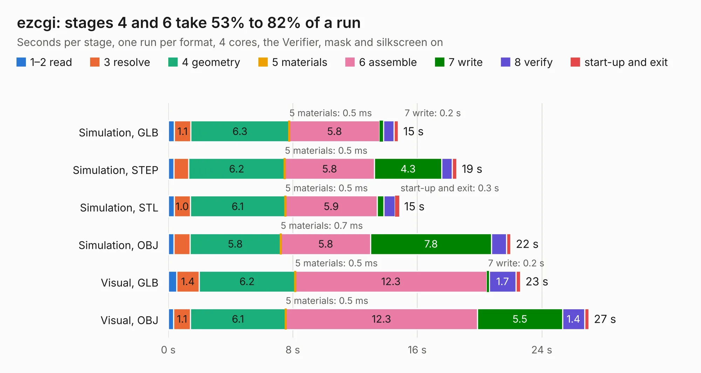

# 484. ezcgi

Board 484 of the 3,116 of [Corpus Testing](../Corpus-Testing.md), on [Corpus Page 5](../CorpusTestingPages/Corpus-Testing-05.md#484-ezcgi).

| Mode and format | 1–2 read | 3 resolve | 4 geometry | 5 materials | 6 assemble | 7 write | 8 verify | start-up and exit | Total |
|---|---:|---:|---:|---:|---:|---:|---:|---:|---:|
| Simulation, GLB | 0.4 | 1.1 | 6.3 | 0.5&nbsp;ms | 5.8 | 0.2 | 0.7 | 0.3 | 14.8 |
| Simulation, STEP | 0.4 | 0.9 | 6.2 | 0.5&nbsp;ms | 5.8 | 4.3 | 0.7 | 0.3 | 18.5 |
| Simulation, STL | 0.4 | 1.0 | 6.1 | 0.5&nbsp;ms | 5.9 | 0.4 | 0.7 | 0.3 | 14.8 |
| Simulation, OBJ | 0.4 | 1.0 | 5.8 | 0.7&nbsp;ms | 5.8 | 7.8 | 1.0 | 0.3 | 22.0 |
| Visual, GLB | 0.5 | 1.4 | 6.2 | 0.5&nbsp;ms | 12.3 | 0.2 | 1.7 | 0.3 | 22.6 |
| Visual, OBJ | 0.3 | 1.1 | 6.1 | 0.5&nbsp;ms | 12.3 | 5.5 | 1.4 | 0.3 | 27.0 |

<table align="center"><tr><td valign="top">

| Board | Repo: [baldengineer/bit-preserve](https://github.com/baldengineer/bit-preserve) Board: `ezcgi.kicad_pcb` |
|---|---|
| Folder | Apple / Peripherals / ezcgi |
| Complexity | 232&nbsp;/&nbsp;1000 (size&nbsp;167, features&nbsp;65) |
| KESE&nbsp;features | through vias, filled zones, stack-up, dielectric εr and tanδ |
| Tested | 9th November 2026 |
| Copper&nbsp;layers | 2 |
| File&nbsp;format | KiCad 6 (20211014) |
| Parts,&nbsp;tracks,&nbsp;vias | 34, 749, 62 |
| Triangles,&nbsp;simulation | 1,628,824 in 94 parts |
| Verifier | PASS in all six runs |

</td><td valign="top">

<table>
<tr><th>File type</th><th>File size</th><th>Peak memory used</th></tr>
<tr><th colspan="3" align="left">Simulation</th></tr>
<tr><td>GLB</td><td align="right">55&nbsp;MB</td><td align="right">760&nbsp;MB</td></tr>
<tr><td>STEP</td><td align="right">255&nbsp;MB</td><td align="right">774&nbsp;MB</td></tr>
<tr><td>STL</td><td align="right">81&nbsp;MB</td><td align="right">751&nbsp;MB</td></tr>
<tr><td>OBJ</td><td align="right">166&nbsp;MB</td><td align="right">1.1&nbsp;GB</td></tr>
<tr><th colspan="3" align="left">Visual</th></tr>
<tr><td>GLB</td><td align="right">36&nbsp;MB</td><td align="right">726&nbsp;MB</td></tr>
<tr><td>OBJ</td><td align="right">109&nbsp;MB</td><td align="right">823&nbsp;MB</td></tr>
</table>

</td></tr></table>

| Previous | Next |
|:---|---:|
| [483. Platinum IIe keyboard](b0483b_bit-preserve_Platinum-IIe-keyboard.md) | [485. PCPI_AppliCard](b0485b_bit-preserve_PCPI-AppliCard.md) |
