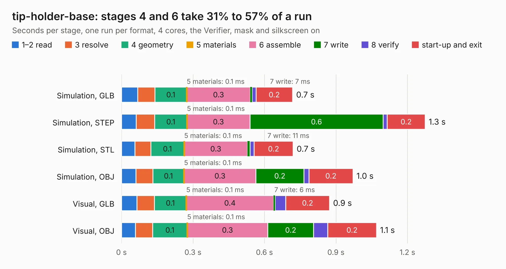

# 485. tip-holder-base

Board 485 of the 3,138 of [Corpus Testing](../Corpus-Testing.md), on [Corpus Page 5](../CorpusTestingPages/Corpus-Testing-05.md#485-tip-holder-base).

| Mode and format | 1–2 read | 3 resolve | 4 geometry | 5 materials | 6 assemble | 7 write | 8 verify | start-up and exit | Total |
|---|---:|---:|---:|---:|---:|---:|---:|---:|---:|
| Simulation, GLB | 68&nbsp;ms | 72&nbsp;ms | 0.1 | 0.1&nbsp;ms | 0.3 | 7&nbsp;ms | 17&nbsp;ms | 0.2 | 0.7 |
| Simulation, STEP | 61&nbsp;ms | 78&nbsp;ms | 0.1 | 0.1&nbsp;ms | 0.3 | 0.6 | 17&nbsp;ms | 0.2 | 1.3 |
| Simulation, STL | 56&nbsp;ms | 67&nbsp;ms | 0.1 | 0.1&nbsp;ms | 0.3 | 11&nbsp;ms | 17&nbsp;ms | 0.2 | 0.7 |
| Simulation, OBJ | 60&nbsp;ms | 71&nbsp;ms | 0.1 | 0.1&nbsp;ms | 0.3 | 0.2 | 22&nbsp;ms | 0.2 | 1.0 |
| Visual, GLB | 64&nbsp;ms | 74&nbsp;ms | 0.1 | 0.1&nbsp;ms | 0.4 | 6&nbsp;ms | 44&nbsp;ms | 0.2 | 0.9 |
| Visual, OBJ | 59&nbsp;ms | 72&nbsp;ms | 0.1 | 0.1&nbsp;ms | 0.3 | 0.2 | 59&nbsp;ms | 0.2 | 1.1 |

<table align="center"><tr><td valign="top">

| Board | Repo: [azonenberg/starshipraider](https://github.com/azonenberg/starshipraider) Board: `tip-holder-base.kicad_pcb` |
|---|---|
| Folder | boards / probes / tip-holder-base |
| Complexity | 129&nbsp;/&nbsp;1000 (size&nbsp;94, features&nbsp;35) |
| KESE&nbsp;features | through vias, filled zones |
| Tested | 9th November 2026 |
| Copper&nbsp;layers | 2 |
| File&nbsp;format | KiCad 6 (20211014) |
| Parts,&nbsp;tracks,&nbsp;vias | 0, 0, 36 |
| Triangles,&nbsp;simulation | 54,936 in 7 parts |
| Note | no components |
| Verifier | PASS in all six runs |

</td><td valign="top">

<table>
<tr><th>File type</th><th>File size</th><th>Peak memory used</th></tr>
<tr><th colspan="3" align="left">Simulation</th></tr>
<tr><td>GLB</td><td align="right">1.9&nbsp;MB</td><td align="right">73&nbsp;MB</td></tr>
<tr><td>STEP</td><td align="right">5.5&nbsp;MB</td><td align="right">184&nbsp;MB</td></tr>
<tr><td>STL</td><td align="right">2.7&nbsp;MB</td><td align="right">73&nbsp;MB</td></tr>
<tr><td>OBJ</td><td align="right">5.1&nbsp;MB</td><td align="right">84&nbsp;MB</td></tr>
<tr><th colspan="3" align="left">Visual</th></tr>
<tr><td>GLB</td><td align="right">1.5&nbsp;MB</td><td align="right">106&nbsp;MB</td></tr>
<tr><td>OBJ</td><td align="right">4.1&nbsp;MB</td><td align="right">107&nbsp;MB</td></tr>
</table>

</td></tr></table>

| Previous | Next |
|:---|---:|
| [484. solder-kf047-test](b0484b_starshipraider_solder-kf047-test.md) | [486. mch2022](b0486b_mch2022-badge-hardware_mch2022.md) |
