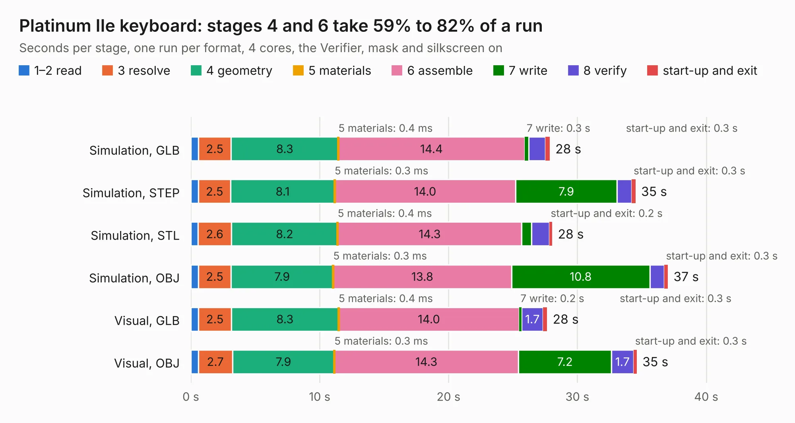

# 486. Platinum IIe keyboard

Board 486 of the 3,123 of [Corpus Testing](../Corpus-Testing.md), on [Corpus Page 5](../CorpusTestingPages/Corpus-Testing-05.md#486-platinum-iie-keyboard).

| Mode and format | 1–2 read | 3 resolve | 4 geometry | 5 materials | 6 assemble | 7 write | 8 verify | start-up and exit | Total |
|---|---:|---:|---:|---:|---:|---:|---:|---:|---:|
| Simulation, GLB | 0.6 | 2.5 | 8.3 | 0.4&nbsp;ms | 14.4 | 0.3 | 1.3 | 0.3 | 27.9 |
| Simulation, STEP | 0.6 | 2.5 | 8.1 | 0.3&nbsp;ms | 14.0 | 7.9 | 1.2 | 0.3 | 34.5 |
| Simulation, STL | 0.6 | 2.6 | 8.2 | 0.4&nbsp;ms | 14.3 | 0.7 | 1.4 | 0.2 | 28.0 |
| Simulation, OBJ | 0.6 | 2.5 | 7.9 | 0.3&nbsp;ms | 13.8 | 10.8 | 1.1 | 0.3 | 37.0 |
| Visual, GLB | 0.6 | 2.5 | 8.3 | 0.4&nbsp;ms | 14.0 | 0.2 | 1.7 | 0.3 | 27.6 |
| Visual, OBJ | 0.6 | 2.7 | 7.9 | 0.3&nbsp;ms | 14.3 | 7.2 | 1.7 | 0.3 | 34.6 |

<table align="center"><tr><td valign="top">

| Board | Repo: [baldengineer/bit-preserve](https://github.com/baldengineer/bit-preserve) Board: `Platinum IIe keyboard.kicad_pcb` |
|---|---|
| Folder | Apple / Apple IIe / Apple IIe keyboard / Platinum IIe keyboard |
| Complexity | 267&nbsp;/&nbsp;1000 (size&nbsp;197, features&nbsp;70) |
| KESE&nbsp;features | through vias, custom pads, filled zones, copper drawings, copper text |
| Tested | 9th November 2026 |
| Copper&nbsp;layers | 2 |
| File&nbsp;format | KiCad 9 (20241229) |
| Parts,&nbsp;tracks,&nbsp;vias | 105, 2,551, 78 |
| Triangles,&nbsp;simulation | 1,816,130 in 43 parts |
| Verifier | PASS in all six runs |

</td><td valign="top">

<table>
<tr><th>File type</th><th>File size</th><th>Peak memory used</th></tr>
<tr><th colspan="3" align="left">Simulation</th></tr>
<tr><td>GLB</td><td align="right">62&nbsp;MB</td><td align="right">729&nbsp;MB</td></tr>
<tr><td>STEP</td><td align="right">320&nbsp;MB</td><td align="right">878&nbsp;MB</td></tr>
<tr><td>STL</td><td align="right">91&nbsp;MB</td><td align="right">704&nbsp;MB</td></tr>
<tr><td>OBJ</td><td align="right">187&nbsp;MB</td><td align="right">1.2&nbsp;GB</td></tr>
<tr><th colspan="3" align="left">Visual</th></tr>
<tr><td>GLB</td><td align="right">40&nbsp;MB</td><td align="right">746&nbsp;MB</td></tr>
<tr><td>OBJ</td><td align="right">120&nbsp;MB</td><td align="right">1.0&nbsp;GB</td></tr>
</table>

</td></tr></table>

| Previous | Next |
|:---|---:|
| [485. mch2022](b0485b_mch2022-badge-hardware_mch2022.md) | [487. ezcgi](b0487b_bit-preserve_ezcgi.md) |
