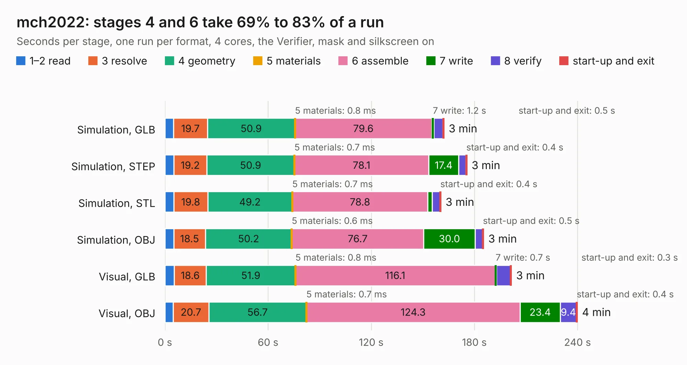

# 486. mch2022

Board 486 of the 3,138 of [Corpus Testing](../Corpus-Testing.md), on [Corpus Page 5](../CorpusTestingPages/Corpus-Testing-05.md#486-mch2022).

| Mode and format | 1–2 read | 3 resolve | 4 geometry | 5 materials | 6 assemble | 7 write | 8 verify | start-up and exit | Total |
|---|---:|---:|---:|---:|---:|---:|---:|---:|---:|
| Simulation, GLB | 5.0 | 19.7 | 50.9 | 0.8&nbsp;ms | 79.6 | 1.2 | 5.3 | 0.5 | 162.2 |
| Simulation, STEP | 5.1 | 19.2 | 50.9 | 0.7&nbsp;ms | 78.1 | 17.4 | 4.2 | 0.4 | 175.5 |
| Simulation, STL | 5.1 | 19.8 | 49.2 | 0.7&nbsp;ms | 78.8 | 2.5 | 4.7 | 0.4 | 160.4 |
| Simulation, OBJ | 5.1 | 18.5 | 50.2 | 0.6&nbsp;ms | 76.7 | 30.0 | 4.3 | 0.5 | 185.2 |
| Visual, GLB | 5.4 | 18.6 | 51.9 | 0.8&nbsp;ms | 116.1 | 0.7 | 8.4 | 0.3 | 201.4 |
| Visual, OBJ | 4.8 | 20.7 | 56.7 | 0.7&nbsp;ms | 124.3 | 23.4 | 9.4 | 0.4 | 239.7 |

<table align="center"><tr><td valign="top">

| Board | Repo: [badgeteam/mch2022-badge-hardware](https://github.com/badgeteam/mch2022-badge-hardware) Board: `mch2022.kicad_pcb` |
|---|---|
| Complexity | 379&nbsp;/&nbsp;1000 (size&nbsp;284, features&nbsp;95) |
| KESE&nbsp;features | through vias, slotted holes, rounded, trapezoid or chamfered pads, filled zones, curved board outline, stack-up, dielectric εr and tanδ |
| Tested | 9th November 2026 to 10th November 2026 |
| Copper&nbsp;layers | 4 |
| File&nbsp;format | KiCad 6 (20211014) |
| Parts,&nbsp;tracks,&nbsp;vias | 196, 3,130, 521 |
| Triangles,&nbsp;simulation | 5,499,232 in 219 parts |
| Verifier | PASS in all six runs |
| Run&nbsp;again | Simulation, GLB; Simulation, STEP; Simulation, STL; Simulation, OBJ: failed in the corpus run, run again with fixes to KESE made after the corpus run, and passed |

</td><td valign="top">

<table>
<tr><th>File type</th><th>File size</th><th>Peak memory used</th></tr>
<tr><th colspan="3" align="left">Simulation</th></tr>
<tr><td>GLB</td><td align="right">197&nbsp;MB</td><td align="right">1.6&nbsp;GB</td></tr>
<tr><td>STEP</td><td align="right">1.3&nbsp;GB</td><td align="right">2.3&nbsp;GB</td></tr>
<tr><td>STL</td><td align="right">275&nbsp;MB</td><td align="right">1.6&nbsp;GB</td></tr>
<tr><td>OBJ</td><td align="right">614&nbsp;MB</td><td align="right">3.8&nbsp;GB</td></tr>
<tr><th colspan="3" align="left">Visual</th></tr>
<tr><td>GLB</td><td align="right">124&nbsp;MB</td><td align="right">2.1&nbsp;GB</td></tr>
<tr><td>OBJ</td><td align="right">392&nbsp;MB</td><td align="right">2.6&nbsp;GB</td></tr>
</table>

</td></tr></table>

| Previous | Next |
|:---|---:|
| [485. tip-holder-base](b0485b_starshipraider_tip-holder-base.md) | [487. Platinum IIe keyboard](b0487b_bit-preserve_Platinum-IIe-keyboard.md) |
