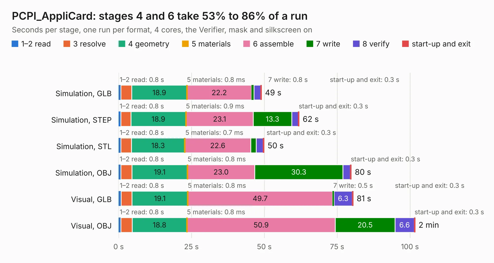

# 489. PCPI_AppliCard

Board 489 of the 3,132 of [Corpus Testing](../Corpus-Testing.md), on [Corpus Page 5](../CorpusTestingPages/Corpus-Testing-05.md#489-pcpi_applicard).

| Mode and format | 1–2 read | 3 resolve | 4 geometry | 5 materials | 6 assemble | 7 write | 8 verify | start-up and exit | Total |
|---|---:|---:|---:|---:|---:|---:|---:|---:|---:|
| Simulation, GLB | 0.8 | 3.7 | 18.9 | 0.8&nbsp;ms | 22.2 | 0.8 | 2.3 | 0.3 | 49.0 |
| Simulation, STEP | 0.8 | 3.5 | 18.9 | 0.9&nbsp;ms | 23.1 | 13.3 | 2.3 | 0.3 | 62.0 |
| Simulation, STL | 0.8 | 3.6 | 18.3 | 0.7&nbsp;ms | 22.6 | 1.8 | 2.4 | 0.3 | 49.9 |
| Simulation, OBJ | 0.8 | 3.8 | 19.1 | 0.8&nbsp;ms | 23.0 | 30.3 | 2.6 | 0.3 | 79.9 |
| Visual, GLB | 0.8 | 3.8 | 19.1 | 0.8&nbsp;ms | 49.7 | 0.5 | 6.3 | 0.3 | 80.5 |
| Visual, OBJ | 0.8 | 3.9 | 18.8 | 0.8&nbsp;ms | 50.9 | 20.5 | 6.6 | 0.3 | 101.7 |

<table align="center"><tr><td valign="top">

| Board | Repo: [baldengineer/bit-preserve](https://github.com/baldengineer/bit-preserve) Board: `PCPI_AppliCard.kicad_pcb` |
|---|---|
| Folder | Apple / Peripherals / PCPI_AppliCard |
| Complexity | 301&nbsp;/&nbsp;1000 (size&nbsp;201, features&nbsp;100) |
| KESE&nbsp;features | through vias, custom pads, rounded, trapezoid or chamfered pads, filled zones, copper drawings, stack-up, dielectric εr and tanδ |
| Tested | 9th November 2026 |
| Copper&nbsp;layers | 2 |
| File&nbsp;format | KiCad 10 (20260206) |
| Parts,&nbsp;tracks,&nbsp;vias | 81, 2,775, 421 |
| Triangles,&nbsp;simulation | 5,225,206 in 209 parts |
| Verifier | PASS in all six runs |

</td><td valign="top">

<table>
<tr><th>File type</th><th>File size</th><th>Peak memory used</th></tr>
<tr><th colspan="3" align="left">Simulation</th></tr>
<tr><td>GLB</td><td align="right">176&nbsp;MB</td><td align="right">1.8&nbsp;GB</td></tr>
<tr><td>STEP</td><td align="right">803&nbsp;MB</td><td align="right">2.1&nbsp;GB</td></tr>
<tr><td>STL</td><td align="right">261&nbsp;MB</td><td align="right">1.8&nbsp;GB</td></tr>
<tr><td>OBJ</td><td align="right">550&nbsp;MB</td><td align="right">3.3&nbsp;GB</td></tr>
<tr><th colspan="3" align="left">Visual</th></tr>
<tr><td>GLB</td><td align="right">122&nbsp;MB</td><td align="right">2.0&nbsp;GB</td></tr>
<tr><td>OBJ</td><td align="right">391&nbsp;MB</td><td align="right">2.5&nbsp;GB</td></tr>
</table>

</td></tr></table>

| Previous | Next |
|:---|---:|
| [488. ezcgi](b0488b_bit-preserve_ezcgi.md) | [490. KU-14194HB-REV-B-KiCad](b0490b_bit-preserve_KU-14194HB-REV-B-KiCad.md) |
