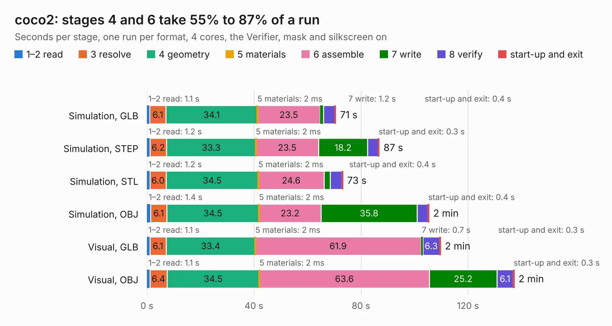

# 491. coco2

Board 491 of the 3,128 of [Corpus Testing](../Corpus-Testing.md), on [Corpus Page 5](../CorpusTestingPages/Corpus-Testing-05.md#491-coco2).

| Mode and format | 1–2 read | 3 resolve | 4 geometry | 5 materials | 6 assemble | 7 write | 8 verify | start-up and exit | Total |
|---|---:|---:|---:|---:|---:|---:|---:|---:|---:|
| Simulation, GLB | 1.1 | 6.1 | 34.1 | 2&nbsp;ms | 23.5 | 1.2 | 4.1 | 0.4 | 70.5 |
| Simulation, STEP | 1.2 | 6.2 | 33.3 | 2&nbsp;ms | 23.5 | 18.2 | 4.0 | 0.3 | 86.8 |
| Simulation, STL | 1.2 | 6.0 | 34.5 | 2&nbsp;ms | 24.6 | 2.4 | 4.3 | 0.4 | 73.2 |
| Simulation, OBJ | 1.4 | 6.1 | 34.5 | 2&nbsp;ms | 23.2 | 35.8 | 4.1 | 0.4 | 105.4 |
| Visual, GLB | 1.1 | 6.1 | 33.4 | 2&nbsp;ms | 61.9 | 0.7 | 6.3 | 0.3 | 109.7 |
| Visual, OBJ | 1.1 | 6.4 | 34.5 | 2&nbsp;ms | 63.6 | 25.2 | 6.1 | 0.3 | 137.2 |

<table align="center"><tr><td valign="top">

| Board | Repo: [baldengineer/bit-preserve](https://github.com/baldengineer/bit-preserve) Board: `coco2.kicad_pcb` |
|---|---|
| Folder | Tandy-RS / TRS-80 Color Computer / Color Computer 2 / 26-302x / coco2 |
| Complexity | 283&nbsp;/&nbsp;1000 (size&nbsp;213, features&nbsp;70) |
| KESE&nbsp;features | through vias, slotted holes, custom pads, filled zones, copper drawings |
| Tested | 9th November 2026 |
| Copper&nbsp;layers | 2 |
| File&nbsp;format | KiCad 5 (20171130) |
| Parts,&nbsp;tracks,&nbsp;vias | 140, 4,973, 352 |
| Triangles,&nbsp;simulation | 5,905,724 in 206 parts |
| Verifier | PASS in all six runs |

</td><td valign="top">

<table>
<tr><th>File type</th><th>File size</th><th>Peak memory used</th></tr>
<tr><th colspan="3" align="left">Simulation</th></tr>
<tr><td>GLB</td><td align="right">200&nbsp;MB</td><td align="right">1.8&nbsp;GB</td></tr>
<tr><td>STEP</td><td align="right">928&nbsp;MB</td><td align="right">2.3&nbsp;GB</td></tr>
<tr><td>STL</td><td align="right">295&nbsp;MB</td><td align="right">1.9&nbsp;GB</td></tr>
<tr><td>OBJ</td><td align="right">625&nbsp;MB</td><td align="right">3.7&nbsp;GB</td></tr>
<tr><th colspan="3" align="left">Visual</th></tr>
<tr><td>GLB</td><td align="right">140&nbsp;MB</td><td align="right">2.2&nbsp;GB</td></tr>
<tr><td>OBJ</td><td align="right">444&nbsp;MB</td><td align="right">2.9&nbsp;GB</td></tr>
</table>

</td></tr></table>

| Previous | Next |
|:---|---:|
| [490. Commodore Plus 4](b0490b_bit-preserve_Commodore-Plus-4.md) | [492. coco2](b0492b_bit-preserve_Tandy-RS-TRS-80-Color-Computer-Color-Computer-2-26-313xA-coco2_coco2.md) |
