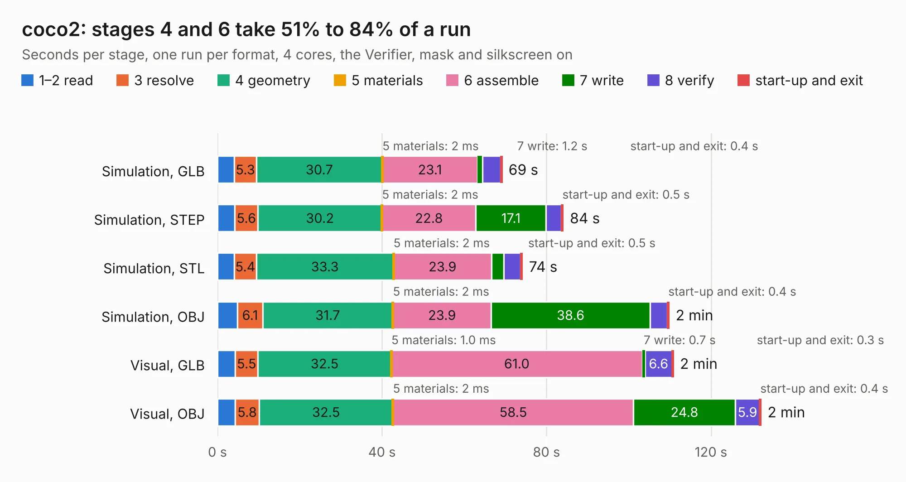

# 491. coco2

Board 491 of the 3,120 of [Corpus Testing](../Corpus-Testing.md), on [Corpus Page 5](../CorpusTestingPages/Corpus-Testing-05.md#491-coco2).

| Mode and format | 1–2 read | 3 resolve | 4 geometry | 5 materials | 6 assemble | 7 write | 8 verify | start-up and exit | Total |
|---|---:|---:|---:|---:|---:|---:|---:|---:|---:|
| Simulation, GLB | 4.1 | 5.3 | 30.7 | 2&nbsp;ms | 23.1 | 1.2 | 4.4 | 0.4 | 69.2 |
| Simulation, STEP | 4.2 | 5.6 | 30.2 | 2&nbsp;ms | 22.8 | 17.1 | 3.8 | 0.5 | 84.1 |
| Simulation, STL | 4.1 | 5.4 | 33.3 | 2&nbsp;ms | 23.9 | 2.9 | 4.1 | 0.5 | 74.2 |
| Simulation, OBJ | 4.9 | 6.1 | 31.7 | 2&nbsp;ms | 23.9 | 38.6 | 4.2 | 0.4 | 109.8 |
| Visual, GLB | 4.3 | 5.5 | 32.5 | 1.0&nbsp;ms | 61.0 | 0.7 | 6.6 | 0.3 | 110.9 |
| Visual, OBJ | 4.3 | 5.8 | 32.5 | 2&nbsp;ms | 58.5 | 24.8 | 5.9 | 0.4 | 132.2 |

<table align="center"><tr><td valign="top">

| Board | Repo: [baldengineer/bit-preserve](https://github.com/baldengineer/bit-preserve) Board: `coco2.kicad_pcb` |
|---|---|
| Folder | Tandy-RS / TRS-80 Color Computer / Color Computer 2 / 26-313xA / coco2 |
| Complexity | 276&nbsp;/&nbsp;1000 (size&nbsp;206, features&nbsp;70) |
| KESE&nbsp;features | through vias, slotted holes, custom pads, filled zones, copper drawings |
| Tested | 9th November 2026 |
| Copper&nbsp;layers | 2 |
| File&nbsp;format | KiCad 5 (20171130) |
| Parts,&nbsp;tracks,&nbsp;vias | 144, 3,233, 221 |
| Triangles,&nbsp;simulation | 5,592,220 in 199 parts |
| Verifier | PASS in all six runs |

</td><td valign="top">

<table>
<tr><th>File type</th><th>File size</th><th>Peak memory used</th></tr>
<tr><th colspan="3" align="left">Simulation</th></tr>
<tr><td>GLB</td><td align="right">189&nbsp;MB</td><td align="right">2.0&nbsp;GB</td></tr>
<tr><td>STEP</td><td align="right">853&nbsp;MB</td><td align="right">2.2&nbsp;GB</td></tr>
<tr><td>STL</td><td align="right">280&nbsp;MB</td><td align="right">2.0&nbsp;GB</td></tr>
<tr><td>OBJ</td><td align="right">589&nbsp;MB</td><td align="right">3.6&nbsp;GB</td></tr>
<tr><th colspan="3" align="left">Visual</th></tr>
<tr><td>GLB</td><td align="right">130&nbsp;MB</td><td align="right">2.1&nbsp;GB</td></tr>
<tr><td>OBJ</td><td align="right">414&nbsp;MB</td><td align="right">2.6&nbsp;GB</td></tr>
</table>

</td></tr></table>

| Previous | Next |
|:---|---:|
| [490. coco2](b0490b_bit-preserve_Tandy-RS-TRS-80-Color-Computer-Color-Computer-2-26-302x-coco2_coco2.md) | [492. coco2](b0492b_bit-preserve_Tandy-RS-TRS-80-Color-Computer-Color-Computer-2-26-313xB-coco2_coco2.md) |
