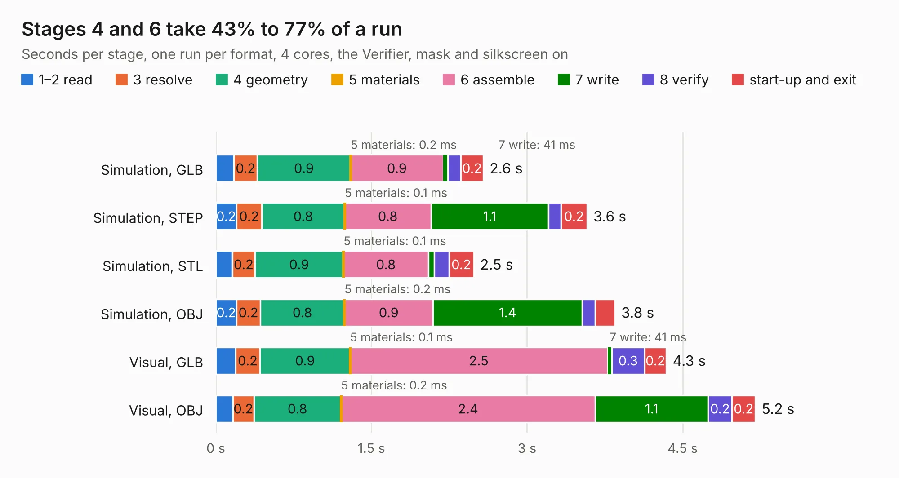

# 493. gd audio proto pcb-rev1 bad footprint

Board 493 of the 3,116 of [Corpus Testing](../Corpus-Testing.md), on [Corpus Page 5](../CorpusTestingPages/Corpus-Testing-05.md#493-gd-audio-proto-pcb-rev1-bad-footprint).

| Mode and format | 1–2 read | 3 resolve | 4 geometry | 5 materials | 6 assemble | 7 write | 8 verify | start-up and exit | Total |
|---|---:|---:|---:|---:|---:|---:|---:|---:|---:|
| Simulation, GLB | 0.2 | 0.2 | 0.9 | 0.2&nbsp;ms | 0.9 | 41&nbsp;ms | 0.1 | 0.2 | 2.6 |
| Simulation, STEP | 0.2 | 0.2 | 0.8 | 0.1&nbsp;ms | 0.8 | 1.1 | 0.1 | 0.2 | 3.6 |
| Simulation, STL | 0.2 | 0.2 | 0.9 | 0.1&nbsp;ms | 0.8 | 56&nbsp;ms | 0.1 | 0.2 | 2.5 |
| Simulation, OBJ | 0.2 | 0.2 | 0.8 | 0.2&nbsp;ms | 0.9 | 1.4 | 0.1 | 0.2 | 3.8 |
| Visual, GLB | 0.2 | 0.2 | 0.9 | 0.1&nbsp;ms | 2.5 | 41&nbsp;ms | 0.3 | 0.2 | 4.3 |
| Visual, OBJ | 0.2 | 0.2 | 0.8 | 0.2&nbsp;ms | 2.4 | 1.1 | 0.2 | 0.2 | 5.2 |

<table align="center"><tr><td valign="top">

| Board | Repo: [baldengineer/Mega-IIe](https://github.com/baldengineer/Mega-IIe) Board: `gd audio proto pcb-rev1 bad footprint.kicad_pcb` |
|---|---|
| Folder | kicad files / gd audio proto pcb |
| Complexity | 211&nbsp;/&nbsp;1000 (size&nbsp;126, features&nbsp;85) |
| KESE&nbsp;features | through vias, rounded, trapezoid or chamfered pads, filled zones, curved board outline, stack-up, dielectric εr and tanδ |
| Tested | 9th November 2026 |
| Copper&nbsp;layers | 2 |
| File&nbsp;format | KiCad 6 (20211014) |
| Parts,&nbsp;tracks,&nbsp;vias | 17, 53, 20 |
| Triangles,&nbsp;simulation | 256,378 in 26 parts |
| Verifier | PASS in all six runs |

</td><td valign="top">

<table>
<tr><th>File type</th><th>File size</th><th>Peak memory used</th></tr>
<tr><th colspan="3" align="left">Simulation</th></tr>
<tr><td>GLB</td><td align="right">9.0&nbsp;MB</td><td align="right">240&nbsp;MB</td></tr>
<tr><td>STEP</td><td align="right">52&nbsp;MB</td><td align="right">254&nbsp;MB</td></tr>
<tr><td>STL</td><td align="right">13&nbsp;MB</td><td align="right">244&nbsp;MB</td></tr>
<tr><td>OBJ</td><td align="right">26&nbsp;MB</td><td align="right">243&nbsp;MB</td></tr>
<tr><th colspan="3" align="left">Visual</th></tr>
<tr><td>GLB</td><td align="right">7.2&nbsp;MB</td><td align="right">230&nbsp;MB</td></tr>
<tr><td>OBJ</td><td align="right">21&nbsp;MB</td><td align="right">235&nbsp;MB</td></tr>
</table>

</td></tr></table>

| Previous | Next |
|:---|---:|
| [492. gd 6502 proto pcb](b0492b_Mega-IIe_kicad-files-gd-6502-proto-pcb_gd-6502-proto-pcb.md) | [494. gd blackplane proto pcb](b0494b_Mega-IIe_kicad-files-gd-backplane-proto-pcb_gd-blackplane-proto-pcb.md) |
