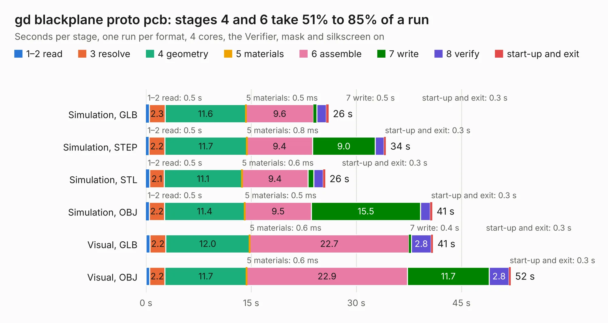

# 493. gd blackplane proto pcb

Board 493 of the 3,112 of [Corpus Testing](../Corpus-Testing.md), on [Corpus Page 5](../CorpusTestingPages/Corpus-Testing-05.md#493-gd-blackplane-proto-pcb).

| Mode and format | 1–2 read | 3 resolve | 4 geometry | 5 materials | 6 assemble | 7 write | 8 verify | start-up and exit | Total |
|---|---:|---:|---:|---:|---:|---:|---:|---:|---:|
| Simulation, GLB | 0.5 | 2.3 | 11.6 | 0.5&nbsp;ms | 9.6 | 0.5 | 1.4 | 0.3 | 26.0 |
| Simulation, STEP | 0.5 | 2.2 | 11.7 | 0.8&nbsp;ms | 9.4 | 9.0 | 1.3 | 0.3 | 34.2 |
| Simulation, STL | 0.5 | 2.1 | 11.1 | 0.6&nbsp;ms | 9.4 | 0.8 | 1.3 | 0.3 | 25.6 |
| Simulation, OBJ | 0.5 | 2.2 | 11.4 | 0.5&nbsp;ms | 9.5 | 15.5 | 1.4 | 0.3 | 40.8 |
| Visual, GLB | 0.6 | 2.2 | 12.0 | 0.6&nbsp;ms | 22.7 | 0.4 | 2.8 | 0.3 | 41.0 |
| Visual, OBJ | 0.5 | 2.2 | 11.7 | 0.6&nbsp;ms | 22.9 | 11.7 | 2.8 | 0.3 | 52.0 |

<table align="center"><tr><td valign="top">

| Board | Repo: [baldengineer/Mega-IIe](https://github.com/baldengineer/Mega-IIe) Board: `gd blackplane proto pcb.kicad_pcb` |
|---|---|
| Folder | kicad files / gd backplane proto pcb / rev1 |
| Complexity | 223&nbsp;/&nbsp;1000 (size&nbsp;168, features&nbsp;55) |
| KESE&nbsp;features | through vias, rounded, trapezoid or chamfered pads, filled zones, curved board outline |
| Tested | 9th November 2026 |
| Copper&nbsp;layers | 2 |
| File&nbsp;format | KiCad 5 (20171130) |
| Parts,&nbsp;tracks,&nbsp;vias | 29, 930, 59 |
| Triangles,&nbsp;simulation | 2,625,784 in 58 parts |
| Verifier | PASS in all six runs |

</td><td valign="top">

<table>
<tr><th>File type</th><th>File size</th><th>Peak memory used</th></tr>
<tr><th colspan="3" align="left">Simulation</th></tr>
<tr><td>GLB</td><td align="right">88&nbsp;MB</td><td align="right">919&nbsp;MB</td></tr>
<tr><td>STEP</td><td align="right">437&nbsp;MB</td><td align="right">1.1&nbsp;GB</td></tr>
<tr><td>STL</td><td align="right">131&nbsp;MB</td><td align="right">882&nbsp;MB</td></tr>
<tr><td>OBJ</td><td align="right">275&nbsp;MB</td><td align="right">1.7&nbsp;GB</td></tr>
<tr><th colspan="3" align="left">Visual</th></tr>
<tr><td>GLB</td><td align="right">61&nbsp;MB</td><td align="right">1.1&nbsp;GB</td></tr>
<tr><td>OBJ</td><td align="right">189&nbsp;MB</td><td align="right">1.4&nbsp;GB</td></tr>
</table>

</td></tr></table>

| Previous | Next |
|:---|---:|
| [492. gd blackplane proto pcb](b0492b_Mega-IIe_kicad-files-gd-backplane-proto-pcb_gd-blackplane-proto-pcb.md) | [494. gd interdeswizzlepozer](b0494b_Mega-IIe_gd-interdeswizzlepozer.md) |
