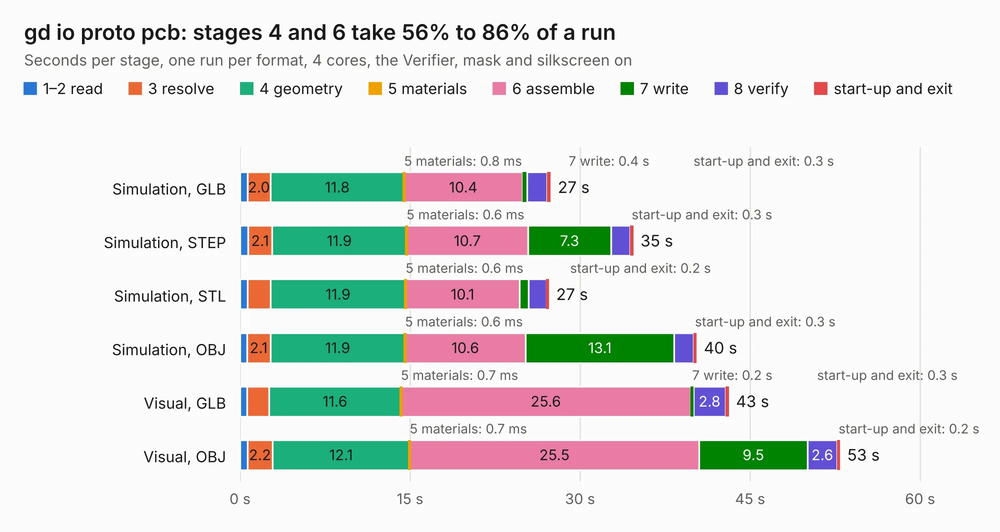

# 494. gd io proto pcb

Board 494 of the 3,106 of [Corpus Testing](../Corpus-Testing.md), on [Corpus Page 5](../CorpusTestingPages/Corpus-Testing-05.md#494-gd-io-proto-pcb).

| Mode and format | 1–2 read | 3 resolve | 4 geometry | 5 materials | 6 assemble | 7 write | 8 verify | start-up and exit | Total |
|---|---:|---:|---:|---:|---:|---:|---:|---:|---:|
| Simulation, GLB | 0.6 | 2.0 | 11.8 | 0.8&nbsp;ms | 10.4 | 0.4 | 1.8 | 0.3 | 27.4 |
| Simulation, STEP | 0.7 | 2.1 | 11.9 | 0.6&nbsp;ms | 10.7 | 7.3 | 1.7 | 0.3 | 34.7 |
| Simulation, STL | 0.7 | 2.0 | 11.9 | 0.6&nbsp;ms | 10.1 | 0.8 | 1.6 | 0.2 | 27.3 |
| Simulation, OBJ | 0.6 | 2.1 | 11.9 | 0.6&nbsp;ms | 10.6 | 13.1 | 1.7 | 0.3 | 40.3 |
| Visual, GLB | 0.6 | 2.0 | 11.6 | 0.7&nbsp;ms | 25.6 | 0.2 | 2.8 | 0.3 | 43.1 |
| Visual, OBJ | 0.7 | 2.2 | 12.1 | 0.7&nbsp;ms | 25.5 | 9.5 | 2.6 | 0.2 | 52.9 |

<table align="center"><tr><td valign="top">

| Board | Repo: [baldengineer/Mega-IIe](https://github.com/baldengineer/Mega-IIe) Board: `gd io proto pcb.kicad_pcb` |
|---|---|
| Folder | kicad files / gd io proto pcb |
| Complexity | 296&nbsp;/&nbsp;1000 (size&nbsp;211, features&nbsp;85) |
| KESE&nbsp;features | through vias, rounded, trapezoid or chamfered pads, filled zones, curved board outline, knockout text, TrueType text |
| Tested | 9th November 2026 |
| Copper&nbsp;layers | 2 |
| File&nbsp;format | KiCad 7 (20221018) |
| Parts,&nbsp;tracks,&nbsp;vias | 36, 920, 60 |
| Triangles,&nbsp;simulation | 2,448,548 in 115 parts |
| Verifier | PASS in all six runs |

</td><td valign="top">

<table>
<tr><th>File type</th><th>File size</th><th>Peak memory used</th></tr>
<tr><th colspan="3" align="left">Simulation</th></tr>
<tr><td>GLB</td><td align="right">85&nbsp;MB</td><td align="right">934&nbsp;MB</td></tr>
<tr><td>STEP</td><td align="right">475&nbsp;MB</td><td align="right">1.1&nbsp;GB</td></tr>
<tr><td>STL</td><td align="right">122&nbsp;MB</td><td align="right">932&nbsp;MB</td></tr>
<tr><td>OBJ</td><td align="right">260&nbsp;MB</td><td align="right">1.6&nbsp;GB</td></tr>
<tr><th colspan="3" align="left">Visual</th></tr>
<tr><td>GLB</td><td align="right">58&nbsp;MB</td><td align="right">1.1&nbsp;GB</td></tr>
<tr><td>OBJ</td><td align="right">178&nbsp;MB</td><td align="right">1.2&nbsp;GB</td></tr>
</table>

</td></tr></table>

| Previous | Next |
|:---|---:|
| [493. gd interdeswizzlepozer](b0493b_Mega-IIe_gd-interdeswizzlepozer.md) | [495. gd io proto pcb](b0495b_Mega-IIe_kicad-files-gd-io-proto-pcb-mk1_gd-io-proto-pcb.md) |
