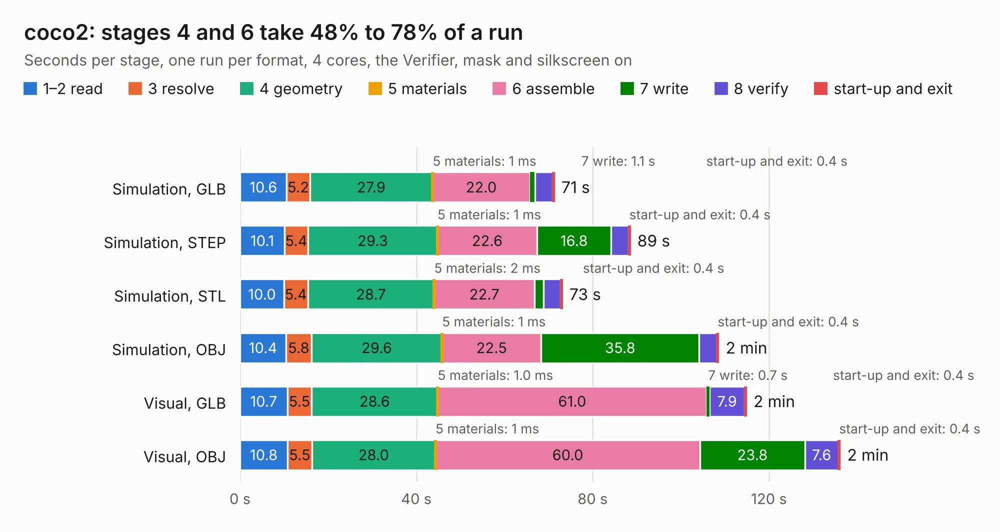

# 494. coco2

Board 494 of the 3,132 of [Corpus Testing](../Corpus-Testing.md), on [Corpus Page 5](../CorpusTestingPages/Corpus-Testing-05.md#494-coco2).

| Mode and format | 1–2 read | 3 resolve | 4 geometry | 5 materials | 6 assemble | 7 write | 8 verify | start-up and exit | Total |
|---|---:|---:|---:|---:|---:|---:|---:|---:|---:|
| Simulation, GLB | 10.6 | 5.2 | 27.9 | 1&nbsp;ms | 22.0 | 1.1 | 4.0 | 0.4 | 71.3 |
| Simulation, STEP | 10.1 | 5.4 | 29.3 | 1&nbsp;ms | 22.6 | 16.8 | 3.9 | 0.4 | 88.5 |
| Simulation, STL | 10.0 | 5.4 | 28.7 | 2&nbsp;ms | 22.7 | 2.1 | 3.9 | 0.4 | 73.1 |
| Simulation, OBJ | 10.4 | 5.8 | 29.6 | 1&nbsp;ms | 22.5 | 35.8 | 4.0 | 0.4 | 108.6 |
| Visual, GLB | 10.7 | 5.5 | 28.6 | 1.0&nbsp;ms | 61.0 | 0.7 | 7.9 | 0.4 | 114.9 |
| Visual, OBJ | 10.8 | 5.5 | 28.0 | 1&nbsp;ms | 60.0 | 23.8 | 7.6 | 0.4 | 136.1 |

<table align="center"><tr><td valign="top">

| Board | Repo: [baldengineer/bit-preserve](https://github.com/baldengineer/bit-preserve) Board: `coco2.kicad_pcb` |
|---|---|
| Folder | Tandy-RS / TRS-80 Color Computer / Color Computer 2 / 26-313xB / coco2 |
| Complexity | 308&nbsp;/&nbsp;1000 (size&nbsp;208, features&nbsp;100) |
| KESE&nbsp;features | through vias, slotted holes, custom pads, filled zones, copper drawings, stack-up, dielectric εr and tanδ |
| Tested | 9th November 2026 |
| Copper&nbsp;layers | 2 |
| File&nbsp;format | KiCad 6 (20211014) |
| Parts,&nbsp;tracks,&nbsp;vias | 147, 3,563, 215 |
| Triangles,&nbsp;simulation | 5,999,852 in 211 parts |
| Verifier | PASS in all six runs |

</td><td valign="top">

<table>
<tr><th>File type</th><th>File size</th><th>Peak memory used</th></tr>
<tr><th colspan="3" align="left">Simulation</th></tr>
<tr><td>GLB</td><td align="right">203&nbsp;MB</td><td align="right">2.3&nbsp;GB</td></tr>
<tr><td>STEP</td><td align="right">1.0&nbsp;GB</td><td align="right">2.5&nbsp;GB</td></tr>
<tr><td>STL</td><td align="right">300&nbsp;MB</td><td align="right">2.4&nbsp;GB</td></tr>
<tr><td>OBJ</td><td align="right">633&nbsp;MB</td><td align="right">3.9&nbsp;GB</td></tr>
<tr><th colspan="3" align="left">Visual</th></tr>
<tr><td>GLB</td><td align="right">138&nbsp;MB</td><td align="right">2.4&nbsp;GB</td></tr>
<tr><td>OBJ</td><td align="right">437&nbsp;MB</td><td align="right">3.0&nbsp;GB</td></tr>
</table>

</td></tr></table>

| Previous | Next |
|:---|---:|
| [493. coco2](b0493b_bit-preserve_Tandy-RS-TRS-80-Color-Computer-Color-Computer-2-26-313xA-coco2_coco2.md) | [495. coco3](b0495b_bit-preserve_coco3.md) |
